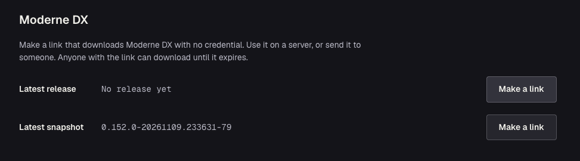

# Installing Moderne DX

This guide will walk you through the steps to start DX on your own machine at: `https://moderne.localhost:8443`.

To serve it to your organization, please see [Running Moderne DX for your organization](../how-to-guides/running-moderne-dx.md).

## Prerequisites

* macOS on Apple silicon or Linux, with Java 25 and the [Moderne CLI](../../../user-documentation/moderne-cli/getting-started/cli-intro.md).
* A license key and a [Code Genome Project](../../../user-documentation/recipes/accessing-the-code-genome-project.md) (CGP) token from Moderne.

## Downloading Moderne DX

1. Sign in to your [Code Genome Project account page](https://codegenomeproject.org/account) with your [CGP credentials](../../../user-documentation/recipes/accessing-the-code-genome-project.md#getting-credentials).
2. Under **Moderne DX**, click **Make a link** next to **Latest release** (or **Latest snapshot**).

   {/* Placeholder: retake once a DX release is published to CGP, so Latest release shows a version. */}
   
3. Copy the `curl` command and run it to download DX.

The link needs no credential, so you can run the command on a server or share it with someone else. The link expires a day after you make it, and anyone who has it can download DX until then.

### Downloading with a CGP token

If you need a download that doesn't expire, such as in a script that installs or upgrades DX, use your CGP token instead. Each URL always serves the newest build of its kind:

```bash
# The newest release
curl -fLO -u <cgp-user>:<cgp-token> https://artifacts.codegenomeproject.org/moderne-dx.jar

# The newest snapshot
curl -fLO -u <cgp-user>:<cgp-token> https://artifacts.codegenomeproject.org/snapshot/moderne-dx.jar
```

## Initializing Moderne DX

`init` creates DX's two configuration files, `moderne.yml` and `moderne.env`, in the current directory.

:::tip
If the Moderne CLI on this machine already has your license key and CGP credentials, `init` uses them and you can skip [Configuring Moderne DX](#configuring-moderne-dx).
:::

import Tabs from '@theme/Tabs';
import TabItem from '@theme/TabItem';

<Tabs groupId="dx-os" queryString="os">
<TabItem value="macos" label="macOS" default>

```bash
java -jar moderne-dx.jar init
```

Say yes when `init` offers to trust DX's certificate authority.

</TabItem>
<TabItem value="linux" label="Linux">

```bash
java -jar moderne-dx.jar init
java -jar moderne-dx.jar trust
```

`trust` prints the commands that make your system and your browsers trust DX's certificate authority. Run the ones for your distribution and browser.

</TabItem>
</Tabs>

To create the files somewhere else, name a directory, such as `java -jar moderne-dx.jar init /etc/moderne-dx`. Then run DX's other commands from that directory, or pass them `--config /etc/moderne-dx/moderne.yml`.

## Configuring Moderne DX

Most of `moderne.yml` works as `init` writes it. To start DX, you only need to set three values: your license key, your CGP username, and your CGP token.

Put your CGP username in `moderne.yml`. Leave the other two as variables:

```yaml title="moderne.yml"
moderne:
  license:
    key: ${MODERNE_LICENSE_KEY}
  recipe:
    marketplace:
      repositories:
        code-genome-project:
          username: <cgp-user>
          token: ${CGP_TOKEN}
```

Then add the license key and token to `moderne.env`, below the `SCM_TOKEN_KEY` line that `init` wrote there:

```bash title="moderne.env"
MODERNE_LICENSE_KEY=…
CGP_TOKEN=…
```

You can set these as environment variables of the process that runs DX instead. An environment variable wins over a `moderne.env` line of the same name.

:::warning
`doctor` doesn't check the license key. If `MODERNE_LICENSE_KEY` isn't set, `doctor` can pass and `start` will still fail.
:::

`SCM_TOKEN_KEY` is only used once you turn on [user-level repository access control](../how-to-guides/repository-access-control.md). Until then, every user can read every repository in DX.

For everything else, see the [`moderne.yml` reference](../references/moderne-yml-reference.md).

### Adding your repositories

DX shows the repositories in a `repos-lock.csv` file. [Mass ingest](../how-to-guides/mass-ingest-dx.md) writes that file next to your `repos.csv`, in the artifact repository it publishes LSTs to. Until you name your own, DX shows Netflix's public repositories from Moderne's mass ingest.

Name your file under `moderne.organization.sources.http`, with a user that can read it and the LSTs it lists:

```yaml title="moderne.yml"
moderne:
  organization:
    sources:
      http:
        - uri: https://artifactory.acme.com/artifactory/moderne-ingest/repos-lock.csv
          username: moderne
          password: ${INGEST_PASSWORD}
```

Then add `INGEST_PASSWORD=…` to `moderne.env`, and remove the Netflix entry that `init` wrote. For local files, filtering organizations, or LSTs on another host, see [organization sources](../references/moderne-yml-reference.md#organization-sources).

### Choosing where DX keeps V3 LSTs

DX makes a V3 copy of each V2 LST that mass ingest publishes, and keeps it under `data/permanent` by default. To keep the copies in a Maven or Artifactory repository instead:

```yaml title="moderne.yml"
moderne:
  repository:
    converter:
      lsts:
        artifacts:
          maven:
            - url: https://artifactory.acme.com/artifactory/moderne-lsts
              username: moderne
              password: ${LST_PUBLISH_PASSWORD}
```

`doctor` checks that DX can reach the repository. If mass ingest already publishes V3 LSTs, add `lst-version: 3` to its source instead, and DX makes no copies.

## Starting Moderne DX

```bash
java -jar moderne-dx.jar doctor
java -jar moderne-dx.jar start
```

Once DX is up, `start` prints the password of the `moderne` user. It only prints it the first time, and also keeps it in `data/permanent/dx/secrets/initial-user-password`. Open `https://moderne.localhost:8443`, sign in as `moderne` and choose a new password.

### Loading recipes

DX starts with no recipes. To install a default set of OpenRewrite and Moderne recipe modules from CGP, click **Deploy** in the left menu, then click **Load recipes**. The button only shows while no recipes are installed.

To add other recipes, such as your own module or any [module CGP publishes](https://codegenomeproject.org/recipes?view=modules), click **Add** on the same page. See [Importing external recipes](../../moderne-platform/how-to-guides/importing-external-recipes.md).

## Connecting the CLI

```bash
mod config moderne edit https://moderne.localhost:8443
mod login
```

After you sign in, `mod login` replaces the CLI's recipes with the ones installed in DX. If the CLI already has recipes, it asks before replacing them. Answer no to keep your current recipes; you stay logged in, and you can switch to DX's recipes later with `mod config recipes moderne sync`.

The CLI must trust DX's certificate authority. On macOS, `mod config http trust-store edit system` makes it use the keychain, where `init` or `trust` added it. Elsewhere, see [`mod config http trust-store`](../../../user-documentation/moderne-cli/cli-reference.md#mod-config-http-trust-store).

## Next steps

* [Serve DX to your organization](../how-to-guides/running-moderne-dx.md#choosing-its-name) with a name and certificate of its own.
* [Connect your identity provider](../how-to-guides/running-moderne-dx.md#connecting-your-identity-provider).
* [Show each user only the repositories they can read](../how-to-guides/repository-access-control.md).
* [Connect your developers](../how-to-guides/running-moderne-dx.md#connecting-your-developers).
* [Upgrade](../how-to-guides/running-moderne-dx.md#upgrading) and [back up](../how-to-guides/running-moderne-dx.md#backing-up) DX.
* [Find DX's files](../how-to-guides/running-moderne-dx.md#where-dx-keeps-its-files) and [read its logs](../how-to-guides/running-moderne-dx.md#reading-dxs-logs).
* [Troubleshoot DX](../how-to-guides/running-moderne-dx.md#troubleshooting).
