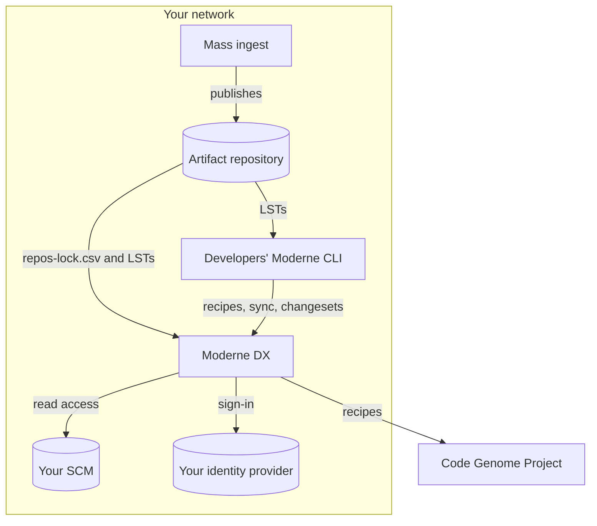

# Moderne DX overview

Moderne DX runs the Moderne Platform's recipe marketplace, code search, and changesets on a machine you control. Your source code, your Lossless Semantic Trees (LSTs), and everything your developers do with them stay inside your network.

DX is one jar that you start with one command. It runs the same way on a laptop and on a server, and a server adds only its own name and a certificate. You can try DX on your own machine, then move the same configuration to the machine your organization will use.

## How DX fits with mass ingest and the CLI

DX does not build LSTs and does not run recipes. It works alongside two things you already have:

* **[Mass ingest](../how-to-guides/mass-ingest-dx.md)** builds an [LST](../../../user-documentation/recipes/authoring-recipes/concepts/lossless-semantic-trees.md) for every repository and publishes it to your artifact repository. It also publishes a `repos-lock.csv` file that lists where each LST is.
* **The [Moderne CLI](../../../user-documentation/moderne-cli/getting-started/cli-intro.md)** runs recipes on developers' machines, against LSTs it downloads from your artifact repository.

DX reads the `repos-lock.csv` file. It builds your organizations from it and indexes each LST for code search. Developers point their CLI at DX to find recipes in the marketplace and to sync repositories. They push the changes their recipes made to DX as changesets, which others review in the UI.

DX shows a repository only to people who can read it on your source control management (SCM) system. Each user connects their SCM account in the UI once, and DX checks their access with it.

## What DX includes

DX is a configuration of the Moderne Platform, not a separate product. The parts it runs work as they do on the Platform.

| Capability                                           |              Moderne DX                          |            Moderne Platform            |
|------------------------------------------------------|:------------------------------------------------:|:--------------------------------------:|
| Recipe marketplace                                   |                       Yes                        |                  Yes                   |
| Code search across every repository                  |                       Yes                        |                  Yes                   |
| Organizations from your `repos.csv` file             |                       Yes                        |                  Yes                   |
| Changesets pushed from the CLI, reviewed in the UI   |                       Yes                        |                  Yes                   |
| Sign-in through your identity provider               |                       Yes                        |                  Yes                   |
| A status page with every service's metrics and logs  |                       Yes                        |                  Yes                   |
| Recipe runs started from the UI                      | No. The marketplace shows the CLI command instead. |                  Yes                   |
| Commits and pull requests made from the UI           |                       No                         |                  Yes                   |
| Visualizations, DevCenter, and audit logs            |                       No                         |                  Yes                   |
| Moddy                                                |                       No                         |                  Yes                   |
| Where it runs                                        |             A machine you control                | A single-tenant SaaS hosted by Moderne |

The marketplace's **Run with the CLI** button gives developers the commands that sync an organization and run a recipe with the options they picked.

## Next steps

* [Install and configure Moderne DX](./installing-moderne-dx.md).
* [Set up mass ingest](../how-to-guides/mass-ingest-dx.md) to build the LSTs that DX reads.
* Look up a setting in the [`moderne.yml` reference](../references/moderne-yml-reference.md).
