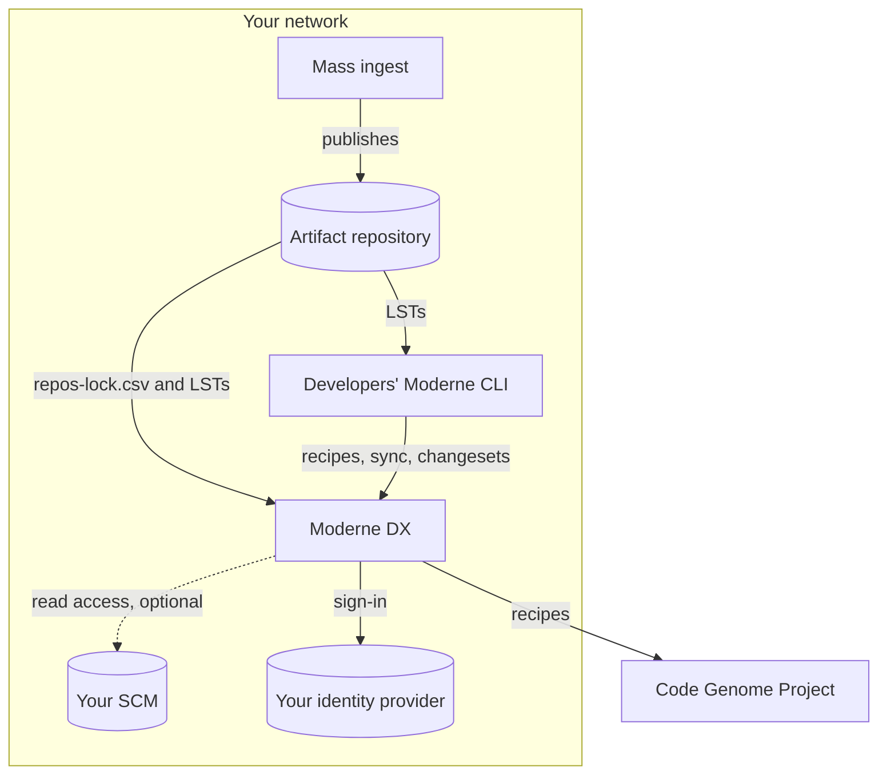

# Moderne DX overview

Moderne DX runs the Moderne Platform's [recipe marketplace](../../moderne-platform/how-to-guides/connector-configuration/configure-recipe-marketplace-repositories.md), [code search](../../../user-documentation/moderne-platform/getting-started/code-search.md), and [changesets](../../../user-documentation/moderne-platform/references/changesets.md) on a machine you control. Your code, Lossless Semantic Trees (LSTs), and any changes your developers make stay inside your network.

DX is a single JAR (Java archive) file that you start with one command. It runs the same way on a laptop and a server, but on a server you also set a host name and a certificate. You can try DX on your own machine first, then move the same configuration to the machine your organization will use.

## How DX fits with mass ingest and the CLI

DX does not build LSTs and does not run recipes. Instead, it works alongside two things you already have:

* **[Mass ingest](../how-to-guides/mass-ingest-dx.md)** builds an [LST](../../../user-documentation/recipes/authoring-recipes/concepts/lossless-semantic-trees.md) and code search index for every repository listed in your [`repos.csv` file](../how-to-guides/mass-ingest-dx.md#creating-the-reposcsv-file) and publishes them to your artifact repository. It also publishes a `repos-lock.csv` file that lists where each LST is.
* **The [Moderne CLI](../../../user-documentation/moderne-cli/getting-started/cli-intro.md)** runs recipes on developers' machines, against LSTs it downloads from your artifact repository.

DX reads the `repos-lock.csv` file to build your organizations. It combines the individual LSTs into a shared index for code search. In the DX UI, developers can pick an organization to see its repositories and their LST build status. They can also search code across all of their organizations' repositories.

Developers [connect their CLI to DX](../how-to-guides/running-moderne-dx.md#pointing-the-cli-at-dx) to sync an organization's repositories, and the marketplace's recipes, to their machines. From there, they or their agents can run recipes and push any changes they make back to DX as changesets.

## What DX includes

| Capability                                          |                     Moderne DX                     |            Moderne Platform            |
|-----------------------------------------------------|:--------------------------------------------------:|:--------------------------------------:|
| Recipe marketplace                                  |                        Yes                         |                  Yes                   |
| Code search across every repository                 |                        Yes                         |                  Yes                   |
| Organizations                                       |          From your `repos-lock.csv` file           |    From your organizations service     |
| Changesets pushed from the CLI, reviewed in the UI  |                        Yes                         |                  Yes                   |
| Sign-in through your identity provider              |                        Yes                         |                  Yes                   |
| A status page with every service's metrics and logs |                        Yes                         |                  Yes                   |
| CLI telemetry for usage reporting                   | Yes. Stored on DX's disk, or in your S3 bucket or Azure container | Yes |
| Recipe runs started from the UI                     | No. The marketplace shows the CLI command instead. |                  Yes                   |
| Commits and pull requests made from the UI          |                         No                         |                  Yes                   |
| Visualizations, DevCenter, and audit logs in the UI |                         No                         |                  Yes                   |
| Moddy                                               |                         No                         |                  Yes                   |
| Where it runs                                       |               A machine you control                | A single-tenant SaaS hosted by Moderne |

The **Run with the CLI** button in the recipe marketplace gives developers the commands to sync an organization and run a recipe with the selected options.

## Where to run DX

DX runs on Linux, or on macOS with Apple silicon. It requires Java 25.

* **Trying DX on your own machine.** Run `java -jar moderne-dx.jar start` from a terminal. See [Installing Moderne DX](./installing-moderne-dx.md).
* **Serving your organization from a Linux server or VM.** Run DX as a `systemd` service, so it starts when the machine boots and restarts if it fails. See [Running DX as a service](../how-to-guides/running-moderne-dx.md#running-dx-as-a-service).
* **Running DX in a container.** Moderne doesn't publish a DX container image. To run DX in a container, use `java -jar moderne-dx.jar start` as its command and mount [DX's permanent directory](../how-to-guides/running-moderne-dx.md#where-dx-keeps-its-files) on a persistent volume.

## Next steps

* [Install and configure Moderne DX](./installing-moderne-dx.md).
* [Set up mass ingest](../how-to-guides/mass-ingest-dx.md) to build the LSTs that DX reads.
* Look up a setting in the [`moderne.yml` reference](../references/moderne-yml-reference.md).
