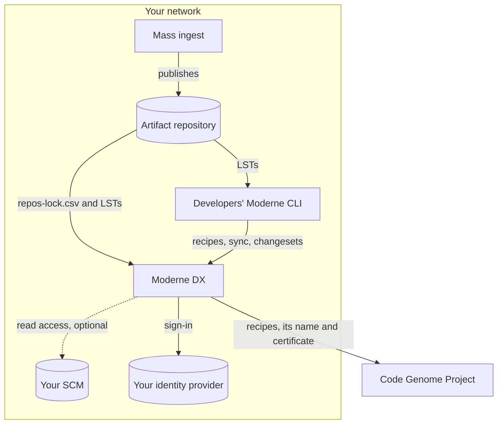

# Moderne DX overview

Moderne DX lets you host parts of the Moderne Platform on a machine you control. With it, your developers can browse the recipe marketplace, [use Moderne Code Search](../../../user-documentation/moderne-platform/getting-started/code-search.md), and review [changesets](../../../user-documentation/moderne-platform/references/changesets.md). Because DX runs on your machine, your source code, your Lossless Semantic Trees (LSTs), and everything your developers do with them will stay inside of your network.

DX is a single JAR file that you start with one command, and it runs the same way on a laptop as it does on a server. You also won't need to set up DNS records or a certificate for it. The Code Genome Project (CGP) will give your DX a name under `moderne.direct`, along with a certificate for that name.

Because of that, you can try DX out on your own machine first. Once you're happy with it, you can move the same configuration over to the machine your organization will use.

## How DX fits with mass ingest and the CLI

DX doesn't build LSTs, and it doesn't run recipes. Instead, it works alongside two things you already have:

* **[Mass ingest](../how-to-guides/mass-ingest-dx.md)** builds an [LST](../../../user-documentation/recipes/authoring-recipes/concepts/lossless-semantic-trees.md) for every repository in your [`repos.csv` file](../how-to-guides/mass-ingest-dx.md#creating-the-reposcsv-file) and publishes it to your artifact repository. It also publishes a `repos-lock.csv` file that lists where each LST is.
* **The [Moderne CLI](../../../user-documentation/moderne-cli/getting-started/cli-intro.md)** runs recipes on your developers' machines. It runs them against LSTs that it downloads from your artifact repository.

DX, in turn, reads the `repos-lock.csv` file that mass ingest publishes. It uses that file to build your organizations, and it indexes each LST so that your developers can search across all of your code.

Your developers will then [point their CLI at DX](../how-to-guides/running-moderne-dx.md#pointing-the-cli-at-dx). From there, they can find recipes in the marketplace and sync repositories to their machine. When a recipe makes changes, they can push those changes to DX as a changeset for others to review in the UI.

By default, every user can read every repository in DX. If you'd like DX to only show each user the repositories they can read in your source control management (SCM) system, you can turn on [user-level repository access control](../how-to-guides/repository-access-control.md).

## What DX includes

DX isn't a separate product. It's the Moderne Platform, configured to run a smaller set of features on your own machine. The features it does include work the same way they do on the Platform. The table below shows how the two compare:

| Capability                                          |                     Moderne DX                     |            Moderne Platform            |
|-----------------------------------------------------|:--------------------------------------------------:|:--------------------------------------:|
| Recipe marketplace                                  |                        Yes                         |                  Yes                   |
| Code search across every repository                 |                        Yes                         |                  Yes                   |
| Organizations                                       |          From your `repos-lock.csv` file           |    From your organizations service     |
| Changesets pushed from the CLI, reviewed in the UI  |                        Yes                         |                  Yes                   |
| Sign-in through your identity provider              |                        Yes                         |                  Yes                   |
| A status page with every service's metrics and logs |                        Yes                         |                  Yes                   |
| CLI telemetry for usage reporting                   |                        Yes                         |                  Yes                   |
| Recipe runs started from the UI                     | No. The marketplace shows the CLI command instead. |                  Yes                   |
| Commits and pull requests made from the UI          |                         No                         |                  Yes                   |
| Visualizations, DevCenter, and audit logs in the UI |                         No                         |                  Yes                   |
| Moddy                                               |                         No                         |                  Yes                   |
| Where it runs                                       |               A machine you control                | A single-tenant SaaS hosted by Moderne |

In the recipe marketplace, the **Run with the CLI** button will give your developers the commands they need to sync an organization and run a recipe with the options they picked.

## Where to run DX

DX runs on Linux and on macOS with Apple silicon. It also needs Java 25.

If you're just trying DX out, you can start it from a terminal on your own machine by following the [installation guide](./installing-moderne-dx.md). When you're ready to serve DX to your organization, you can [run it as a `systemd` service](../how-to-guides/running-moderne-dx.md#running-dx-as-a-service) on a Linux server.

## Next steps

* [Install and configure Moderne DX](./installing-moderne-dx.md).
* [Set up mass ingest](../how-to-guides/mass-ingest-dx.md) to build the LSTs that DX reads.
* Look up a setting in the [`moderne.yml` reference](../references/moderne-yml-reference.md).
