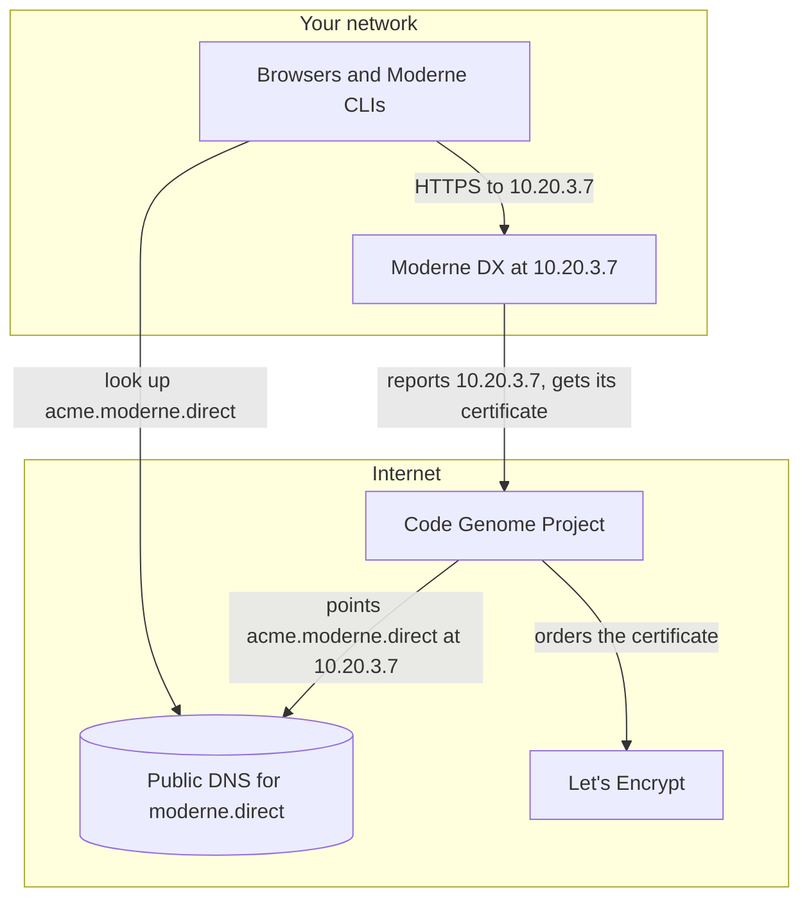

# Configuring DNS for Moderne DX

Browsers and the Moderne CLI reach DX by name, over HTTPS. Each of DX's names needs a Domain Name System (DNS) record that points at DX, and a certificate that browsers and the CLI trust.

The route you name in `moderne.yml` decides where those records and that certificate come from. In this guide, we will walk you through the three routes and how to choose between them.

## Choosing a route

`moderne.dx.routes` names exactly one route. The routes differ in where DX's name, DNS records, and certificate come from, and in where Transport Layer Security (TLS) ends:

| Route                | DX's name                                                    | DNS records                                       | Certificate                       | Where TLS ends     |
|----------------------|--------------------------------------------------------------|---------------------------------------------------|-----------------------------------|--------------------|
| `managed`            | A name under `moderne.direct`, such as `acme.moderne.direct` | Public records that the Code Genome Project keeps | From Let's Encrypt, renewed by DX | DX                 |
| `custom-certificate` | Your own, such as `moderne.acme.com`                         | Yours, pointing at DX's machine                   | Yours, on DX's machine            | DX                 |
| `load-balanced`      | Your own, such as `moderne.acme.com`                         | Yours, pointing at your load balancer             | Yours, on your load balancer      | Your load balancer |

Start with the `managed` route that `init` writes, because it needs no DNS records or certificate from you. Choose `custom-certificate` or `load-balanced` when DX needs a name in your own domain. Of those two, choose `load-balanced` when a load balancer you already run should end TLS for DX.

## The four names

Every route serves DX at four names, on one port, through a proxy inside DX:

| Name                      | Example                      | What it serves                       |
|---------------------------|------------------------------|--------------------------------------|
| The host                  | `acme.moderne.direct`        | The UI                               |
| `api.` before the host    | `api.acme.moderne.direct`    | The API, which the Moderne CLI calls |
| `login.` before the host  | `login.acme.moderne.direct`  | Keycloak, where users sign in        |
| `status.` before the host | `status.acme.moderne.direct` | The status page                      |

A `custom-certificate` or `load-balanced` route takes its host from `public-url`, such as `moderne.acme.com`. Every public URL is `https`.

Each of the four names needs a DNS record. The certificate must cover all four.

The names must also resolve on DX's own machine, because DX's UI reaches the API and Keycloak at their public names. DX will not start when one of them does not resolve there.

## Using a name under `moderne.direct`

The `managed` route that `init` writes points DX's names at `127.0.0.1`, which only your own machine reaches. To serve DX to your organization, set `address` to the IP address your users reach DX's machine at:

```yaml title="moderne.yml"
moderne:
  dx:
    routes:
      managed:
        token: ${CGP_TOKEN}
        address: 10.20.3.7
```

* `token` is the Code Genome Project (CGP) token Moderne gave you for DX.
* `address` is the IP address the four names point at.
* `port` is the port DX listens on. `init` names `8443`. Leave it out to listen on `443`, which on Linux needs the [systemd unit](./running-moderne-dx.md#running-dx-as-a-service).

DX listens on `address` when it is one of the machine's own addresses. When it is not, such as behind a cloud provider's network address translation (NAT), DX listens on every address of the machine.

### How the name resolves

CGP names DX after the CGP user that the token belongs to. A token for the user `acme` gives DX the name `acme.moderne.direct`.

Each time DX starts, and every hour after, it reports `address` to CGP. CGP keeps public DNS records that point the four names at the address DX last reported. The records are in Moderne's `moderne.direct` zone on Amazon Route 53. With a one-minute time to live (TTL) on the records, resolvers pick up a new address within a minute.

The address is a private one, such as `10.20.3.7`, which only machines inside your network can reach. Browsers and CLIs look up the name, then connect to DX over your own network, without going through CGP:



### Where the certificate comes from

CGP gets a certificate for the four names from Let's Encrypt. No one needs to install a certificate authority or change a trust store, because browsers and the Moderne CLI already trust Let's Encrypt.

Let's Encrypt confirms that CGP controls the names by looking up temporary DNS records that CGP adds. DX can run on a network that the internet cannot reach, because Let's Encrypt never connects to DX. The managed route needs only outbound HTTPS access from DX's machine to `api.codegenomeproject.org`.

DX makes the certificate's private key itself and sends CGP only a certificate signing request. The key never leaves DX's machine.

DX renews the certificate before it expires and serves the new one without a restart. If DX cannot reach CGP, it keeps serving its current certificate until that certificate expires.

### When the names do not resolve

A resolver that looked up a name before CGP's records were in place can remember, for up to 15 minutes, that the name did not exist. If `doctor` says a name does not resolve right after DX's first start, wait and try again.

Some DNS resolvers have DNS rebinding protection, which drops answers that point at private addresses. Where your resolver does this, `doctor` says the names do not resolve. To fix it, do one of the following:

* Allow private answers for `moderne.direct` in your resolver's rebinding protection.
* Add the four names to your own DNS, pointing at the same address.
* Add the line that `doctor` prints to the hosts file of DX's machine and of each user's machine.

## Using your own name and certificate

A `custom-certificate` route serves DX under a name in your own domain, such as `moderne.acme.com`. DX ends TLS with a certificate that you give it.

```yaml title="moderne.yml"
moderne:
  dx:
    routes:
      custom-certificate:
        public-url: https://moderne.acme.com
        certificate: /etc/moderne-dx/tls.crt
        private-key: /etc/moderne-dx/tls.key
```

Before DX starts, you will need to:

* Create DNS records that point the four names at DX's machine. Records for `moderne.acme.com` and `*.moderne.acme.com` cover all four. They can live in your internal DNS alone.
* Get a certificate that covers the four names, such as one for `moderne.acme.com` and `*.moderne.acme.com`.
* Save the certificate in a PEM file, followed by the certificates of its chain. Save its private key in a second PEM file.

DX listens on every address of the machine, on the public URL's port. That port is `443` unless the URL names another. For a name under `localhost`, DX listens on the loopback address alone. On Linux, a port below 1024 needs the [systemd unit](./running-moderne-dx.md#running-dx-as-a-service).

`doctor` checks that the certificate covers all four names and that the key matches it. It warns a month before the certificate expires. DX reads the certificate only when it starts, so restart DX after you renew it.

## Using your own name behind a load balancer

A `load-balanced` route serves DX under a name in your own domain, behind a load balancer that you run. The load balancer ends TLS and forwards plain HTTP to DX.

```yaml title="moderne.yml"
moderne:
  dx:
    routes:
      load-balanced:
        public-url: https://moderne.acme.com
        http-port: 8080
```

Before DX starts, you will need to:

* Create DNS records that point the four names at the load balancer. Records for `moderne.acme.com` and `*.moderne.acme.com` cover all four.
* Give the load balancer a certificate that covers the four names.
* Have the load balancer forward all four names to `http-port` on DX's machine as plain HTTP, with each request's `Host` header unchanged. DX uses that header to tell the four names apart.
* Let DX's own machine reach the load balancer too. DX's UI reaches the API and Keycloak through it.

DX serves plain HTTP on `http-port`, on every address of the machine. Let only the load balancer reach that port, through a firewall or a security group, so that no one reaches DX without TLS.

## Trusting a private certificate authority

With either `custom-certificate` or `load-balanced`, the certificate may come from a private certificate authority (CA), such as your organization's own. Your users' browsers and CLIs must then trust that CA, and so must DX.

DX's UI reaches the API and Keycloak at their public names, and gets the same certificate your users do. Add the CA's PEM file to `moderne.env` so that the UI trusts it:

```bash title="moderne.env"
NODE_EXTRA_CA_CERTS=/etc/moderne-dx/ca.pem
```

Developers whose Java trust store lacks the CA can add it to their CLI with [`mod config http trust-store`](../../../user-documentation/moderne-cli/cli-reference.md#mod-config-http-trust-store).

## Changing the route

You can change the route at any time, such as when you move DX from a `moderne.direct` name to one of your own. Restart DX after you change it. At that start, DX points Keycloak at the new names for you.

After the restart, each of these needs the new URL:

* Users need to sign in again at the new URL.
* Developers need to point their CLIs at the new URL with `mod config moderne edit`.
* Your source control management (SCM) system's OAuth app, if `moderne.yml` names one, needs the new public URL as its callback URL.
* An identity provider you connected needs [DX's new `login.` URLs](./running-moderne-dx.md#connecting-your-identity-provider) in its settings.

## Settings that routes replaced

Earlier versions of DX set their URLs and certificate with settings that routes replaced. A start that finds one of them stops, and prints the route that does what it did. Those settings, all under `moderne.dx`, are `public-url`, `api-url`, `login-url`, `status-url`, `tls`, `ports.proxy`, `ports.proxy-http`, and `bind-address`.

DX also no longer has a certificate authority of its own. The `managed` route takes its place, with a certificate that browsers and CLIs already trust.
