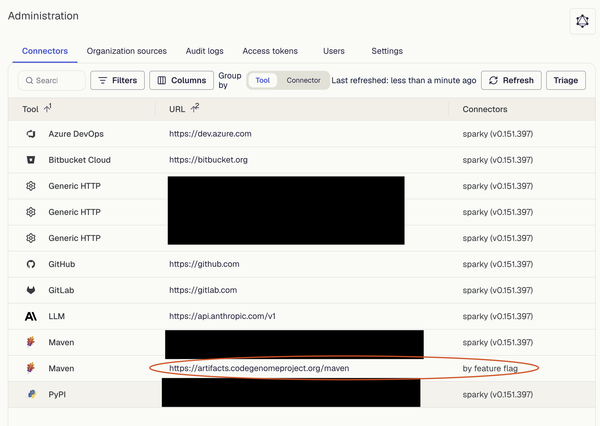

# Using the Code Genome Project as a recipe source

## When would I need this?

If your internal Artifactory (or other artifact repository) has a strict cooldown period before new artifacts can be pulled in, thus preventing the latest recipe artifacts from being available in your SaaS tenant.

## How does it work?

Moderne resolves recipe artifacts from the [recipe marketplace repositories](./connector-configuration/configure-recipe-marketplace-repositories.md) the Moderne Connector provides. When one of these repositories has a curation cooldown in place, this can often cause the artifact repository to advertise a given version (for example, via `maven-metadata.xml`), but when a client actually tries to download that version, it won't be available. Hereafter we'll refer to this broken behavior as "torn recipe metadata".

To allow Moderne to provide recipe updates in a timely manner, and to prevent torn recipe metadata from blocking automated updates to your recipe jars, Moderne will configure the [Code Genome Project](../../../user-documentation/recipes/accessing-the-code-genome-project.md) as a recipe marketplace repository directly in your tenant.

## Security posture

Curation cooldowns on Artifactory, Nexus, etc., are designed around preventing insecure libraries—libraries that have not yet been vetted to be free of security vulnerabilities—from ending up in production code and being exploited. Adding the Code Genome Project as a recipe marketplace repository directly in the SaaS tenant will allow those dependencies to be used for recipes, but **will not** circumvent the curation cooldown and allow these artifacts to be used in production code.

## Checking that the Code Genome Project is enabled

You can confirm the Code Genome Project is configured from the [Connectors page](../getting-started/admin-pages.md#connectors-page):

1. Click the gear icon in the top-right corner of the navbar, then click **Connectors**.
2. You'll see a Maven row for `https://artifacts.codegenomeproject.org/maven` with connector nickname `by feature flag`:

:::info
Moderne adds the Code Genome Project to your tenant directly, so it is not listed against any of your own Connectors. If the row does not appear, the Code Genome Project has not been enabled for your tenant yet.
:::

## Next steps

* [Importing external recipes](./importing-external-recipes.md)
* [Configuring recipe marketplace repositories](./connector-configuration/configure-recipe-marketplace-repositories.md)
* [Categorizing recipes](./categorize-recipes.md)
