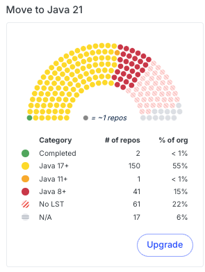
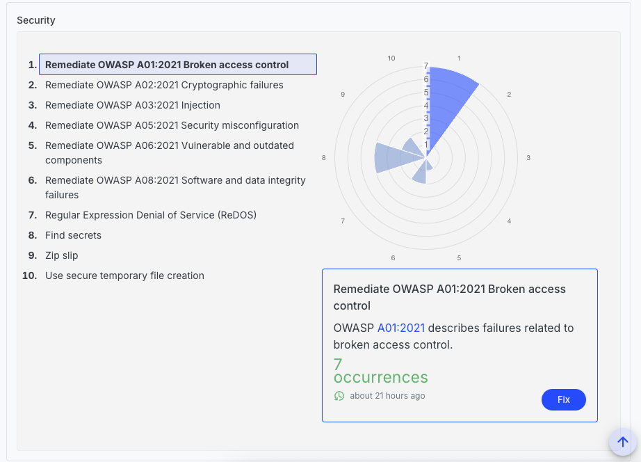

# Creating a DevCenter recipe

Moderne DevCenters are defined and configured via a standard OpenRewrite recipe. Each card in the DevCenter comes from a recipe in its recipe list, so you can track anything a recipe can measure.

In this doc, we'll walk you through how to create a DevCenter recipe and deploy it to your tenant. By the end, you should be ready to [configure a recipe-based DevCenter in your tenant](./recipe-based-devcenter.md).

## Prerequisites

This guide assumes that you have:

* Already configured an [organizational structure](./connector-configuration/configure-organizations-hierarchy.md)
* A basic understanding of what [declarative YAML recipes](https://docs.openrewrite.org/reference/yaml-format-reference) look like and how to work with them.

## Creating and deploying a DevCenter recipe

### Step 1: Create a new recipe repository

The first thing you need to do is to create a new recipe repository using either the [rewrite-recipe-starter](https://github.com/moderneinc/rewrite-recipe-starter) or your own internal recipe starter template. This repository is where you'll create all of the DevCenter recipes you'd like to use.

### Step 2: Add the rewrite-devcenter dependency

Once you've created your recipe repository, you will need to update your `build.gradle` or `pom.xml` file to include a dependency on [io.moderne.recipe:rewrite-devcenter](https://artifacts.codegenomeproject.org/maven/io/moderne/recipe/rewrite-devcenter/). This will give you access to key components you need to create and run DevCenter recipes.

:::info
`rewrite-devcenter` is a Moderne proprietary recipe published under `io.moderne.recipe` in the [Code Genome Project repository](https://artifacts.codegenomeproject.org/maven). Resolve it through your internal artifact repository, which mirrors the Code Genome Project repository, rather than reaching that URL directly from your build.

Because it is a proprietary recipe, the credentials your organization uses to mirror the Code Genome Project repository must have the customer entitlement.

See [Accessing the Code Genome Project](../../../user-documentation/recipes/accessing-the-code-genome-project.md) for how your organization obtains credentials and mirrors the repository.
:::

### Step 3: Create a declarative DevCenter recipe

We've provided a [devcenter-starter recipe](https://github.com/moderneinc/rewrite-devcenter/blob/main/src/main/resources/META-INF/rewrite/devcenter-starter.yml) that you can copy to your own repository to get started. You can also create your own if you desire. Check out the [understanding DevCenter recipes section](#understanding-devcenter-recipes) below for more information on how to create your own.

The [rewrite-devcenter repository](https://github.com/moderneinc/rewrite-devcenter) contains common card recipes that you may want to use or modify, such as the [LibraryUpgrade card recipe](https://github.com/moderneinc/rewrite-devcenter/blob/main/src/main/java/io/moderne/devcenter/LibraryUpgrade.java). See [Card recipes](#card-recipes) below for an overview.

Any recipe that meets the following requirements can be displayed as a DevCenter card:

* Requires no input options
* Outputs the `UpgradesAndMigrations` and/or `SecurityIssues` data tables (either or both)
* Includes the correct columns for those tables (see the [data table definitions](https://github.com/moderneinc/rewrite-devcenter/tree/main/src/main/java/io/moderne/devcenter/table) for details)

### Step 4: Deploy the recipe artifact

Once you're satisfied with your recipe(s), you will need to [deploy them to your tenant](./importing-external-recipes.md).

## Understanding DevCenter recipes

In order to help you get a better understanding of how DevCenter recipes work, let's walk through the [DevCenter starter recipe](https://github.com/moderneinc/rewrite-devcenter/blob/main/src/main/resources/META-INF/rewrite/devcenter-starter.yml). By the end, you should have a good idea of what makes up a DevCenter recipe and how you can create your own.

### Metadata

The top of this recipe begins with standard metadata (e.g., `name` and `description`) that you would find in any declarative YAML recipe:

```yaml
type: specs.openrewrite.org/v1beta/recipe
name: io.moderne.devcenter.DevCenterStarter
displayName: DevCenter Starter
description: |-
  A starting point for your own DevCenter, combining upgrades, migrations, and security fixes.
  Run it as-is for a first overview of your organization, then copy and customize the configuration.
```

### Recipe list

After that, it lists out the recipes that will be run to build the DevCenter dashboard. Most of these recipes will turn into a card in your DevCenter:

```yaml
recipeList:
  - io.moderne.devcenter.LibraryUpgrade:
      cardName: Move to Spring Boot 4.1
      groupIdPattern: org.springframework.boot
      artifactIdPattern: '*'
      version: 4.1.0
      upgradeRecipe: io.moderne.java.spring.boot4.UpgradeSpringBoot_4_1
  - io.moderne.devcenter.JavaVersionUpgrade:
      majorVersion: 25
      upgradeRecipe: org.openrewrite.java.migrate.UpgradeToJava25
  - io.moderne.devcenter.JUnitJupiterUpgrade:
      upgradeRecipe: org.openrewrite.java.testing.junit6.JUnit5to6Migration
  - io.moderne.devcenter.SecurityStarter
  - io.moderne.devcenter.FindOrganizationStatistics
  - io.moderne.devcenter.FindActiveCommitters
```

DevCenter recipes have two notable properties worth calling out:

* `cardName` is a property that allows you to customize what the name of the card should be. Not all recipes have a `cardName` property. For instance, the [LibraryUpgrade recipe](https://github.com/moderneinc/rewrite-devcenter/blob/main/src/main/java/io/moderne/devcenter/LibraryUpgrade.java) has a `cardName` property – whereas the [JavaVersionUpgrade recipe](https://github.com/moderneinc/rewrite-devcenter/blob/main/src/main/java/io/moderne/devcenter/JavaVersionUpgrade.java) does not.
* `upgradeRecipe` is a property that defines the recipe that should be run to upgrade your repositories. It is the recipe that will get executed when you press the `Upgrade` button on a card. On `PackageMigration` cards, this property is called `migrationRecipe`.

<figure>
  
  <figcaption>_An example of a DevCenter card._</figcaption>
</figure>

### Organizational ownership recipes

The last two recipes in the list, `io.moderne.devcenter.FindOrganizationStatistics` and `io.moderne.devcenter.FindActiveCommitters`, do not produce cards. They populate the **Lines of code** and **Contributing developers** cards in the DevCenter's Organizational ownership section. Include both in every DevCenter recipe. Without them, those two cards remain empty. The canonical recipe list that includes both is the [DevCenterStarter recipe](https://github.com/moderneinc/rewrite-devcenter/blob/main/src/main/resources/META-INF/rewrite/devcenter-starter.yml).

:::warning
If your DevCenter recipe lists `org.openrewrite.search.FindCommitters`, replace it with `io.moderne.devcenter.FindActiveCommitters`. `FindCommitters` counts everyone who ever committed to a repository, which inflates the **Contributing developers** card. `FindActiveCommitters` only counts committers from the last 90 days.
:::

### Security card

You can also define recipes in the same YAML file as your DevCenter recipe. For instance, the starter file defines the `SecurityStarter` recipe that creates a security card in the DevCenter:

```yaml
---
type: specs.openrewrite.org/v1beta/recipe
name: io.moderne.devcenter.SecurityStarter
displayName: OWASP top ten
description: >-
  This recipe is a starter card to reveal common OWASP Top 10 issues in your source code.
  You can customize this configuration to suit your needs.
recipeList:
  - org.openrewrite.java.security.OwaspA01
  - org.openrewrite.java.security.OwaspA02
  - org.openrewrite.java.security.OwaspA03
  - org.openrewrite.java.security.OwaspA08
  # Changes made by recipes above this one in the recipe list are reported as occurrences
  # in the Security DevCenter card.
  - io.moderne.devcenter.ReportAsSecurityIssues:
      fixRecipe: org.openrewrite.java.security.OwaspTopTen
```

This security recipe differs slightly from a traditional YAML recipe. In the recipe list, there is a special recipe called `io.moderne.devcenter.ReportAsSecurityIssues`. By adding that recipe to the list, it will detect the number of issues found in the above recipes and generate a card that displays them all.

This recipe takes in a `fixRecipe` property that defines the recipe that can be run to fix the issues reported by the above security recipes.

<figure>
  
  <figcaption>_An example of a security section in a DevCenter._</figcaption>
</figure>

## Card recipes

The following card recipes are among the most commonly used. Each one places every repository in a category, such as how far it is from a target version, and the card shows how many repositories fall in each category.

| Card recipe | What the card tracks |
|-------------|----------------------|
| [`LibraryUpgrade`](https://github.com/moderneinc/rewrite-devcenter/blob/main/src/main/java/io/moderne/devcenter/LibraryUpgrade.java) | The lowest version of the matching Maven or Gradle dependencies, compared to a target version. |
| [`ParentPomUpgrade`](https://github.com/moderneinc/rewrite-devcenter/blob/main/src/main/java/io/moderne/devcenter/ParentPomUpgrade.java) | The version of a Maven parent POM, compared to a target version. |
| [`PackageUpgrade`](https://github.com/moderneinc/rewrite-devcenter/blob/main/src/main/java/io/moderne/devcenter/PackageUpgrade.java) | The version of an npm, PyPI, or NuGet package or a Go module, compared to a target version. |
| [`PackageMigration`](https://github.com/moderneinc/rewrite-devcenter/blob/main/src/main/java/io/moderne/devcenter/PackageMigration.java) | Whether repositories have moved from one npm, PyPI, or NuGet package or Go module to another. |
| [`JavaVersionUpgrade`](https://github.com/moderneinc/rewrite-devcenter/blob/main/src/main/java/io/moderne/devcenter/JavaVersionUpgrade.java) | The Java version each repository compiles for. |
| [`JUnitJupiterUpgrade`](https://github.com/moderneinc/rewrite-devcenter/blob/main/src/main/java/io/moderne/devcenter/JUnitJupiterUpgrade.java) | Whether each repository tests with JUnit 4, JUnit 5, or JUnit 6. |
| [`BuildToolCard`](https://github.com/moderneinc/rewrite-devcenter/blob/main/src/main/java/io/moderne/devcenter/BuildToolCard.java) | The Gradle or Maven version each repository builds with. |
| [`DependencyVulnerabilityCheck`](https://github.com/moderneinc/rewrite-devcenter/blob/main/src/main/java/io/moderne/devcenter/DependencyVulnerabilityCheck.java) | Known dependency vulnerabilities, measured by severity, by the size of the upgrade that fixes them, or by risk score. |
| [`BucketedMetricCard`](https://github.com/moderneinc/rewrite-devcenter/blob/main/src/main/java/io/moderne/devcenter/BucketedMetricCard.java) | A numeric column from a data table that an earlier recipe in the list produces, aggregated per repository and sorted into the categories you define. |
| [`EcmaScriptModernization`](https://github.com/moderneinc/rewrite-devcenter/blob/main/src/main/java/io/moderne/devcenter/EcmaScriptModernization.java) | How many JavaScript and TypeScript variable declarations still use `var`. |
| [`ReportAsSecurityIssues`](https://github.com/moderneinc/rewrite-devcenter/blob/main/src/main/java/io/moderne/devcenter/ReportAsSecurityIssues.java) | Issues found by the recipes listed before it, shown in the security section. |

There are also version cards for other languages and frameworks:

* [`AngularVersionUpgrade`](https://github.com/moderneinc/rewrite-devcenter/blob/main/src/main/java/io/moderne/devcenter/AngularVersionUpgrade.java)
* [`CSharpVersionUpgrade`](https://github.com/moderneinc/rewrite-devcenter/blob/main/src/main/java/io/moderne/devcenter/CSharpVersionUpgrade.java)
* [`GoVersionUpgrade`](https://github.com/moderneinc/rewrite-devcenter/blob/main/src/main/java/io/moderne/devcenter/GoVersionUpgrade.java)
* [`GroovyVersionUpgrade`](https://github.com/moderneinc/rewrite-devcenter/blob/main/src/main/java/io/moderne/devcenter/GroovyVersionUpgrade.java)
* [`KotlinVersionUpgrade`](https://github.com/moderneinc/rewrite-devcenter/blob/main/src/main/java/io/moderne/devcenter/KotlinVersionUpgrade.java)
* [`NodeVersionUpgrade`](https://github.com/moderneinc/rewrite-devcenter/blob/main/src/main/java/io/moderne/devcenter/NodeVersionUpgrade.java)
* [`PythonVersionUpgrade`](https://github.com/moderneinc/rewrite-devcenter/blob/main/src/main/java/io/moderne/devcenter/PythonVersionUpgrade.java)
* [`ScalaVersionUpgrade`](https://github.com/moderneinc/rewrite-devcenter/blob/main/src/main/java/io/moderne/devcenter/ScalaVersionUpgrade.java)

The [rewrite-devcenter repository](https://github.com/moderneinc/rewrite-devcenter) has the complete set, including [card recipes](https://github.com/moderneinc/rewrite-devcenter/tree/main/src/main/java/io/moderne/devcenter) and [DevCenters](https://github.com/moderneinc/rewrite-devcenter/tree/main/src/main/resources/META-INF/rewrite) added after this guide was written.

## More DevCenter recipe examples

Besides the starter, `rewrite-devcenter` ships complete DevCenter recipes that you can deploy as they are or copy as a starting point:

* [DevCenter for Quarkus](https://github.com/moderneinc/rewrite-devcenter/blob/main/src/main/resources/META-INF/rewrite/quarkus-devcenter.yml)
* [DevCenter for Apache](https://github.com/moderneinc/rewrite-devcenter/blob/main/src/main/resources/META-INF/rewrite/apache-maven-devcenter.yml) and [DevCenter for Apache Maven](https://github.com/moderneinc/rewrite-devcenter/blob/main/src/main/resources/META-INF/rewrite/apache-maven-devcenter.yml)
* [DevCenter for Gradle and Maven](https://github.com/moderneinc/rewrite-devcenter/blob/main/src/main/resources/META-INF/rewrite/build-tool-devcenter.yml)
* [DevCenter for Vulnerability Management](https://github.com/moderneinc/rewrite-devcenter/blob/main/src/main/resources/META-INF/rewrite/vulnerabilities-devcenter.yml)
* [Class cohesion DevCenter](https://github.com/moderneinc/rewrite-devcenter/blob/main/src/main/resources/META-INF/rewrite/code-quality-devcenter.yml)
* DevCenters for [Angular](https://github.com/moderneinc/rewrite-devcenter/blob/main/src/main/resources/META-INF/rewrite/angular-devcenter.yml), [C#](https://github.com/moderneinc/rewrite-devcenter/blob/main/src/main/resources/META-INF/rewrite/csharp-devcenter.yml), [Go](https://github.com/moderneinc/rewrite-devcenter/blob/main/src/main/resources/META-INF/rewrite/go-devcenter.yml), [JavaScript and TypeScript](https://github.com/moderneinc/rewrite-devcenter/blob/main/src/main/resources/META-INF/rewrite/node-devcenter.yml), [Kotlin](https://github.com/moderneinc/rewrite-devcenter/blob/main/src/main/resources/META-INF/rewrite/devcenter-kotlin.yml), [Python](https://github.com/moderneinc/rewrite-devcenter/blob/main/src/main/resources/META-INF/rewrite/python-devcenter.yml), and [React](https://github.com/moderneinc/rewrite-devcenter/blob/main/src/main/resources/META-INF/rewrite/react-devcenter.yml)

The following examples, taken from those recipes, show how you can customize a DevCenter to meet your own needs.

### Quarkus example

The [DevCenter for Quarkus](https://github.com/moderneinc/rewrite-devcenter/blob/main/src/main/resources/META-INF/rewrite/quarkus-devcenter.yml) recipe:

* Points the `LibraryUpgrade` recipe at `io.quarkus` dependencies instead of `org.springframework.boot`.
* Uses a `ParentPomUpgrade` recipe to track the Quarkus Universe BOM parent POM.
* Defines its own `UpgradeQuarkusUniverseBom` recipe to upgrade that parent POM, as no such recipe exists elsewhere.

```yaml
type: specs.openrewrite.org/v1beta/recipe
name: io.moderne.devcenter.QuarkusDevCenter
displayName: DevCenter for Quarkus
description: >-
  A DevCenter that tracks the latest Quarkus framework versions and applies best practices.
recipeList:
  - io.moderne.devcenter.FindOrganizationStatistics
  - io.moderne.devcenter.FindActiveCommitters
  - io.moderne.devcenter.LibraryUpgrade:
      cardName: Move to Quarkus 4.0
      groupIdPattern: io.quarkus
      artifactIdPattern: quarkus-*
      version: 4.0.x
      upgradeRecipe: org.openrewrite.quarkus.MigrateToQuarkus_v4_0_0
  - io.moderne.devcenter.ParentPomUpgrade:
      cardName: Move to the latest Quarkus Universe BOM
      groupIdPattern: io.quarkus
      artifactIdPattern: quarkus-universe-bom
      version: 4.0.x
      upgradeRecipe: io.moderne.devcenter.UpgradeQuarkusUniverseBom
  - io.moderne.devcenter.JavaVersionUpgrade:
      majorVersion: 25
      upgradeRecipe: org.openrewrite.java.migrate.UpgradeToJava25
  - io.moderne.devcenter.SecurityStarter
---
type: specs.openrewrite.org/v1beta/recipe
name: io.moderne.devcenter.UpgradeQuarkusUniverseBom
displayName: Upgrade Quarkus Universe BOM
description: >-
  Upgrades the Quarkus Universe BOM parent to the latest version.
recipeList:
  - org.openrewrite.maven.UpgradeParentVersion:
      groupId: io.quarkus
      artifactId: quarkus-universe-bom
      newVersion: x
```

:::tip
Additional recipes do not have to be in the same file or even the same module.
:::

### Custom parent example

The [DevCenter for Apache](https://github.com/moderneinc/rewrite-devcenter/blob/main/src/main/resources/META-INF/rewrite/apache-maven-devcenter.yml) recipe:

* Uses a `ParentPomUpgrade` recipe to track the Apache parent POM instead of a `LibraryUpgrade` recipe.
* Defines its own `UpgradeApacheParent` recipe that specifies the `groupId` and `artifactId` of the parent POM to upgrade.

```yaml
type: specs.openrewrite.org/v1beta/recipe
name: io.moderne.devcenter.ApacheDevCenter
displayName: DevCenter for Apache
description: >-
  A DevCenter that tracks the latest Apache parent POM version and applies best practices.
recipeList:
  - io.moderne.devcenter.FindOrganizationStatistics
  - io.moderne.devcenter.FindActiveCommitters
  - io.moderne.devcenter.ParentPomUpgrade:
      cardName: Move to the latest `apache` parent POM
      groupIdPattern: org.apache
      artifactIdPattern: apache
      version: 40
      upgradeRecipe: io.moderne.devcenter.UpgradeApacheParent
  - io.moderne.devcenter.JavaVersionUpgrade:
      majorVersion: 25
      upgradeRecipe: org.openrewrite.java.migrate.UpgradeToJava25
  - io.moderne.devcenter.JUnitJupiterUpgrade:
      upgradeRecipe: org.openrewrite.java.testing.junit6.JUnit5to6Migration
  - io.moderne.devcenter.SecurityStarter
---
type: specs.openrewrite.org/v1beta/recipe
name: io.moderne.devcenter.UpgradeApacheParent
displayName: Upgrade Apache Parent POM
description: >-
  Upgrades the Apache parent POM to the latest version.
recipeList:
  - org.openrewrite.maven.UpgradeParentVersion:
      groupId: org.apache
      artifactId: apache
      newVersion: x
```
