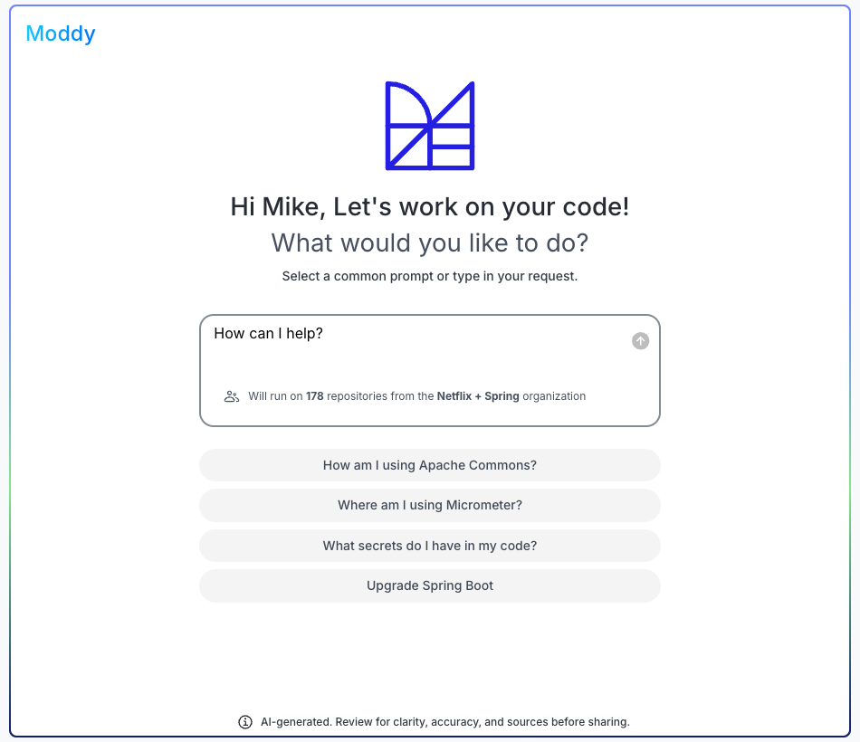
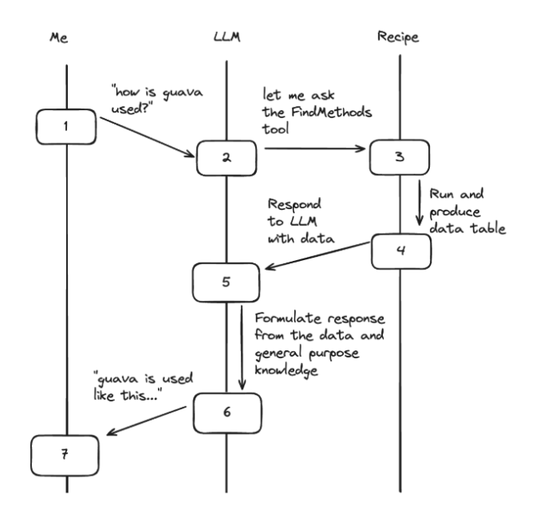
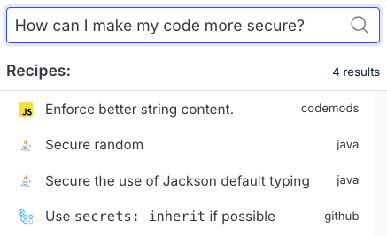

# AI architecture

Moderne has integrated AI capabilities into our solution set in a number of ways to enhance your experience, including: 

* **Moddy, a multi-repo AI agent** that is an optional component to the Moderne Platform, combines suggestive AI with deterministic OpenRewrite recipes to help developers search, analyze, and transform codebases. 
* **An AI-driven recipe search function** in the Moderne Platform enables you to use natural language search to find the most relevant recipes among thousands.

This architecture document will walk through all of the components and their use of AI.

:::warning
All AI tools and features may produce incorrect or incomplete results. Please ensure that you thoroughly review any results for clarity and accuracy before sharing or using.

**Note**: Our general philosophy is to create AI tools that help you _find_ and _discover_ things. However, we ensure that the core recipes themselves don't use AI unless explicitly described as such, so we can guarantee deterministic, consistent, and reliable changes.
:::

## Moddy (AI agent) - SaaS restricted beta

Moddy is a multi-repo AI agent that developers can optionally interact with in the Moderne Platform. It uses a BYOM (bring-your-own-model) approach to support its work, but leverages OpenRewrite recipes to do the heavy lifting of code search and transformation.

Moddy integrates with your AI LLMs to interpret natural language queries, search for recipes, summarize recipe options, run recipes to transform code and generate data tables, summarize recipe runs, and summarize data from data tables while making suggestions.

Moddy does not use generative AI to make changes to your code. All code changes are made by deterministic OpenRewrite recipes. Developers must still review diffs and issue PRs themselves (just like using the Moderne Platform without Moddy).

<figure>
  
  <figcaption>_A preview of Moddy_</figcaption>
</figure>

#### Deployment

Deployed as part of the Moderne Platform. Moderne customers can choose whether or not to enable this AI agent in their tenants.

#### AI models

Moddy does not include its own model. You configure your own. Right now we support Anthropic, but other models have been tested and performed relatively similarly. We plan to support additional generative models via their APIs.

#### State management

Conversation history is stored locally in the browser (e.g., cookies/local storage). If a user clears their browser data or switches devices, their history is lost.

#### Workflow

<figure>
  
  <figcaption>_AI model interactions_</figcaption>
</figure>

## AI recipe search

The Moderne Platform search uses AI capabilities to help you find recipes using natural language. This makes it easy to discover recipes even when you don't know their exact names. For more details, check out our [guide on how to search for recipes](../../../user-documentation/moderne-platform/how-to-guides/moderne-platform-search.md).

<figure>
  
  <figcaption>_Searching for recipes using AI_</figcaption>
</figure>

#### Deployment

Deployed as part of the Moderne Platform.

#### AI models

We use two BAAI embedding models – one for retrieval and one for reranking. We obtain the models from HuggingFace and deploy them using LangChain.

#### State management

Search results are saved on the worker, similar to any recipe run result. No data is permanently stored.

## Frequently asked questions

### Can I configure and customize AI features?

Moderne customers can choose what AI features they want to enable or disable. For instance, you can:

* Disable AI-powered search and rely on keyword matching only.
* Toggle the Moddy AI agent availability.

Furthermore, many of our AI features offer you the flexibility of bringing your own model so that you can ensure that the model you use meets your safety and security standards.

