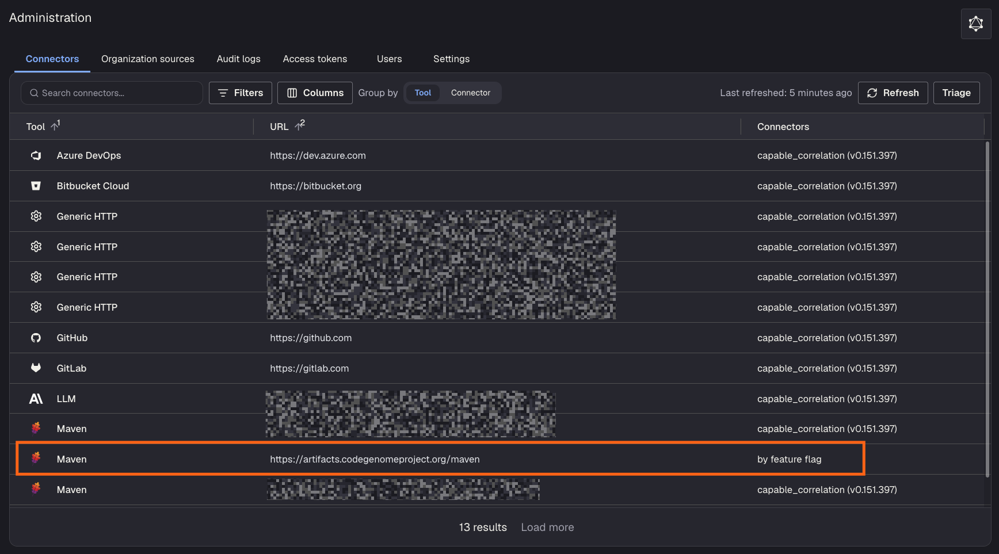

# Code Genome Project as a recipe source

If your artifact repository has a strict cooldown period before new artifacts can be pulled in, your Moderne tenant will have out-of-date recipe artifacts until that period ends. To get around this, Moderne can add the Code Genome Project to your tenant as a recipe source.

Moderne will make this change for you. Nothing needs to be changed in your Connector or in your artifact repository.

To help you evaluate this change before Moderne makes it, this page will explain how it works, what it means for your security posture, and how to confirm it is enabled.

## Why cooldowns block recipe updates

Moderne gets recipe artifacts from the [recipe marketplace repositories](../how-to-guides/connector-configuration/configure-recipe-marketplace-repositories.md) that your Moderne Connector provides. If one of them enforces a curation cooldown, your tenant won't be able to get new recipe versions until the cooldown ends.

## Where your tenant will get recipes

Once Moderne adds the [Code Genome Project](../../../user-documentation/recipes/accessing-the-code-genome-project.md) as a recipe marketplace repository, your tenant will look for recipes in this order:

1. Your own recipe marketplace repositories
2. The Code Genome Project (if your repositories can't provide a version yet)
3. Maven Central (for public dependencies of the recipes)

## Security posture

Companies often have cooldowns on newly published releases so there's time to catch a compromised or vulnerable version before it ends up in their code. Adding the Code Genome Project as a recipe marketplace repository **will not** change that. Your builds will still download through your artifact repository and wait for the cooldown like they do today.

What will change is that the _recipes_ in your Moderne tenant won't wait anymore. Your tenant will be able to use new recipe versions (and the public dependencies they need) before your cooldown has cleared them. Those recipes will only run inside your Moderne tenant. Nothing they download gets added to your builds.

You also won't need to open anything up on your side. The Moderne Platform downloads from the Code Genome Project and Maven Central directly - without going through your Connector or your network.

## Checking that the Code Genome Project is enabled

You can confirm that Moderne has enabled the Code Genome Project from the [Connectors page](../getting-started/admin-pages.md#connectors-page):

1. Click the gear icon in the top-right corner of the navbar, then click **Connectors**.
2. Look for a Maven row with the URL `https://artifacts.codegenomeproject.org/maven`. In the `Connectors` column, you will see `by feature flag` instead of the name of one of your Connectors.

If you don't see a row like this, Moderne hasn't enabled the Code Genome Project for your tenant yet.
