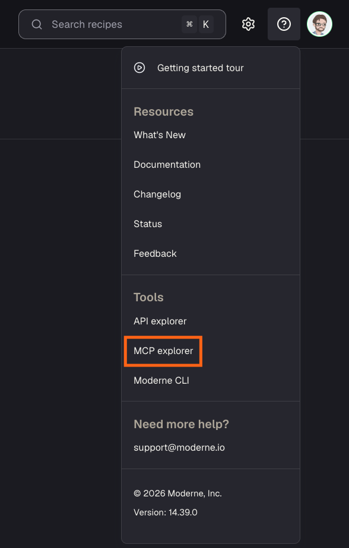
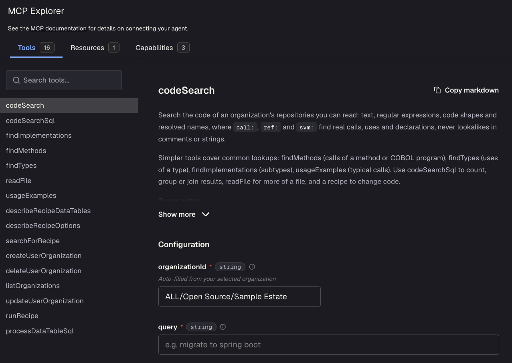

import Tabs from '@theme/Tabs';
import TabItem from '@theme/TabItem';

# Remote Moderne MCP server

The Moderne Platform hosts a remote [Model Context Protocol (MCP)](https://modelcontextprotocol.io/) server that gives AI coding agents access to your platform's recipes, recipe results, and code search. It operates on the repositories already ingested into your tenant, so your agent can run a recipe or search code across an entire organization without checking anything out.

:::info[Beta]
The remote MCP server is in beta. Tools will be added, reshaped, and occasionally removed as we learn how agents use them. That being said, it's only the tools themselves that are in beta - not the platform underneath it. Authentication and access scoping work exactly as they do for the rest of the Moderne API (as described under [Security](#security)).

None of the changes to the tools requires anything from you, because your agent reads the current list of tools from the server each time it connects.
:::

This page covers how to connect your coding agents to the remote server, how to try it out via the MCP explorer, how it authenticates and scopes access, and the [tools it provides](#available-tools).

## Before you begin

In order to authenticate with the Moderne MCP server, you will need to use a Moderne personal access token. The remote MCP server authenticates with the same token you would use for the [Moderne API](../../moderne-platform/how-to-guides/accessing-the-moderne-api.md), so if you already have one, you can reuse it. Otherwise, you can [create a new access token](../../moderne-platform/how-to-guides/create-api-access-tokens.md).

The token carries the same permissions as your account, so an agent that uses it can only act on the organizations and repositories you can already access.

## Connecting your agent

Your coding agent can't use Moderne's recipes or results until it knows the remote server exists. Connecting it registers the server's tools with the agent, so you can ask, in plain language, to find a recipe, run it across an organization, and explore the results - without leaving your editor or opening the platform. You only need to do this once per agent. Afterwards, the tools are available in every session.

Whichever agent you use, register the remote server as a streamable HTTP MCP server at `https://api.<tenant>.moderne.io/mcp` with two headers:

* `Authorization: Bearer <your-moderne-access-token>`
* `X-Moderne-Platform-Version: v2`
  * _This is required while you have SaaS v1 running in parallel with SaaS v2._

:::info
Don't forget to replace `<tenant>` with your tenant's subdomain.

If you want to connect to the public Moderne instance, please use the following URL: `https://api.app.moderne.io/mcp`.
:::

<Tabs groupId="agent">
<TabItem value="claude-code" label="Claude Code">

```bash
claude mcp add --scope user --transport http modernesaasv2 https://api.<tenant>.moderne.io/mcp \
  --header "Authorization: Bearer <your-moderne-access-token>" \
  --header "X-Moderne-Platform-Version: v2"
```

Verify the connection with `claude mcp list`, or run `/mcp` inside a session to see the server and its tools.

</TabItem>
<TabItem value="gemini-cli" label="Gemini CLI">

```bash
gemini mcp add --transport http -s user modernesaasv2 https://api.<tenant>.moderne.io/mcp \
  -H "Authorization: Bearer <your-moderne-access-token>" \
  -H "X-Moderne-Platform-Version: v2"
```

Verify the connection with `gemini mcp list`.

</TabItem>
<TabItem value="copilot-cli" label="GitHub Copilot CLI">

```bash
copilot mcp add --transport http \
  --header "Authorization: Bearer <your-moderne-access-token>" \
  --header "X-Moderne-Platform-Version: v2" \
  modernesaasv2 https://api.<tenant>.moderne.io/mcp
```

Verify the connection with `copilot mcp list`.

</TabItem>
</Tabs>

:::tip
Any coding agent that supports remote MCP servers with custom request headers can connect using the same URL and the two headers above. The configuration steps vary by client, so consult your agent's MCP documentation for the exact syntax.
:::

## Example prompts

Once your agent is connected, you don't need to explicitly call the tools by name. Instead, you can describe what you want in plain language. The agent will then pick the right Moderne tool and fill in its parameters. You can mention Moderne in your request to help nudge the agent towards these tools, though. Below are some example prompts of how to interact with your agent:

* "Find me a recipe to upgrade my repositories to the latest version of Spring Boot."
* "What options does that recipe take, and what data tables does it produce?"
* "Use the Moderne MCP to find all the places the `java.util.List` type is used across the Default organization."
* "Run the unused-imports cleanup recipe across my cool cats organization, then tell me which repositories changed the most."

Because most tools run against an organization, the agent may ask which one to use when you haven't named it. See [choosing an organization](#choosing-an-organization) for how to identify yours.

## Trying it in the MCP explorer

If you want to browse the available tools or test a call without configuring an agent, use the MCP explorer built into the Moderne Platform. Click the help icon (**?**) in the top-right corner and select **MCP explorer** under **Tools**:

<figure style={{maxWidth: '400px', margin: '0 auto'}}>
  
  <figcaption>_Opening the MCP explorer from the help menu_</figcaption>
</figure>

The explorer lists the server's tools and lets you fill in each tool's parameters and run it, with the response shown inline. It is the quickest way to confirm your account can reach the server and to see what each tool returns:

<figure style={{maxWidth: '600px', margin: '0 auto'}}>
  
  <figcaption>_Browsing and running tools in the MCP explorer_</figcaption>
</figure>

## Choosing an organization

Repositories are ingested into your tenant, and an organization is a grouping of those repositories defined in the platform (the same repository can belong to more than one). Most of the remote tools run against a single organization, which you choose by passing an `organizationId` parameter. In the MCP explorer, this is filled in automatically from the organization you have selected in the platform. A headless agent has no selected organization, so you will need to tell it which one to use.

You can identify an organization by its ID, its path (`ALL/Open Source/Sample Estate`), or its name (`Sample Estate`). An agent can look these up itself with the `listOrganizations` tool. You can also find them in the organization selector in the platform, or by querying the `organizations` field of the [Moderne API](../../moderne-platform/how-to-guides/accessing-the-moderne-api.md).

:::note
Recipe runs are not allowed against the root organization (`ALL`). Pass a specific sub-organization to `runRecipe`.
:::

## Available tools

| Tool                       | Description                                                                                                                                                   |
|----------------------------|---------------------------------------------------------------------------------------------------------------------------------------------------------------|
| `searchForRecipe`          | Searches the platform's recipe catalog via a natural-language query and returns the matching recipes for an organization.                                     |
| `describeRecipeOptions`    | Returns the configurable options a specific recipe accepts. Use it before running a recipe to understand what parameters it takes.                            |
| `describeRecipeDataTables` | Returns the data tables a specific recipe produces. Use it before running a recipe to understand what output it generates.                                    |
| `runRecipe`                | Runs a recipe across an organization's repositories and returns a preview of the resulting data tables.                                                       |
| `processDataTableSql`      | Runs SQL against the data tables produced by a recipe run, identified by its run ID.                                                                          |
| `codeSearch`               | Searches an organization's code with a [code search](../../moderne-platform/getting-started/code-search.md) query and returns matches by repository and file. |
| `codeSearchSql`            | Answers a question about code search results with SQL, for counts, distributions, and joins across an organization.                                           |
| `findMethods`              | Finds the call sites of a method, by its declaring type and name.                                                                                             |
| `findTypes`                | Finds every use of a type.                                                                                                                                    |
| `findImplementations`      | Finds the classes that extend or implement a type.                                                                                                            |
| `usageExamples`            | Shows how a method, constructor, or program is usually called.                                                                                                |
| `readFile`                 | Reads a file from a search result at the commit the search read.                                                                                              |
| `listOrganizations`        | Lists the organizations you can see, to find the `organizationId` the other tools take.                                                                       |
| `createUserOrganization`   | Creates a private organization from a list of repositories, so a recipe can run against just those.                                                           |
| `updateUserOrganization`   | Renames one of your user organizations or replaces its repository list.                                                                                       |
| `deleteUserOrganization`   | Deletes one of your user organizations. The repositories themselves are untouched.                                                                            |

A typical recipe flow is to find a recipe with `searchForRecipe`, inspect it with `describeRecipeOptions` and `describeRecipeDataTables`, run it with `runRecipe`, and then query the results with `processDataTableSql`. A recipe run can take a little time, so your agent waits for it to finish before returning the results.

A typical code search flow starts with `codeSearch` (which takes the same queries as the [Platform's code search page](../../moderne-platform/getting-started/code-search.md)). If a match looks interesting, `readFile` pulls up more of that file. If what the agent really wants is a number or a breakdown rather than a list of matches, the `codeSearchSql` tool is used.

The organization tools fit into either flow. An agent that hasn't been told which organization to use can find one with `listOrganizations`. Once a search or recipe has turned up a set of repositories, `createUserOrganization` groups them into an organization that `runRecipe` can target.

## Tool schemas

Below is the input schema for each tool. Your agent reads the same schemas when it connects, so this is what it fills in for you when you ask for something in plain language. It is also what you would code against in a client of your own. If you'd rather use a UI to run the tools, check out our [MCP explorer](#trying-it-in-the-mcp-explorer).

Every tool that takes an `organizationId` accepts the organization's ID, path, or name, as described in [choosing an organization](#choosing-an-organization).

### searchForRecipe

Searches the marketplace for recipes matching a natural-language query, scoped to one organization.

```json
{
  "type": "object",
  "properties": {
    "query": { "type": "string", "description": "The search query" },
    "organizationId": { "type": "string", "description": "The organization ID to search within" }
  },
  "required": ["query", "organizationId"]
}
```

### describeRecipeOptions

Returns the options a recipe accepts, including each option's type, description, and whether it is required.

```json
{
  "type": "object",
  "properties": {
    "recipeId": { "type": "string", "description": "The recipe ID" },
    "organizationId": { "type": "string", "description": "The organization ID" }
  },
  "required": ["recipeId", "organizationId"]
}
```

### describeRecipeDataTables

Returns the data tables a recipe produces, along with the columns in each one. The input schema is identical to `describeRecipeOptions`.

```json
{
  "type": "object",
  "properties": {
    "recipeId": { "type": "string", "description": "The recipe ID" },
    "organizationId": { "type": "string", "description": "The organization ID" }
  },
  "required": ["recipeId", "organizationId"]
}
```

### runRecipe

Runs a recipe across an organization's repositories and, once the run finishes, returns a preview of the first requested data table.

```json
{
  "type": "object",
  "properties": {
    "recipeId": { "type": "string", "description": "The recipe ID to run" },
    "organizationId": { "type": "string", "description": "The organization ID to run against" },
    "dataTableNames": {
      "type": "array",
      "items": { "type": "string" },
      "description": "List of data table names to generate after the run"
    },
    "options": {
      "type": "object",
      "description": "Recipe options as key-value pairs",
      "additionalProperties": { "type": "string" }
    },
    "recipeRunId": {
      "type": "string",
      "description": "Optional. Server-generated on the first call and returned in structuredContent. Pass it back on subsequent calls to resume the same run."
    },
    "email": {
      "type": "string",
      "description": "Reserved for the gateway-injected verified caller identity. Clients must not set this; any client-supplied value is ignored and overwritten at the gateway."
    }
  },
  "required": ["recipeId", "organizationId", "dataTableNames"]
}
```

A recipe run usually takes longer than a single MCP request can stay open, so `runRecipe` follows a resume-token protocol rather than blocking until the run finishes. Each call returns within about twenty seconds, carrying a `structuredContent` payload alongside the text response:

```json
{
  "recipeRunId": "the ID for this run, generated on the first call and echoed on every later one",
  "status": "QUEUED, RUNNING, FINISHED, ERROR, or CANCELED",
  "terminal": "false while the run is still going, true once it has stopped for good",
  "errorMessage": "present only when the status is ERROR or CANCELED and a reason was captured"
}
```

If you omit `recipeRunId` on the first call, the server will generate one for you. Every call after that should pass the same ID, which is how the server knows you are asking after an existing run rather than starting a new one.

The `terminal` flag is what tells you when to stop calling. It stays `false` while the run is queued or still in progress, and turns `true` once the run has reached a final state, whether that is `FINISHED`, `ERROR`, or `CANCELED`. So you keep calling while it is `false`, and the response that finally comes back with `true` is the one carrying the data table preview. Most agents run this loop for you, but a client written directly against the server has to implement it.

A response that carries no `structuredContent` at all means the run failed before it was ever queued, so there is no ID to pass back and nothing to resume.

### processDataTableSql

Queries the data tables produced by a recipe run using [DuckDB](https://duckdb.org/) SQL.

```json
{
  "type": "object",
  "properties": {
    "recipeRunId": { "type": "string", "description": "The recipe run ID" },
    "dataTableName": { "type": "string", "description": "The data table name to query" },
    "sqlQuery": { "type": "string", "description": "SQL query to run against the data table" }
  },
  "required": ["recipeRunId", "dataTableName", "sqlQuery"]
}
```

`dataTableName` picks which table to query. The SQL you pass in `sqlQuery` refers to that table through the `{CSV_PATH}` placeholder rather than by name, and the server swaps in the loaded table just before running your statement:

```sql
SELECT sourceFile, COUNT(*) AS occurrences
FROM {CSV_PATH}
GROUP BY sourceFile
ORDER BY occurrences DESC
LIMIT 20
```

Leave the placeholder as written rather than trying to resolve it yourself. A query that never mentions `{CSV_PATH}` is rejected, so a plain `SELECT * FROM data_table` will not work. Data tables are often far too large to return in full, which is why the tool expects a query that summarizes or aggregates the rows instead of selecting all of them.

### codeSearch

Searches the code of an organization's repositories. Results are grouped by repository and file. A note below a match says what it resolved to, such as the dependency coordinate a `dependency:` glob matched.

```json
{
  "type": "object",
  "properties": {
    "organizationId": { "type": "string", "description": "The organization whose repositories to search. Prefer the smallest one that holds the repositories you need." },
    "query": { "type": "string", "description": "The search query, such as `call:java.net.http.HttpClient.newBuilder`, `implements:java.io.Serializable file:src/main` or `spring.datasource.url lang:yaml`." },
    "limit": { "type": "integer", "minimum": 1, "maximum": 100, "default": 20, "description": "Files per page." },
    "after": { "type": "string", "description": "The `nextCursor` of the previous page, to get the next one. Pass the other arguments unchanged." },
    "requireComplete": { "type": "boolean", "default": false, "description": "Return an error instead of a page that is not the whole answer." },
    "save": { "type": "boolean", "default": false, "description": "Keep the whole search as a changeset. Not with `after`." },
    "name": { "type": "string", "description": "With `save`, what to call the changeset. Defaults to the query." }
  },
  "required": ["organizationId", "query"]
}
```

Results come in pages of `limit` files. When a result ends with a `nextCursor` line, pass its value as `after` with the same query to get the next page. Each page has a ten second budget. When that runs out before the page fills, the result carries a warning that says to ask for the next page.

With `save`, the server sweeps the whole organization in the background and keeps every match as a [changeset](../../moderne-platform/references/changesets.md). The changeset shows up in the Platform's activity view under the search's name.

`requireComplete` is for when a partial answer is worse than none. With it set, the tool returns an error instead of a page if any of the following are true:

* The index doesn't cover every repository in the organization yet.
* Some repositories couldn't be checked for access.
* More pages remain.
* The query raised warnings.
* A file hit the per-file match cap.

### codeSearchSql

Runs a [DuckDB](https://duckdb.org/) SQL statement over code search results on the server. Instead of a list of matches, the agent gets back just what it asked for - such as a count, a breakdown by repository, or the files that two searches have in common.

The results come back as a CSV, with a few lines above it that tell you how many repositories the index covered and whether anything was left out.

```json
{
  "type": "object",
  "properties": {
    "organizationId": { "type": "string", "description": "The organization whose repositories to search." },
    "sql": { "type": "string", "description": "The SQL query. Required unless `queryId` is given." },
    "maxRows": { "type": "integer", "minimum": 1, "maximum": 10000, "default": 100, "description": "The most rows to return." },
    "queryId": { "type": "string", "description": "The `queryId` of a query still running, to wait for its result. Pass it alone." },
    "requireComplete": { "type": "boolean", "default": false, "description": "Return an error instead of an answer that may be incomplete." },
    "save": { "type": "boolean", "default": false, "description": "Keep every row of the result as a changeset. Not with `queryId`." },
    "name": { "type": "string", "description": "With `save`, what to call the changeset. Defaults to the query." }
  },
  "required": []
}
```

#### Tables

The SQL query doesn't read from ordinary tables. Instead, it reads from a handful of functions that run a search and hand back the results as rows. The `<query>` you pass to them is a normal code search query - the same thing you'd give to `codeSearch`:

| Function                             | One row per                                    | Columns                                                                                                                                                              |
|--------------------------------------|------------------------------------------------|----------------------------------------------------------------------------------------------------------------------------------------------------------------------|
| `search('<query>')`                  | Matching file                                  | `origin`, `path`, `branch`, `file`, `language`, `matches` (how many lines in the file matched)                                                                       |
| `search_lines('<query>')`            | Matching line                                  | `origin`, `path`, `branch`, `file`, `language`, `line_number`, `line`                                                                                                |
| `search_matches('<query>')`          | Individual match                               | `origin`, `path`, `branch`, `file`, `language`, the exact position (`start_line`, `start_column`, `end_line`, `end_column`), `matched_text`, `captures`, and the symbol that matched |
| `organizations()`                    | Repository, once per organization it belongs to | `origin`, `path`, `branch`, `organization`, `name`, `depth`, `indexed`                                                                                               |
| `recipe('<recipe>', '<data table>')` | Row of the data table, from the latest run of that recipe on each repository | `origin`, `path`, `branch`, `changeset_id`, then the data table's own columns                                                                                         |

To join two searches, match them on `origin`, `path`, `branch`, and `file`. To join a search with `organizations()` or `recipe()`, match on `origin`, `path`, and `branch`. The full column list and more examples are in the `moderne://code-search/query-guide` resource that the server provides alongside its tools.

#### Example

To count the files in each repository that still call `java.sql.Statement.executeQuery`:

```sql
SELECT path, count(*) AS files
FROM search('call:java.sql.Statement.executeQuery')
GROUP BY path
ORDER BY files DESC
```

If you're not sure a query is going to return what you want, add a `LIMIT` and try it. The search stops as soon as it hits that limit, so you'll get an answer back quickly even on a large organization.

#### Long-running queries

Some queries can take awhile. If a query runs for longer than ~20 seconds, you won't get results back. Instead, you'll get a `queryId`. You can call the tool again with just that `queryId` and it will wait for the query to finish.

:::warning
The server will cancel any query that runs for more than ten minutes. Also, note that the server limits you to only running two queries at a time.
:::

#### Saving results

If you set `save` to true, every row in the result gets saved as a changeset, with each row pointing at a specific line in a specific file. For that to work, your `SELECT` has to say which line that is. That means it needs to include `origin`, `path`, `branch`, `file`, and either `line_number` (if you're using `search_lines`) or `start_line` (if you're using `search_matches`). If any of those are missing, the save is refused before the query runs.

Saving only makes sense when each row is a specific line of code that someone could go and look at. A query that returns counts or totals, like the example above, has nothing to save, so leave `save` off for those.

### findMethods

Finds every place a method is called. The tool looks at which method is actually being called, not at the text. That means a comment that mentions a method won't match. Likewise, a method that happens to have the same name - but on an unrelated type - also won't match.

Calls on subtypes are included. For instance, since a `List` in Java is a kind of `Collection` - if you search for `java.util.Collection.add`, you'll get results for adding something to a `List`, a `Set`, or any other class that implements `Collection`.

:::tip
findMethods can't tell overloaded methods apart. If you need to do so, use a recipe instead.
:::

```json
{
  "type": "object",
  "properties": {
    "organizationId": { "type": "string", "description": "The organization whose repositories to search." },
    "method": { "type": "string", "description": "The method, by its declaring type and name: `java.util.List.add`, `java.util.List#add` or `java.util.List add(..)`. A simple type name matches the type in any package (`List.add`). `*` matches one name segment and `..` any number of packages." },
    "language": { "type": "array", "items": { "type": "string" }, "description": "Only files in these languages, such as `java`, `kotlin` or `cobol`." },
    "limit": { "type": "integer", "minimum": 1, "maximum": 100, "default": 20, "description": "Files per page." },
    "after": { "type": "string", "description": "The `nextCursor` of the previous page." },
    "requireComplete": { "type": "boolean", "default": false }
  },
  "required": ["organizationId", "method"]
}
```

### findTypes

Finds every place a type is used. This will find variables, fields, parameters, return types, generic arguments, casts, `new` expressions, and Javadoc links.

This doesn't match lines that only call a method on a variable of that type. For example, searching for `java.util.List` matches `List<String> names = ...` but not `names.add("Alice")`. To find calls like that, you should use `findMethods` instead.

```json
{
  "type": "object",
  "properties": {
    "organizationId": { "type": "string", "description": "The organization whose repositories to search." },
    "type": { "type": "string", "description": "The type: fully qualified (`java.util.List`), a simple name to match it in any package (`List`), or a pattern where `*` matches one name segment and `..` any number of packages (`java.util.*`)." },
    "language": { "type": "array", "items": { "type": "string" } },
    "limit": { "type": "integer", "minimum": 1, "maximum": 100, "default": 20 },
    "after": { "type": "string" },
    "requireComplete": { "type": "boolean", "default": false }
  },
  "required": ["organizationId", "type"]
}
```

### findImplementations

Finds the classes and interfaces that implement or extend a type.

This follows the whole tree. For example, if `A` implements your interface and `B` extends `A`, you'll get results that include both. The input schema is the same as [findTypes](#findtypes).

### usageExamples

Shows how a method is typically called - or how a type is typically constructed.

Rather than listing every call, the tool groups them into patterns like `<recv>.add(<var>)` or `new ArrayList(<num>)`. It then ranks the patterns by how many repositories use them.

Each pattern comes with one real example and where to find it. It's a good first stop when you're about to write code (or a recipe) against an API you don't know well.

If you want every call rather than the patterns, use [findMethods](#findmethods).

```json
{
  "type": "object",
  "properties": {
    "organizationId": { "type": "string", "description": "The organization whose repositories to search." },
    "symbol": { "type": "string", "description": "A method for its calls (`java.util.List.add`, `List.add` or `org.slf4j.Logger.*`), a type for its constructions (`java.util.ArrayList`), or a COBOL program for the statements that call it (`CLMU010`)." },
    "language": { "type": "array", "items": { "type": "string" } },
    "limit": { "type": "integer", "minimum": 1, "maximum": 50, "default": 8, "description": "Idioms to return." }
  },
  "required": ["organizationId", "symbol"]
}
```

The tool only looks at the first 500 files that match. If there were more than that, the result will tell you.

### readFile

Reads a range of lines from a file in a repository.

You will typically only use this after you've already run a search and you want to see more context around the search results (which only show a few lines around each match).

The line numbers are the same ones the search results use. In other words, if you want to read code around a match that was found on line 120, you'll pass in a `from` of 100 and a `to` of 140.

```json
{
  "type": "object",
  "properties": {
    "organizationId": { "type": "string", "description": "The organization the search ran in." },
    "repository": {
      "type": "object",
      "description": "The repository, as the `repository` line of a search result gives it.",
      "properties": {
        "origin": { "type": "string", "description": "The host, such as `github.com`." },
        "path": { "type": "string", "description": "The repository's path on that host, such as `openrewrite/rewrite`." },
        "branch": { "type": "string", "description": "The branch, such as `main`." }
      },
      "required": ["origin", "path", "branch"]
    },
    "path": { "type": "string", "description": "The file's path in the repository, as a search result gives it." },
    "commit": { "type": "string", "description": "The `commit` on the result's `repository` line, to read the file as the search found it. Without it, the file is read at the newest commit the index holds." },
    "from": { "type": "integer", "minimum": 1, "default": 1, "description": "The first line to read." },
    "to": { "type": "integer", "minimum": 1, "description": "The last line to read. Defaults to 2,000 lines from `from`, or the end of the file." }
  },
  "required": ["organizationId", "repository", "path"]
}
```

You can read up to 2,000 lines at a time. If the file is longer than that, the result ends with a note that says how many lines the file has and which `from` value to pass to read the next chunk.

### listOrganizations

Lists the organizations you have access to, including any user organizations you've created. For each one, you get back:

* An `id` (other tools will ask for this as `organizationId`).
* A `name`.
* A `repositoryCount` - which counts everything in the organization and sub-organizations beneath it.
* A `userOrganization` boolean - which is true for the ones you created and false otherwise.
* A `runnable` boolean - which is false for the `Users` and `Users/<email>` groupings. Those only exist to group user organizations. `runRecipe` won't accept them.

```json
{
  "type": "object",
  "properties": {
    "query": { "type": "string", "description": "Text to look for in an organization's name or ID, ignoring case. `Users/` finds your own user organizations. Omit it to list from the top of the organization tree." },
    "limit": { "type": "integer", "minimum": 1, "maximum": 100, "default": 25, "description": "The most organizations to return." }
  },
  "required": []
}
```

Results start at the top of the organization tree and work down. Exact matches of your `query` will be listed before partial ones. If the result says it was cut off, narrow the `query` and try again.

### createUserOrganization

Creates a user organization (a named group of repositories that only you can see).

This is ideal if you want to run a recipe against a hand-picked set of repositories - such as the ones a search just found - without touching organizations everyone else uses.

```json
{
  "type": "object",
  "properties": {
    "name": { "type": "string", "description": "A name for the organization, unique among your user organizations, such as `issue-1234-reproducers`." },
    "repositories": {
      "type": "array",
      "minItems": 1,
      "description": "The repositories to include.",
      "items": {
        "type": "object",
        "properties": {
          "origin": { "type": "string", "description": "The host the repository lives on, such as `github.com`." },
          "path": { "type": "string", "description": "The repository's path on that host, such as `openrewrite/rewrite`." },
          "branch": { "type": "string", "description": "The branch, such as `main`." }
        },
        "required": ["origin", "path", "branch"]
      }
    }
  },
  "required": ["name", "repositories"]
}
```

Every repository you list has to already be in an organization you can see. If one isn't, nothing gets created - and the result tells you which one was the problem.

If this tool successfully runs, you'll get back the new organization's `id` (e.g., `Users/<your email>/<name>`). You'll plug that ID into the `organizationId` field whenever you run a recipe or a search.

Note that for the user organization update tools, you'll pass this ID is as `id` instead of `organizationId`.

### updateUserOrganization

Renames a user organization, replaces its repositories, or both. You can leave out `name` or `repositories` if you don't want that property to change.

Keep in mind that `repositories` replaces the whole list rather than adding to it. To add or remove a few, send the complete list the organization should end up with.

```json
{
  "type": "object",
  "properties": {
    "id": { "type": "string", "description": "The `id` of the user organization to change, of the form `Users/<your email>/<name>`." },
    "name": { "type": "string", "description": "A new name for the organization, unique among your user organizations." },
    "repositories": { "type": "array", "minItems": 1, "description": "The complete new repository list, in the same shape as createUserOrganization takes." }
  },
  "required": ["id"]
}
```

:::warning
Renaming an organization changes its `id`. You'll need to use that new ID in all future calls that reference this organization.
:::

### deleteUserOrganization

Deletes a user organization.

:::note
This does not delete the repositories themselves. Rather, it deletes the specific grouping of repositories you've created.
:::

```json
{
  "type": "object",
  "properties": {
    "id": { "type": "string", "description": "The `id` of the user organization to delete, of the form `Users/<your email>/<name>`." }
  },
  "required": ["id"]
}
```

If you specify an `id` that does not match any user organizations, the tool will return `deleted: false` instead of an error.

## Security

The remote MCP server has the same security posture as the [Moderne API](../../moderne-platform/how-to-guides/accessing-the-moderne-api.md). It is served from the same host as the GraphQL API, authenticates with the same personal access tokens, and enforces the same access scoping:

* **Authentication**: every request from outside the platform requires a valid Moderne personal access token. There is no anonymous access.
* **Identity**: the server derives your identity from your token. An agent cannot impersonate another user, because any caller-supplied identity is ignored and replaced with the verified token identity.
* **Authorization**: your token carries your account's permissions, so an agent can only search, run recipes, and read results for organizations and repositories you can already access.

Because it reuses the API's authentication and authorization, permitting the remote MCP server does not grant any access beyond what a user with a personal access token already has. 

Since none of its tools commits code or opens pull requests, the server never needs an SCM access token. To deliver a changeset's results to your repositories, use the Moderne Platform or trigger a commit through the [API's `commit` mutation](../../moderne-platform/how-to-guides/recipe-execution-and-commits-with-graphql.md).

## Next steps

* [Try the experimental local MCP server](./overview.md), which runs through the CLI on repositories you have checked out.
* [Get started with code search](../../moderne-platform/getting-started/code-search.md) to learn the query syntax the search tools take.
