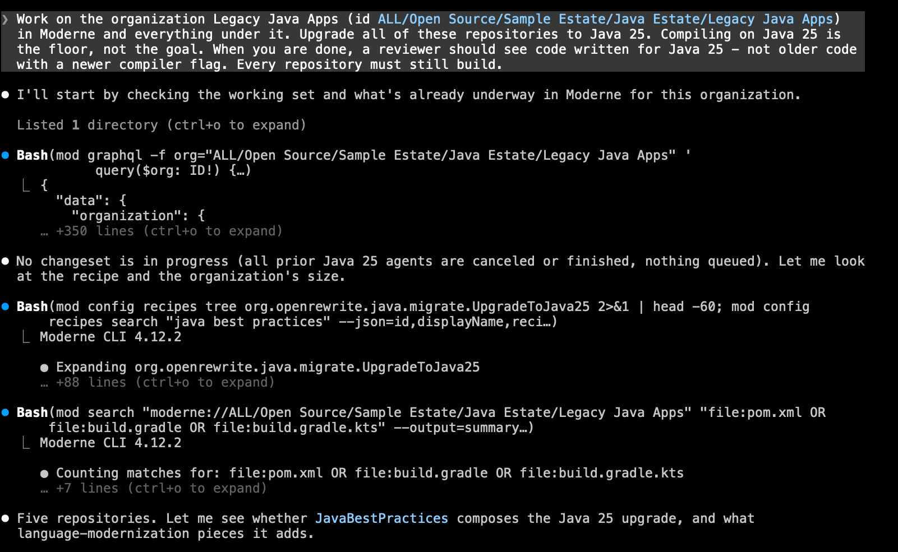
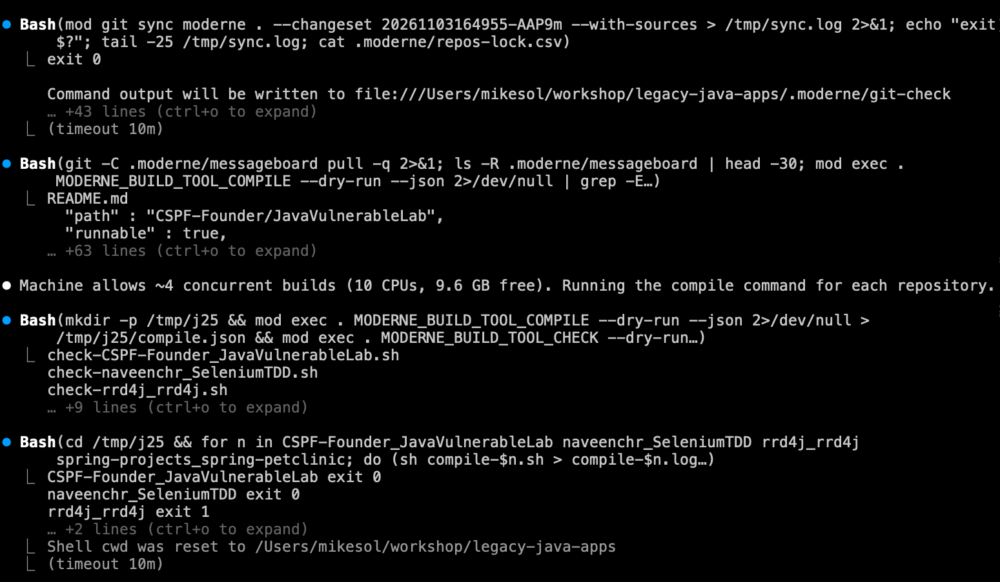
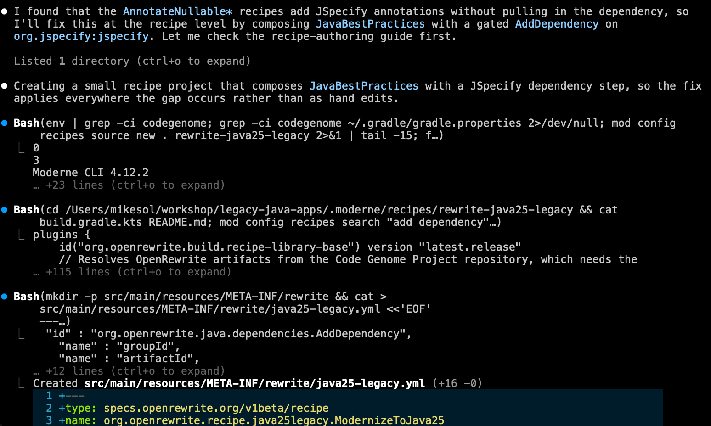
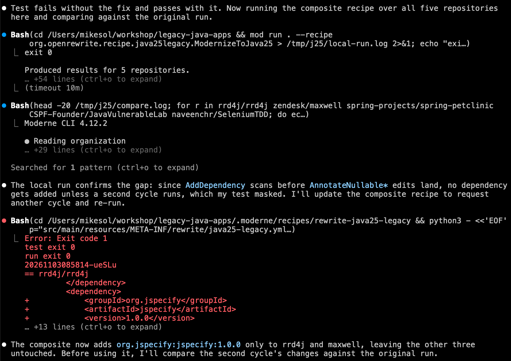
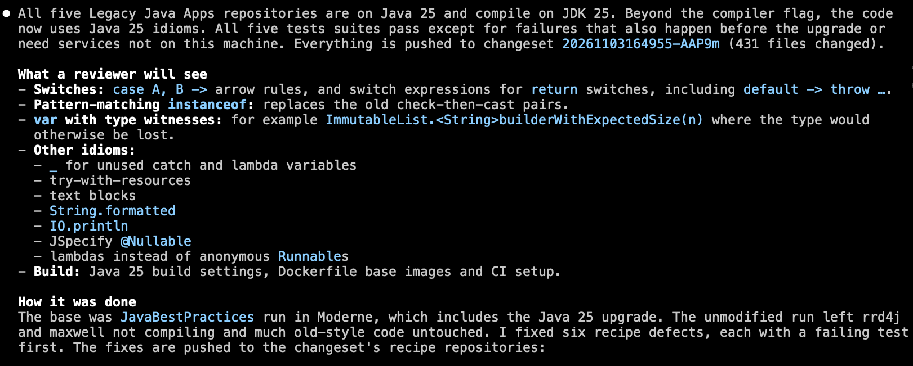
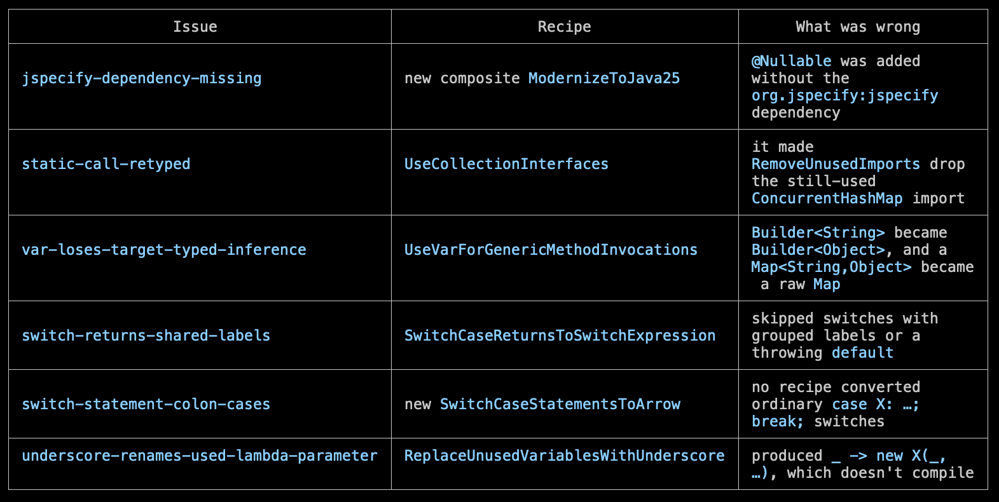
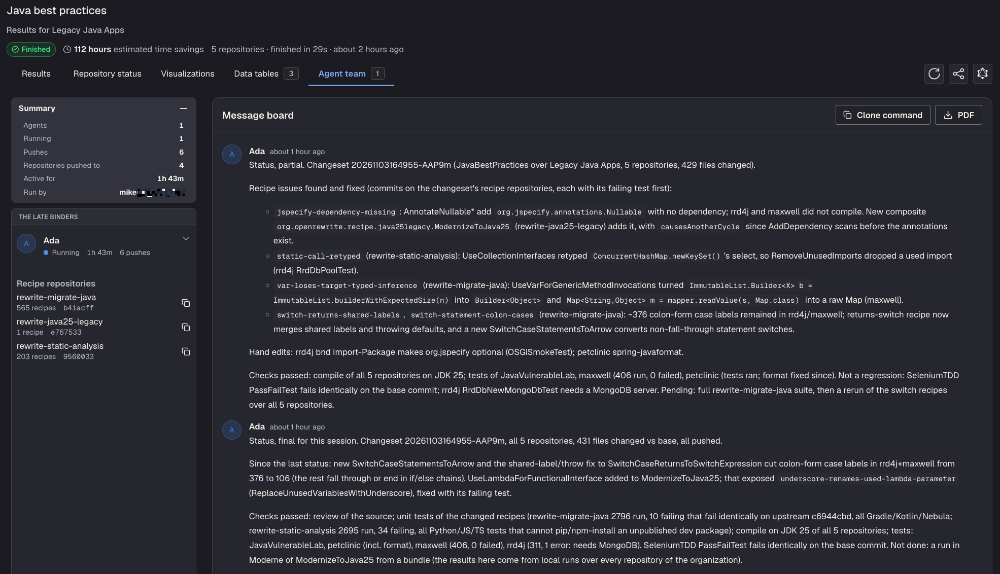

import Tabs from '@theme/Tabs';
import TabItem from '@theme/TabItem';
import ReactPlayer from '@site/src/components/VideoPlayer';

# Quickstart: Modernizing multiple repositories with an agent

Nowadays, when a migration such as Java 17 to 25 is required, many teams reach for an AI agent to handle that. This _can_ work for one repository at a time - but extending that to even tens of repositories can be problematic. AI agents will need to read every repository, make similar edits by hand, and will then return different results for every repository.

This is where Moderne comes into play. AI agents equipped with the Moderne CLI can consistently and quickly modernize every repository you have at once. For that same Java 17 to 25 migration, agents can simply use the [OpenRewrite migrate to Java 25 recipe](https://codegenomeproject.org/recipes/org.openrewrite.java.migrate.UpgradeToJava25) rather than needing to start by searching for everything that's changed in Java 25.

In this guide, we will walk you through this process. We'll start by installing the CLI and connecting it to Moderne before moving on to asking a coding agent to upgrade five sample open source repositories to Java 25. Along the way, you'll see what the agent does with the CLI and what types of results you get back at the end.

:::info
While this quickstart guide uses Claude Code, you are free to use [any of our supported agents](../../agent-tools/agent-chat.md#quick-start). The steps are the same regardless of which agent you pick.
:::

<ReactPlayer className="reactPlayer" url='https://www.youtube.com/watch?v=maZDbrvc3u0' controls="true" />

## Before you begin

You will need to:

* Have the ability to access [app.moderne.io](https://app.moderne.io), so your agent can work on the sample organization.
* [Disable Moderne skills or the local Moderne MCP server](../../agent-tools/agent-chat.md#requirements) if you've enabled those in the past.
* Ensure a supported coding agent is installed on your `PATH` (we'll use [Claude Code](https://code.claude.com/docs/en/overview) in our examples below).
  * Please make sure you have a current version of whatever agent you pick as the agent needs the ability to read an `AGENTS.md` file the CLI writes (for Claude Code, you'll need version `2.1.286` or later).
* Have JDKs 8, 11, 17, and 25 installed, so the agent can test and verify the sample repositories we'll use.
  * The CLI can detect installs from [SDKMAN, Homebrew, and system JDK installs automatically](../how-to-guides/java.md). You can check what the CLI sees by running the `mod config java installation list` command.

## Step 1: Install the CLI and log in

Run the install script for your operating system:

<Tabs groupId="cli-install-os" queryString="os">
<TabItem value="linux-macos" label="Linux / macOS" default>

```bash
curl https://app.moderne.io/cli | bash
```

</TabItem>
<TabItem value="windows" label="Windows">

```powershell
irm https://app.moderne.io/cli/windows | iex
```

:::warning
You must use PowerShell for Windows installation. Git Bash, MSYS2, and Cygwin are not supported.
:::

</TabItem>
</Tabs>

The script installs a small wrapper that downloads the CLI on first use. It makes `mod` available in your terminal, points the CLI to app.moderne.io, and then opens your browser so you can authorize it. Sign in if you aren't already (via GitHub), then click **Yes** when asked whether the CLI can create a personal access token on your behalf.

Once you've confirmed, the CLI stores the token on your machine, where it stays valid for a year, and then syncs the recipe marketplace so the agent can search and run recipes locally. The sync takes a few minutes. You can check everything worked by running `mod --version`.

<details>
<summary>If the browser didn't open</summary>

This may happen if you installed the CLI with Homebrew or Chocolatey instead of via the install script. To configure the CLI and log in manually, run these two steps yourself:

```bash
mod config moderne edit https://app.moderne.io
mod login
```

</details>

## Step 2: Pick an organization

In Moderne, an "organization" is a named group of repositories. Moderne hosts a variety of sample open source organizations that you can use to try recipes out on. For this guide, we'll use the `Legacy Java Apps` organization.

<details>
<summary>Viewing the available organizations</summary>

You can list all organizations via the command:

```bash
mod config moderne organizations show
```

The full tree is long, so you may want to filter it:

```bash
mod config moderne organizations show | grep -A 9 "Sample Estate"
```

`Legacy Java Apps` exists under the `Open Source` -> `Sample Estate` -> `Java Estate` organization:

```bash
  ALL (56608)
    ...
    Open Source (2235)
      ...
      Sample Estate (27)
        Java Estate (8)
          Java Services (4)
          Legacy Java Apps (5)
        JavaScript Estate (8)
          JavaScript Services (5)
          Legacy JavaScript Apps (4)
        Python Estate (11)
          Legacy Python Apps (6)
          Python Services (6)
```

</details>

The `Legacy Java Apps` org is small enough that fully upgrading to Java 25, and verifying that all repositories still build successfully, can finish in about an hour. Each of its five repositories also has something a Java 25 upgrade has to deal with - from a JDK 8 build to an OSGi bundle issue:

| Repository        | Started on           | Tests on JDK 25                                         |
|-------------------|----------------------|---------------------------------------------------------|
| JavaVulnerableLab | Java 7 source, JDK 8 | Pass                                                    |
| SeleniumTDD       | Java 8               | Compiles; the same 4 tests fail as on the original code |
| rrd4j             | Java 11              | 311 run; 1 error, a MongoDB test with no local server   |
| spring-petclinic  | Java 17              | Pass                                                    |
| maxwell           | Java 8 source        | Pass (406 run)                                          |

## Step 3: Start the agent

You're now ready to start the agent. The Moderne CLI includes a command that checks your setup, creates a working directory for the agent, and then starts the agent with a prompt and an organization.

Below you can find example commands for starting the agents:

<Tabs groupId="agent">
<TabItem value="claude-code" label="Claude Code" default>

```bash
mod claude chat legacy-java-apps --org "Legacy Java Apps" \
  --prompt "Upgrade all of these repositories to Java 25. Compiling on Java 25 is the floor, not the goal. When you are done, a reviewer should see code written for Java 25 - not older code with a newer compiler flag. Every repository must still build."
```

</TabItem>
<TabItem value="codex" label="Codex">

```bash
mod codex chat legacy-java-apps --org "Legacy Java Apps" \
  --prompt "Upgrade all of these repositories to Java 25. Compiling on Java 25 is the floor, not the goal. When you are done, a reviewer should see code written for Java 25 - not older code with a newer compiler flag. Every repository must still build."
```

</TabItem>
<TabItem value="copilot-cli" label="Copilot">

```bash
mod copilot chat legacy-java-apps --org "Legacy Java Apps" \
  --prompt "Upgrade all of these repositories to Java 25. Compiling on Java 25 is the floor, not the goal. When you are done, a reviewer should see code written for Java 25 - not older code with a newer compiler flag. Every repository must still build."
```

</TabItem>
<TabItem value="cursor" label="Cursor">

```bash
mod cursor chat legacy-java-apps --org "Legacy Java Apps" \
  --prompt "Upgrade all of these repositories to Java 25. Compiling on Java 25 is the floor, not the goal. When you are done, a reviewer should see code written for Java 25 - not older code with a newer compiler flag. Every repository must still build."
```

</TabItem>
<TabItem value="kiro" label="Kiro">

```bash
mod kiro chat legacy-java-apps --org "Legacy Java Apps" \
  --prompt "Upgrade all of these repositories to Java 25. Compiling on Java 25 is the floor, not the goal. When you are done, a reviewer should see code written for Java 25 - not older code with a newer compiler flag. Every repository must still build."
```

</TabItem>
<TabItem value="amp" label="Amp">

```bash
mod amp chat legacy-java-apps --org "Legacy Java Apps" \
  --prompt "Upgrade all of these repositories to Java 25. Compiling on Java 25 is the floor, not the goal. When you are done, a reviewer should see code written for Java 25 - not older code with a newer compiler flag. Every repository must still build."
```

</TabItem>
<TabItem value="opencode" label="OpenCode">

```bash
mod opencode chat legacy-java-apps --org "Legacy Java Apps" \
  --prompt "Upgrade all of these repositories to Java 25. Compiling on Java 25 is the floor, not the goal. When you are done, a reviewer should see code written for Java 25 - not older code with a newer compiler flag. Every repository must still build."
```

</TabItem>
<TabItem value="vscode" label="VS Code">

```bash
mod vscode chat legacy-java-apps --org "Legacy Java Apps" \
  --prompt "Upgrade all of these repositories to Java 25. Compiling on Java 25 is the floor, not the goal. When you are done, a reviewer should see code written for Java 25 - not older code with a newer compiler flag. Every repository must still build."
```

</TabItem>
<TabItem value="windsurf" label="Windsurf">

```bash
mod windsurf chat legacy-java-apps --org "Legacy Java Apps"
```

Windsurf does not take `--prompt`. Once the IDE opens, paste this prompt into the chat panel:

```text
Upgrade all of these repositories to Java 25. Compiling on Java 25 is the floor, not the goal. When you are done, a reviewer should see code written for Java 25 - not older code with a newer compiler flag. Every repository must still build.
```

</TabItem>
</Tabs>

Let's break the command down:

* `legacy-java-apps` is the agent's working directory. It starts out empty. The agent clones repositories into it only when it needs to build, test, or hand-edit them. You can name this anything you want and put it anywhere on your local machine.
* `--org "Legacy Java Apps"` tells the CLI which organization the agent works on. The agent searches it and runs recipes on it in the Moderne Platform, where the LSTs already are.
* `--prompt ...` is what is fed to the agent so that it knows what to work on.

:::tip
Small changes to the prompt can produce very different results. For instance, if you said, "Upgrade all of these repositories to Java 25" instead of the prompt given above - the agent may just run the upgrade recipe and then fix things that failed to compile. For code that touched an API that Java 25 removed, this may result in an old dependency being added back in so the code would still compile.

By providing a more detailed prompt such as the one above, the agent will, instead, rewrite the code to use a more modern JDK replacement before moving on to modernize the rest.
:::

When you run the command, the CLI first checks that the session can work:

```bash
● Checking that the session can work

  ℹ  CLI               4.12.2
  ℹ  Claude Code       2.1.314
  ℹ  JDKs              25, 21, 17, 11, 8
  ℹ  Tenant            https://app.moderne.io (API https://api.app.moderne.io)
  ✔  Token             accepted by https://api.app.moderne.io (must be accepted)
  ✔  Disk (workspace)  624.1 GiB free (should be at least 10.0 GiB)
  ✔  Memory free       10.2 GiB (should be at least 8.0 GiB)

● Starting Claude Code
```

It then creates the `legacy-java-apps` directory, links an `AGENTS.md` file into it, and starts the agent there. That file is the agent's guide to Moderne. It tells the agent how to run recipes on an organization, bring the changed repositories down, build them, and push the work back. Every supported agent reads it at startup, so the agent knows how to use `mod` right away.

The agent starts with your prompt already submitted. Agent chat approves all of the agent's tool use up front - so it builds, edits, and pushes without asking you first.

Some agents may add additional checks of their own on top of that. Claude Code, for instance, will ask whether you trust the folder and whether you accept bypassing permissions.

If you would rather not be at the terminal at all, add the `--unattended` flag to the command above (see [agent chat options](../../agent-tools/agent-chat.md#options)).

## Step 4: Watch the agent work

Regardless of which agent you use, the work tends to follow the same path. The agent begins by examining the organization in the Moderne Platform and then runs recipes against it. Afterwards, the agent will clone the changed repositories to your machine, verify that each one builds, and then fix what the recipe got wrong or missed. If it can produce a recipe to ensure consistent results, it will.

Below is how that played out with Claude Code 2.1.314 and Moderne CLI 4.12.2 on November 3, 2026.

:::note
The exact steps vary from one session to the next, because the agent decides for itself what to do and when. If your agent asks a different question or picks a different recipe, that's expected.
:::

### Reaching for Moderne, not files

Rather than starting by opening files or cloning repositories, the agent began by asking Moderne what was already underway in that organization. It then looked at what the Java 25 recipe would change, and checked which build tools the five repositories used:

```bash
mod graphql -f org="ALL/Open Source/Sample Estate/Java Estate/Legacy Java Apps" '...changesets(first: 20)...'
mod config recipes tree org.openrewrite.java.migrate.UpgradeToJava25
mod search "moderne://ALL/Open Source/Sample Estate/Java Estate/Legacy Java Apps" "file:pom.xml OR file:build.gradle OR file:build.gradle.kts" --output=summary
```

<figure style={{maxWidth: '800px', margin: '0 auto'}}>
  
  <figcaption>_The agent reached for Moderne before it reached for any files. Nothing was cloned until it had a changeset to work on._</figcaption>
</figure>

It compared two candidates. `UpgradeToJava25` updates the build files and replaces APIs that Java 25 removed. `JavaBestPractices` includes that upgrade and also modernizes the code itself: `var`, text blocks, pattern matching, switch expressions. As the prompt asked for code written for Java 25, not just code that compiles on it, the agent picked `JavaBestPractices` and ran it across the whole organization in Moderne:

```bash
mod run "moderne://ALL/Open Source/Sample Estate/Java Estate/Legacy Java Apps" \
  --recipe org.openrewrite.java.migrate.JavaBestPractices
```

The run took under a minute across all five repositories because it ran against the LSTs Moderne already had. The run was saved as a [changeset](../../moderne-platform/references/changesets.md), which is what the agent synced to continue the work locally.

### Bringing the changeset to your machine

Once the recipe run was done in Moderne, the next step was to build and test the repositories. The agent can sync only the repositories it cares about by grabbing the changeset that was produced by the recipe run:

```bash
mod git sync moderne . --changeset 20261103164955-AAP9m --with-sources
```

That clones the five repositories into `legacy-java-apps`, downloads their LSTs, and checks each one out to a branch for the changeset. The recipe's changes are the first commit on that branch, so the agent reads what the recipe did with plain `git` commands.

The agent then asked the CLI for each repository's compile command and ran them, four at a time to suit the machine:

```bash
mod exec . MODERNE_BUILD_TOOL_COMPILE --dry-run --json
```

Three of the five compiled. rrd4j and maxwell did not.

<figure style={{maxWidth: '800px', margin: '0 auto'}}>
  
  <figcaption>_The agent syncs the changeset, asks the CLI for each repository's compile command, and finds the first failure._</figcaption>
</figure>

### Fixing the recipe instead of the files

Both compile failures had the same cause. The recipe had added JSpecify `@Nullable` annotations without adding the `org.jspecify:jspecify` dependency that declares them. While the agent could have quickly fixed the two `pom.xml` files, it decided to create a recipe so that the dependency is added wherever the upgrade runs:

<figure style={{maxWidth: '800px', margin: '0 auto'}}>
  
  <figcaption>_Rather than edit two build files by hand, the agent fixes the recipe._</figcaption>
</figure>

First it wrote a test that reproduces the missing dependency. Once that test passed, it ran the composite recipe over the working set and compared the result with the original run:

```bash
mod run . --recipe org.openrewrite.recipe.java25legacy.ModernizeToJava25
mod git compare . --last-recipe-run
```

<figure style={{maxWidth: '800px', margin: '0 auto'}}>
  
  <figcaption>_The agent proves the fix with a test, runs the composite recipe locally, and compares the result with the original run._</figcaption>
</figure>

The same pattern repeated for everything else the recipe got wrong. Over the session, the agent found and fixed five more recipe defects:

* `UseCollectionInterfaces` retyped static calls such as `ConcurrentHashMap.newKeySet()`, which made `RemoveUnusedImports` drop an import that was still used. The agent found this by bisecting the recipe list.
* `UseVarForGenericMethodInvocations` lost target-typed inference, turning a `Builder<String>` into `Builder<Object>` and a `Map<String, Object>` into a raw `Map`.
* `SwitchCaseReturnsToSwitchExpression` skipped switches with grouped labels or a throwing `default`.
* No recipe converted ordinary `case X: ...; break;` switches to arrow form. The agent wrote one, `SwitchCaseStatementsToArrow`, and added it to the Java 21 migration.
* `ReplaceUnusedVariablesWithUnderscore` renamed a lambda parameter that was still used, which does not compile.

Only two changes were made by hand. The JSpecify package import in rrd4j's OSGi bundle config became optional, and petclinic's own `spring-javaformat` was applied to the files the recipes had reformatted. The agent recorded both in the changeset's data tables, so a reviewer can tell recipe changes from hand edits.

### Verifying with each repository's own build

Once everything compiled, the agent asked the CLI for each repository's test command and then ran them:

```bash
mod exec . MODERNE_BUILD_TOOL_CHECK --dry-run --json
```

rrd4j and SeleniumTDD had failures, so the agent ran the same tests on each one's original commit and found they failed there too.

## Step 5: Review the result

After an hour, the agent reported this:

<figure style={{maxWidth: '800px', margin: '0 auto'}}>
  
  <figcaption>_The opening of the agent's closing report._</figcaption>
</figure>

<figure style={{maxWidth: '800px', margin: '0 auto'}}>
  
  <figcaption>_The six recipe defects the agent fixed, each with a failing test first._</figcaption>
</figure>

Every repository built on Java 25 at least as well as it did before the upgrade. As the prompt requested, the changes went beyond updating the Java version in the build files.

## Step 6: Push to the changeset and create pull requests

The agent commits its changes in each repository and pushes them to the changeset as soon as that repository builds.

Each push lands on the changeset as a new revision. The agent also records what it did there, as data tables and as status posts on the changeset's message board. You can read both under the **Agent team** tab on the changeset's page in the Platform:

<figure style={{maxWidth: '800px', margin: '0 auto'}}>
  
  <figcaption>_The changeset's Agent team tab: the session, its pushes, the recipe repositories it fixed, and its status posts._</figcaption>
</figure>

Nothing reaches your SCM until you commit the changeset. When you're ready, find the changeset in the Platform's [activity view](../../moderne-platform/getting-started/activity-view.md). From there, you can look through each repository's diff and, once you're happy with it, commit the changes or open pull requests.

:::note
When you close the agent session, the CLI closes the session in Moderne and records a [telemetry row](../how-to-guides/cli-telemetry.md#agent-session-telemetry) with the prompt, the agent version, and the token counts - so you can compare sessions and agents over time.
:::

## Where to go from here

* Try another prompt on the same changeset. The agent remembers nothing between sessions, but the synced repositories and LSTs stay on disk - so `mod claude chat legacy-java-apps --prompt "..."` with no `--org` starts a new session on the same changeset in seconds.
* Point the agent at a different language. `JavaScript Estate` and `Python Estate` work the same way with prompts suited to them. The full `Sample Estate` lets you watch the agent work out which repositories a request applies to.
* Run it on your own code. [Agent chat](../../agent-tools/agent-chat.md) covers using an organization from your company's Moderne tenant, or a `repos.csv` when your repositories are not in Moderne at all.
* Learn what the agent was doing. "[Using the Moderne CLI](./cli-intro.md)" walks through every command the agent used, from syncing an organization to opening pull requests with `mod git`.
