# Using the activity view

As you run recipes, commit code, and examine visualizations, you might find it beneficial to get a higher level picture of what's happened in a specific organization. Did you commit that one recipe run? Has someone else already run a visualization you wanted? What has the agent you started last week been up to since? All of these can be answered with the Moderne activity view.

In this guide, we'll help you navigate to the activity view, and we'll make sure you understand each part of the page.

## Accessing the activity view

From the left-hand navigation bar, click on `Activity`:

<figure>
  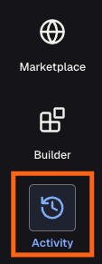
  <figcaption></figcaption>
</figure>

That will take you to the activity view for the **organization you have selected**.

<figure>
  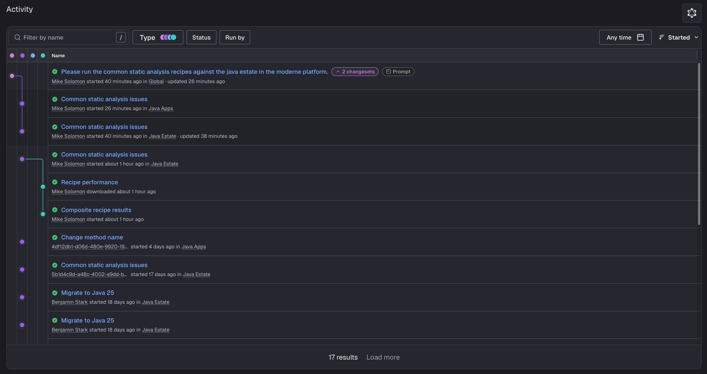
  <figcaption></figcaption>
</figure>

:::info
If your organizations are hierarchical (meaning that one organization contains 1 or more sub-organizations), you will see all of the repositories in both the selected organization and its sub-organizations.
:::

## Types of activity

Each row on this page represents one activity. An activity can be one of four things: a project, a changeset, a commit, or a visualization/data table.

The colored dot on the left tells you which type that row is. Lines between the dots connect related rows - such as a recipe run and the commit job that came from it.

Below, we'll go into more detail about each type of activity.

### Project

<figure>
  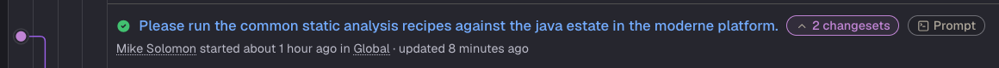
  <figcaption></figcaption>
</figure>

A project groups everything a single AI agent did. The row shows a changeset button and, if it came from an agent chat, a **Prompt** button.

If you click on the changeset button, the changesets will expand or collapse. If you click on the **Prompt** button, a popover will appear that shows you the agent tool and prompt that created this project.

<figure style={{maxWidth: '480px', margin: '0 auto'}}>
  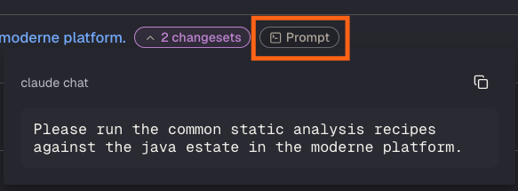
  <figcaption></figcaption>
</figure>

When you start an [agent chat](../../agent-tools/agent-chat.md), the agent may run recipes, save searches, and produce data tables across several organizations. Each of those gets its own activity row tied back to the project row.

### Changeset

A [changeset](../references/changesets.md) is a set of changes or search results across the repositories in an organization.

Changesets are created by running a recipe, by [saving a search](./code-search.md#saving-and-exporting-a-search), or by an agent or `mod exec` pushing changes made without a recipe.

You can click on the changeset's name to see the results for each repository.

### Commit job

When you commit a changeset or open pull requests from it, Moderne creates a commit job. Click the commit job's name to [track the commits and pull requests](../how-to-guides/track-commits.md) it created.

<figure style={{maxWidth: '560px', margin: '0 auto'}}>
  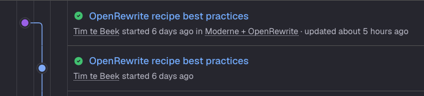
  <figcaption></figcaption>
</figure>

### Data table and visualization

Whenever you generate a data table or a visualization for a particular recipe run, a new row will be created underneath the recipe run.

Anyone who clicks on one of these rows will be able to immediately view or download the visualization/data table since it won't need to be generated again.

<figure style={{maxWidth: '640px', margin: '0 auto'}}>
  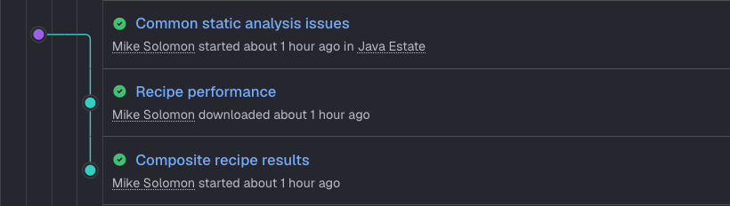
  <figcaption></figcaption>
</figure>

## Filtering

You can filter by name, type, status, run by, or the time the activity was run.

<figure style={{maxWidth: '430px', margin: '0 auto'}}>
  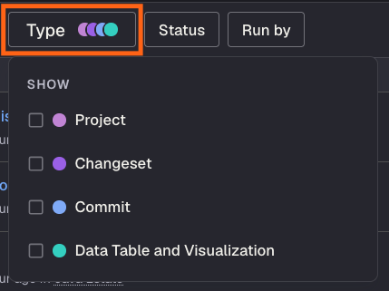
  <figcaption></figcaption>
</figure>

<figure style={{maxWidth: '430px', margin: '0 auto'}}>
  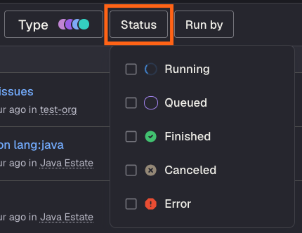
  <figcaption></figcaption>
</figure>

<figure style={{maxWidth: '300px', margin: '0 auto'}}>
  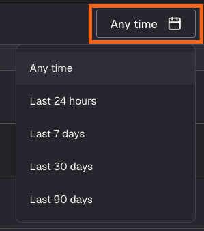
  <figcaption></figcaption>
</figure>

## Sorting

By default, the activity view is sorted by start time. You can click on **Started** in the top-right corner to change it to be sorted by last updated time instead:

<figure style={{maxWidth: '300px', margin: '0 auto'}}>
  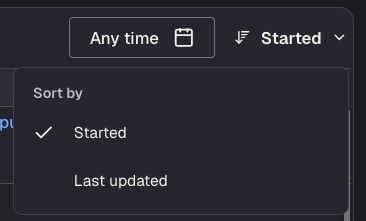
  <figcaption></figcaption>
</figure>

One key benefit of using **Last updated** is that you'll be able to more easily find long-running agent sessions that are still producing changesets.

## Slow lane indicator

Recipe runs are queued and sorted into fast and slow lanes. Runs against an organization with more than 100 repositories go into the slow lane so that smaller runs aren't stuck behind them.

When a run goes into the slow lane queue, a turtle icon will appear next to its name:

<figure style={{maxWidth: '480px', margin: '0 auto'}}>
  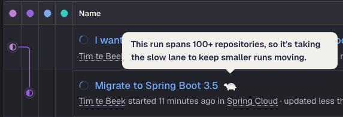
  <figcaption>_A slow lane run, with the tooltip explaining why it's queued behind smaller runs._</figcaption>
</figure>
