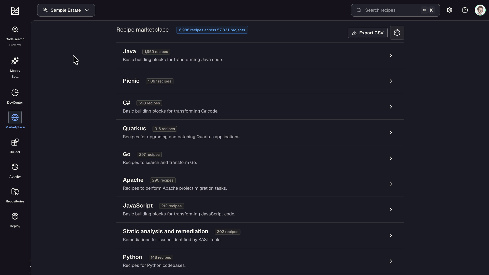
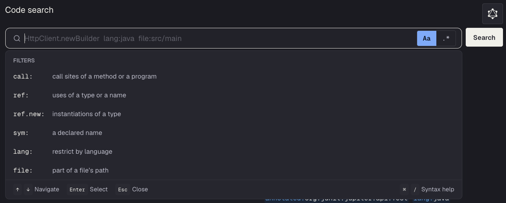
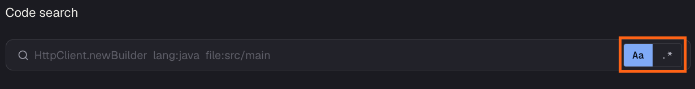
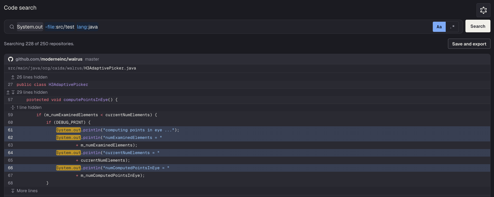
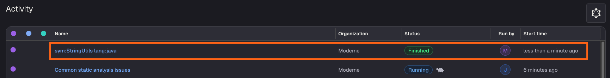

# Getting started with code search

Imagine you want to find every place your company calls `StringUtils.isEmpty`. If you searched for it on GitHub, you'd end up finding results from packages like Apache Commons, Spring, and probably a few others all mixed together.

This is where Moderne's code search comes into play. Since it's powered by [Moderne Trigrep](../../agent-tools/trigrep.md) and the index it searches is built from your LSTs rather than raw text, it lets you perform **type-aware** searches. That means it can tell whether `isEmpty` is coming from Spring or some other library you don't care about.

This doc will walk you through everything you need to know to get started with code search in the Moderne Platform.

## Before you begin

* If the left nav bar does not have a **Code search** icon, ask your Moderne admin to enable it.
* You will need to select an organization to run code search against - the Global org will not work.
* Code search can only search across repositories whose LST includes a search index.
  * Moderne CLI 4.10.0 and later write that index as part of the `mod build` command. If the search page reports that some repositories were skipped, rebuild their LSTs with a current CLI and republish them.

## Running a search

Click on **Code search** in the left nav bar. You'll be taken to a page with a search box and a set of example queries that you can click on to try.

<figure>
  
  <figcaption></figcaption>
</figure>

We'd recommend starting by selecting the language you're interested in and reviewing the examples. If none of those meet your needs, click on the search box and begin typing what you want to search for (we'll cover [query formatting](#writing-queries) later on). The search box will suggest filters you can use:

<figure>
  
  <figcaption></figcaption>
</figure>

Keep in mind that you can configure how you want the search to handle capitalization and regular expressions. On the right side of the search box:

* **Aa** matches the exact case of the search and is on by default. If you want to ignore case, click on it to turn it off.
* **.\*** reads unquoted terms as regular expressions instead of literal text.

<figure>
  
  <figcaption></figcaption>
</figure>

## Reviewing results

Results are grouped by repository and file, with each match highlighted. You can click on a repository, file, or line number to open it in your source control system.

<figure>
  
  <figcaption></figcaption>
</figure>

Above the results, you can see how many repositories were searched. For instance, in the above image, we can see that 228 of the 250 repositories were searched. The repositories that were left out are ones without an indexed LST.

:::note
Each page of search results is capped at ten seconds. If the search runs out of time before the page fills up, you'll see a **Keep searching** button that will pick up where it left off.
:::

:::info
A search only covers repositories you have permission to read. An empty result can mean no access as well as no match.
:::

## Writing queries

The example queries on the search page are the best place to learn the syntax. We'd recommend clicking on one and tweaking it rather than starting from scratch.

Some tips to keep in mind when writing or modifying search queries:

* **You don't have to spell out the full package name.** If you only know the class, that's fine:
  * `call:List.add` finds `List.add` in any package.
  * `call:requests..get` finds the Python `get` function however it's imported.
* **Versions don't have to be exact.**
  * `dependency:junit:junit:4.x` matches any 4.x release.
  * `dependency:jackson-databind:^2.15` and `~2.15.1` style ranges work as well.
  * Maven ranges need quotes: `dependency:"log4j-core:[2.0,2.17.1)"`.
  * npm packages use an `@` instead: `dependency:lodash@4.x`.
* **You can mix `dependency:` with the other filters.**
  * For example, `dependency:guava:29.x call:*..ImmutableList.of` finds every call to `ImmutableList.of` - but only where it came from Guava 29.
* **The [Trigrep query reference](../../agent-tools/trigrep.md#query-reference) has documentation for additional filters.**

:::warning
You can only use one `call:`, `ref:`, or `sym:` filter per query. If you want to find files that match two of them, search for each with `select:file` and compare the results - or [join the two searches in SQL](../../agent-tools/mcp/remote-server.md#codesearchsql).
:::

## Saving and exporting a search

By default, searches are ephemeral. Once you navigate away from the code search page, the search results disappear. This is fine if your goal is to explore - but what if you found results (e.g., every call to a deprecated API) that you want to share with other people? That's where the **Save and export** button comes in.

When you click it, Moderne will run your search on every repository in the organization and save the results to a data table (`org.openrewrite.table.SearchResults`). Once the search is finished, this data table will automatically be downloaded to your machine.

Your saved search will also show up in the [activity view](./activity-view.md) alongside recipe runs:

<figure>
  
  <figcaption></figcaption>
</figure>

If you click on it, you'll be taken to a results page where you can see which repositories matched and download the data table again.

Behind the scenes, a saved search is a _changeset_. That means an agent, or anyone using the CLI, can [pull down exactly the repositories that matched](../../moderne-cli/cli-reference.md#mod-git-sync-moderne) and get to work on them.

## Searching from the CLI

If you have the Moderne CLI set up and connected to the Moderne Platform, you can search an organization from your terminal. The search runs against the Platform's index, so nothing gets synced to your machine:

```bash
mod search "moderne://Sample Estate" "dependency:junit:junit:4.x"
```

If you want to save the search so that other people can see it, add the `--save` flag to the end of the command. It'll show up in the activity view just like a search saved from the UI. Check out the [CLI reference](../../moderne-cli/cli-reference.md#mod-search) for the full set of options for this command.

## Code search for agents

Agents can also take advantage of Moderne's code search via our [remote MCP server](../../agent-tools/mcp/remote-server.md). The MCP server has access to the LST search index, scoped to whatever organizations and repositories your token can read. If the agent needs to count search results or get a breakdown by repository rather than a list of matches, it can use our [SQL tool](../../agent-tools/mcp/remote-server.md#codesearchsql).

## When to use a recipe instead

In some situations, you'll find that search won't be able to answer your questions. For example, a search can't tell two overloads of the same method apart or follow a value from one line to another. In situations like those, you'll want to run a recipe instead.

For more details about what search can or can't do, check out our [Trigrep documentation](../../agent-tools/trigrep.md#limitations-and-when-to-use-recipes).
