import ReactPlayer from '@site/src/components/VideoPlayer';

# Proof of value recipe reference

The [proof of value scenarios](./proof-of-value.md) leave the choice of recipe to the agent. This page is the catalog it chooses from, ordered from simple to complex, for when you want to run a recipe yourself or point the agent at one by name. Each heading links to the recipe's page in the [recipe catalog](https://codegenomeproject.org/recipes), where you can review what it does.

Every command below runs the recipe over a working set you have synced and built on your machine. Replace `.` with `moderne://<organization>` to run the same recipe over an organization in Moderne instead, with nothing cloned.

## Installing the recipe modules

You will need the modules the recipes below come from. This single command installs every one of them:

```bash
mod config recipes jar install org.openrewrite.recipe:rewrite-all:LATEST org.openrewrite.recipe:rewrite-static-analysis:LATEST org.openrewrite.recipe:rewrite-java-security:LATEST org.openrewrite.recipe:rewrite-java-dependencies:LATEST org.openrewrite.recipe:rewrite-sql:LATEST org.openrewrite.recipe:rewrite-spring:LATEST org.openrewrite.recipe:rewrite-logging-frameworks:LATEST org.openrewrite.recipe:rewrite-testing-frameworks:LATEST org.openrewrite.recipe:rewrite-migrate-java:LATEST io.moderne.recipe:rewrite-cryptography:LATEST io.moderne.recipe:rewrite-spring:LATEST io.moderne.recipe:rewrite-prethink:LATEST io.moderne.recipe:rewrite-devcenter:LATEST
```

:::note
This installs only the modules the recipes on this page need. To install every available recipe module instead, copy and run the [Moderne CLI command under CLI installation](../../recipes/lists/latest-versions-of-every-openrewrite-module.md#cli-installation).
:::

## Code quality recipes

### [Common static analysis issues](https://codegenomeproject.org/recipes/org.openrewrite.staticanalysis.CommonStaticAnalysis)

> Resolves common static analysis issues (SAST issues) to improve code quality, fix mistakes, eliminate legacy patterns, and resolve performance issues.

#### CLI commands

```bash
mod run . --recipe org.openrewrite.staticanalysis.CommonStaticAnalysis
mod study . --last-recipe-run --data-table SourcesFileResults
```

#### Recipe results

<figure style={{maxWidth: '700px', margin: '0 auto'}}>
  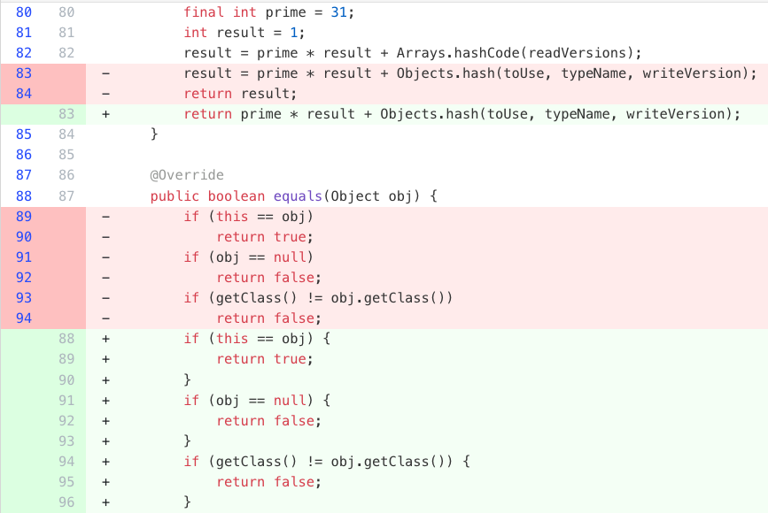
  <figcaption>_Static analysis fixes_</figcaption>
</figure>

## Code search and impact analysis

Many developers use Moderne every day for code search. Need to plan a refactor? Want to understand how an API is used? Trying to assess security concerns? All of these questions can be answered by running search recipes across your repositories.

This is possible because Moderne treats your code like a data warehouse. Our type-aware search capabilities go far beyond simple text searches. They understand your code's structure, inheritance hierarchies, and semantic relationships. It's effectively like running a database query across your entire codebase.

One of the most powerful applications of search is **impact analysis** – understanding what will be affected before you make changes. The search recipes below help you assess the scope and impact of potential transformations, giving you confidence before running large-scale refactors or migrations.

To learn more about impact analysis and how to automate it, check out this video:

<ReactPlayer className="reactPlayer" url='https://youtu.be/jMxSWB5jJ5M?t=306' controls="true" />

### [Language composition report](https://codegenomeproject.org/recipes/org.openrewrite.LanguageComposition)

> Counts the lines of source code and data formats parsed across your repositories, broken down per repository, per folder, and per file. It makes no changes to your code, making it the fastest way to judge up front what kinds of projects you're dealing with — which languages and frameworks are present, and at what scale — before planning any deeper work.

#### CLI commands

```bash
mod run . --recipe org.openrewrite.LanguageComposition

mod study . --last-recipe-run --data-table LanguageCompositionPerRepository
```

#### Recipe results

<figure style={{maxWidth: '700px', margin: '0 auto'}}>
  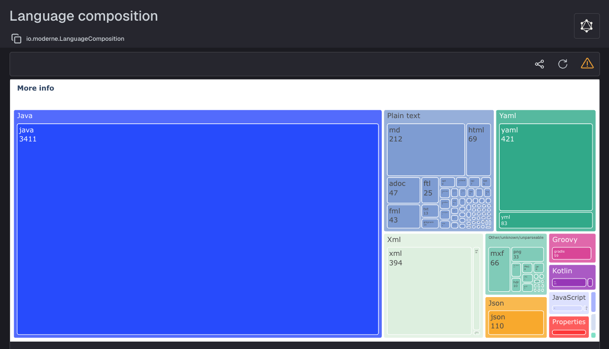
  <figcaption>_Understanding the language composition of your repositories_</figcaption>
</figure>

### [Find types](https://codegenomeproject.org/recipes/org.openrewrite.java.search.FindTypes)

> Identifies classes, interfaces, or enums matching a type pattern. Crucial for understanding class usage and inheritance hierarchies before performing refactoring or migrations.

:::tip
If you don't remember the exact type, try replacing parts of the expression with `*` as a wildcard and go from there.
:::

#### CLI commands

```bash
# Example: Find all uses of Apache Commons StringUtils across your codebase
mod run . --recipe org.openrewrite.java.search.FindTypes \
    -P "fullyQualifiedTypeName=org.apache.commons.lang3.StringUtils" \
    -P "checkAssignability=true"

mod study . --last-recipe-run --data-table SourcesFileResults
```

#### Recipe results

<figure style={{maxWidth: '700px', margin: '0 auto'}}>
  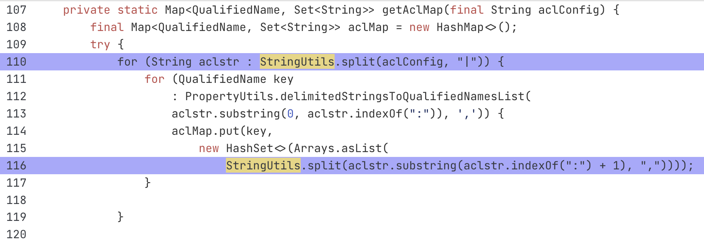
  <figcaption>_Discovering type usage patterns across repositories_</figcaption>
</figure>

### [Find methods](https://codegenomeproject.org/recipes/org.openrewrite.java.search.FindMethods)

> Locates method invocations matching a method pattern, even when methods are imported in different ways or invoked on subclasses. Essential for understanding API usage before refactoring.

:::tip
Unsure how to accurately identify methods? Check out our [documentation on method patterns](https://docs.openrewrite.org/reference/method-patterns#anatomy-of-a-method-pattern).
:::

#### CLI commands

```bash
# Example: Find all uses of methods in org.apache.commons
mod run . --recipe org.openrewrite.java.search.FindMethods \
    -P "methodPattern=org.apache.commons..*#*(..)" \
    -P "matchOverrides=true"

mod study . --last-recipe-run --data-table SourcesFileResults
```

#### Recipe results

<figure style={{maxWidth: '700px', margin: '0 auto'}}>
  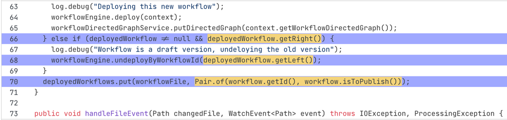
  <figcaption>_Finding method usage across repositories_</figcaption>
</figure>

### [Find sensitive API endpoints](https://codegenomeproject.org/recipes/org.openrewrite.java.security.search.FindSensitiveApiEndpoints)

> Discovers REST API endpoints that handle sensitive data. Essential for security audits, understanding data exposure, and planning privacy improvements.

#### CLI commands

```bash
# Find endpoints handling personal data fields like names and emails
mod run . --recipe org.openrewrite.java.security.search.FindSensitiveApiEndpoints \
    -P "fieldNames=firstName,lastName,email,emailAddress" \
    -P "transitive=true"

mod study . --last-recipe-run --data-table SourcesFileResults
```

#### Recipe results

<figure style={{maxWidth: '700px', margin: '0 auto'}}>
  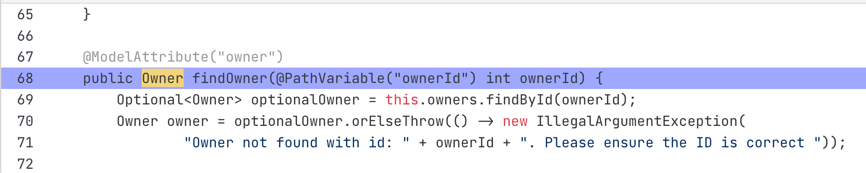
  <figcaption>_Identifying sensitive API endpoints for security review_</figcaption>
</figure>

<figure style={{maxWidth: '700px', margin: '0 auto'}}>
  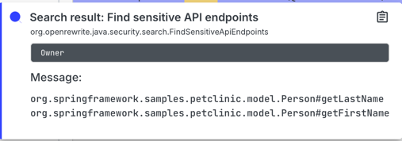
  <figcaption>_Sensitive values can be found on super classes of types used in API endpoints_</figcaption>
</figure>

### [Find SQL statements](https://codegenomeproject.org/recipes/org.openrewrite.sql.FindSql)

> Identifies SQL statements in your codebase, including those constructed through string concatenation. Useful for understanding database dependencies, finding potential SQL injection vulnerabilities, and planning schema changes.

#### CLI commands

```bash
# Find all SQL statements, particularly useful for identifying dynamic SQL construction
mod run . --recipe org.openrewrite.sql.FindSql

mod study . --last-recipe-run --data-table DatabaseColumnsUsed
```

#### Recipe results

<figure style={{maxWidth: '700px', margin: '0 auto'}}>
  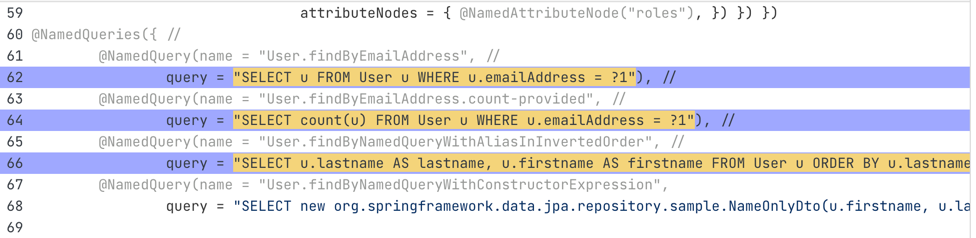
  <figcaption>_Discovering SQL statements across the codebase_</figcaption>
</figure>

### [Find call graph](https://codegenomeproject.org/recipes/org.openrewrite.FindCallGraph)

> Produces a data table where each row represents a method call.

#### CLI commands

```bash
# Generates a data table where each row represents a method call.
mod run . --recipe org.openrewrite.FindCallGraph

mod study . --last-recipe-run --data-table CallGraph
```

#### Recipe results

<figure style={{maxWidth: '700px', margin: '0 auto'}}>
  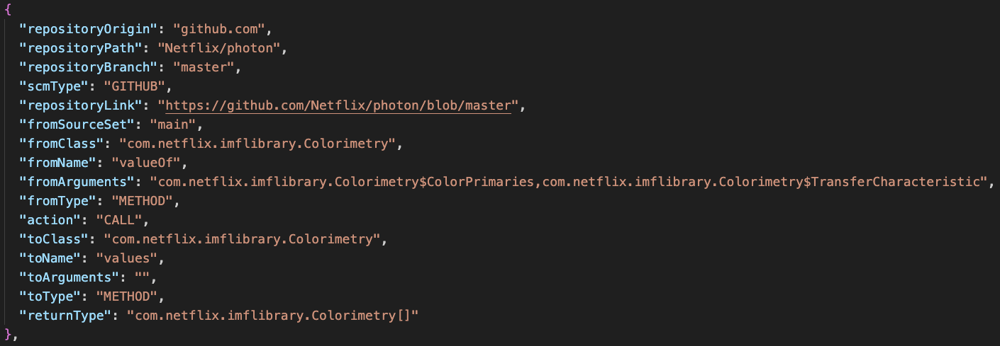
  <figcaption>_Example call graph._</figcaption>
</figure>

### [Find Spring API endpoints](https://codegenomeproject.org/recipes/org.openrewrite.java.spring.search.FindApiEndpoints)

> Find all HTTP API endpoints exposed by Spring applications. More specifically, this marks method declarations annotated with `@RequestMapping`, `@GetMapping`, `@PostMapping`, `@PutMapping`, `@DeleteMapping`, and `@PatchMapping` as search results.

#### CLI commands

```bash
# Finds all HTTP API endpoints exposed by Spring applications.
mod run . --recipe org.openrewrite.java.spring.search.FindApiEndpoints

mod study . --last-recipe-run --data-table ApiEndpoints
```

#### Recipe results

<figure style={{maxWidth: '700px', margin: '0 auto'}}>
  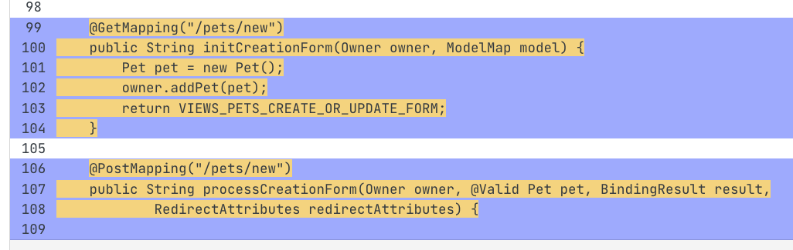
  <figcaption>_Finding Spring API endpoints._</figcaption>
</figure>

### [Software bill of materials](https://codegenomeproject.org/recipes/org.openrewrite.java.dependencies.SoftwareBillOfMaterials)

> Produces a software bill of materials (SBOM) for a project. An SBOM is a complete list of all dependencies used in a project, including transitive dependencies. The produced SBOM is in the CycloneDX XML format. Supports Gradle and Maven. Places a file named `sbom.xml` adjacent to the Gradle or Maven build file.

#### CLI commands

```bash
# Produces a SBOM for the project
mod run . --recipe org.openrewrite.java.dependencies.SoftwareBillOfMaterials

mod study . --last-recipe-run --data-table SourcesFileResults
```

#### Recipe results

<figure style={{maxWidth: '700px', margin: '0 auto'}}>
  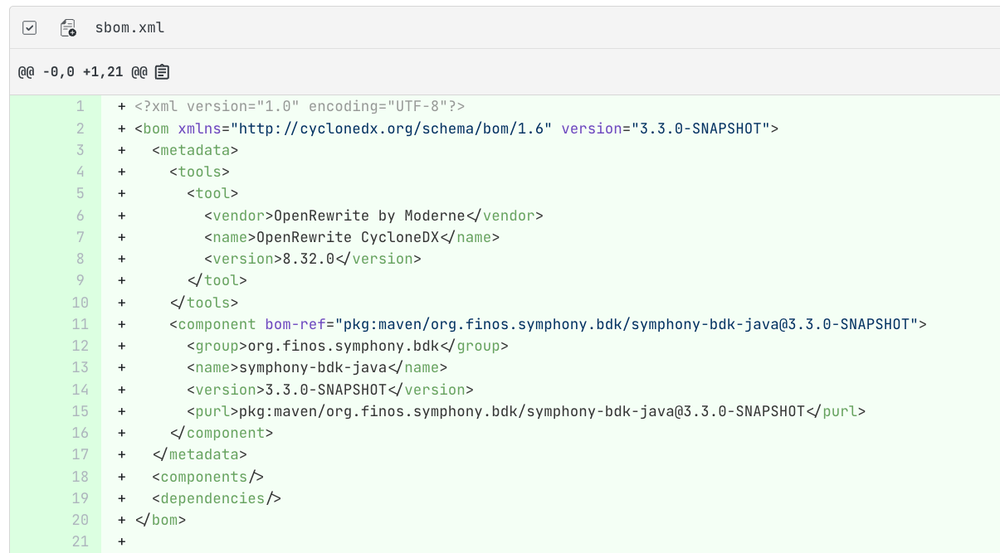
  <figcaption>_Example of a SBOM file created from the recipe._</figcaption>
</figure>

### [Post quantum cryptography](https://codegenomeproject.org/recipes/io.moderne.cryptography.PostQuantumCryptography)

> This recipe searches for instances in code that may be impacted by post quantum cryptography. Applications may need to support larger key sizes, different algorithms, or use crypto agility to handle the migration. The recipe includes detection of hardcoded values that affect behavior in a post-quantum world, programmatic configuration that may prevent algorithm changes, and general cryptographic usage patterns that should be reviewed.

#### CLI commands

```bash
# Searches for code that may be impacted by post quantum cryptography.
mod run . --recipe io.moderne.cryptography.PostQuantumCryptography

mod study . --last-recipe-run --data-table SecurityIssues
mod study . --last-recipe-run --data-table TaintFlowTable
```

#### Recipe results

<figure style={{maxWidth: '700px', margin: '0 auto'}}>
  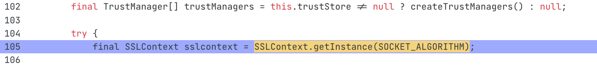
  <figcaption>_Identifying code that will be affected by post quantum cryptography._</figcaption>
</figure>

### [Dependency insight for Gradle and Maven](https://codegenomeproject.org/recipes/org.openrewrite.java.dependencies.DependencyInsight)

> Finds all dependencies (including transitive) across Gradle and Maven projects. Useful for identifying version inconsistencies that can cause runtime issues.

#### CLI commands

```bash
# Example: Find all Jackson library versions
mod run . --recipe org.openrewrite.java.dependencies.DependencyInsight \
  -P "groupIdPattern=*" \
  -P "artifactIdPattern=jackson*" \
  -P "scope=runtime"

mod study . --last-recipe-run --data-table org.openrewrite.maven.table.DependenciesInUse
```

#### Recipe results

<figure>
  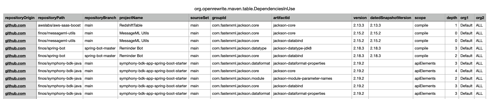
  <figcaption>_A data table that includes information about what repositories use the dependency we specified above._</figcaption>
</figure>

<figure style={{maxWidth: '400px', margin: '0 auto'}}>
  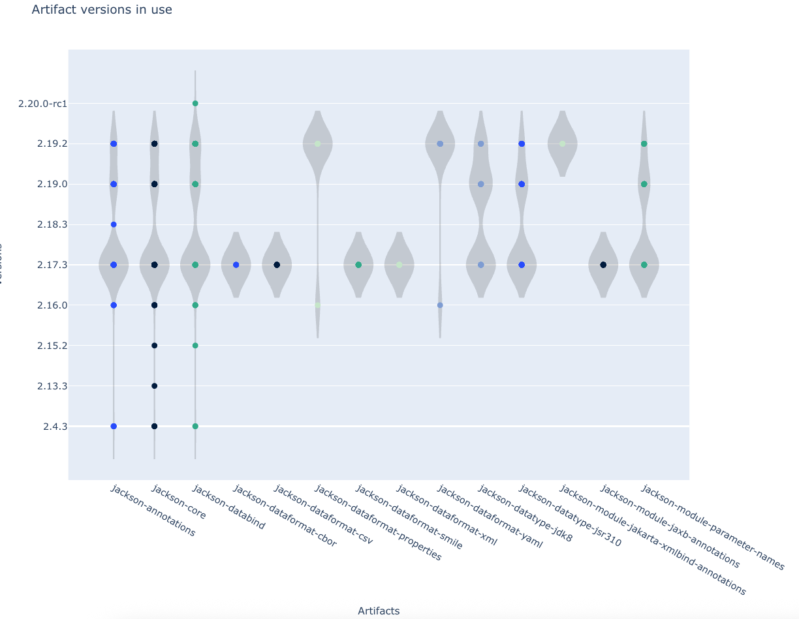
  <figcaption>_A visualization generated from the recipe results that shows the different versions of the specified dependencies across the selected repositories._</figcaption>
</figure>

## Logging improvements

### [Parameterize SLF4J logging statements](https://codegenomeproject.org/recipes/org.openrewrite.java.logging.slf4j.ParameterizedLogging)

> Converts string concatenation in log statements to parameterized logging for significant performance boosts, especially when log levels are disabled.

#### CLI commands

```bash
mod run . --recipe org.openrewrite.java.logging.slf4j.ParameterizedLogging
mod study . --last-recipe-run --data-table SourcesFileResults
```

#### Recipe results

<figure style={{maxWidth: '500px', margin: '0 auto'}}>
  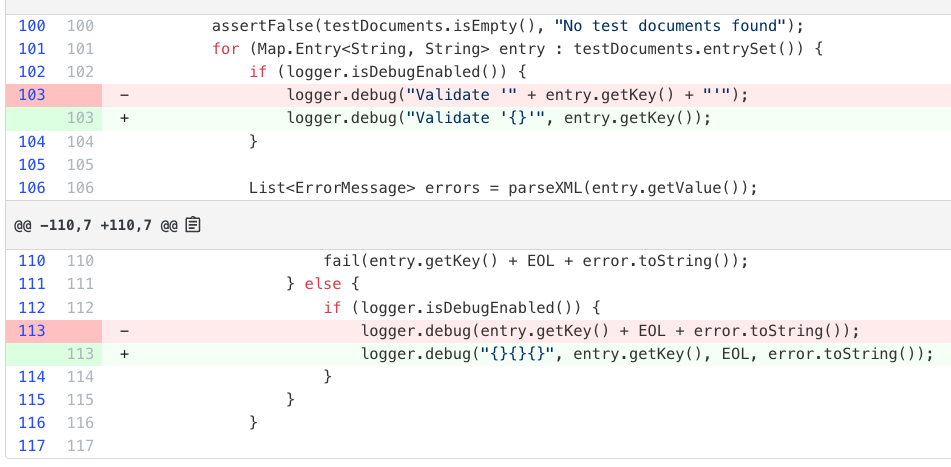
  <figcaption>_Logging improvements_</figcaption>
</figure>

### [Complete exception logging](https://codegenomeproject.org/recipes/org.openrewrite.java.logging.slf4j.CompleteExceptionLogging)

> Ensures exceptions are logged with full stack traces rather than just messages. Many exception types lack useful messages, and stack traces are critical for debugging.

#### CLI commands

```bash
mod run . --recipe org.openrewrite.java.logging.slf4j.CompleteExceptionLogging
mod study . --last-recipe-run --data-table SourcesFileResults
```

#### Recipe results

<figure style={{maxWidth: '500px', margin: '0 auto'}}>
  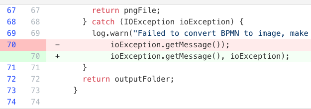
  <figcaption>_Adding useful exceptions to logs_</figcaption>
</figure>

### [SLF4J best practices](https://codegenomeproject.org/recipes/org.openrewrite.java.logging.slf4j.Slf4jBestPractices)

> Applies a comprehensive set of SLF4J logging best practices in a single recipe. Bundles both recipes above and adds more, including naming loggers for their enclosing class, making logger fields `private`, parameterizing `String.format()` and `MessageFormat.format()` calls, unpacking object arrays into varargs, guarding expensive log statements, stripping unnecessary `toString()` calls, and removing redundant log level guards. Because it captures more improvements in a single run, it surfaces greater estimated time savings during a proof of value.

#### CLI commands

```bash
mod run . --recipe org.openrewrite.java.logging.slf4j.Slf4jBestPractices
mod study . --last-recipe-run --data-table SourcesFileResults
```

## DevCenter

A [DevCenter](https://codegenomeproject.org/recipes/io.moderne.devcenter.DevCenterStarter) gives you a high-level, single-page overview of where every repository in your organization stands. It tracks upgrade and migration progress (such as Spring Boot, Java, and JUnit versions), surfaces outstanding security issues, suggests how to upgrade, and reports organization statistics like repository counts, contributing developers, and lines of code. This makes it an effective way to frame a proof of value for leadership before diving into individual recipes.

There are two ways to view a DevCenter:

* **In the Moderne Platform** – organizations configured with a DevCenter display it via the `DevCenter` link in the left navigation. See [Understanding the Moderne DevCenter](./dev-center.md) for a walkthrough of each component.
* **Locally with the CLI** – you can generate an HTML dashboard for any set of repositories you have cloned and built. See [Generating DevCenters locally](../../moderne-cli/how-to-guides/cli-dev-center.md) for the full guide.

### [DevCenter starter](https://codegenomeproject.org/recipes/io.moderne.devcenter.DevCenterStarter)

> Generates the data tables needed to build a DevCenter dashboard that tracks Spring Boot, Java, and JUnit upgrade progress, security issues, and organization statistics.

#### CLI commands

```bash
# Install the DevCenter starter recipes
mod config recipes jar install io.moderne.recipe:rewrite-devcenter:LATEST

# Run the DevCenterStarter recipe to produce the required data tables
mod run . --recipe io.moderne.devcenter.DevCenterStarter

# Generate the HTML DevCenter dashboard
mod devcenter . --last-recipe-run
```

#### Recipe results

<figure style={{maxWidth: '800px', margin: '0 auto'}}>
  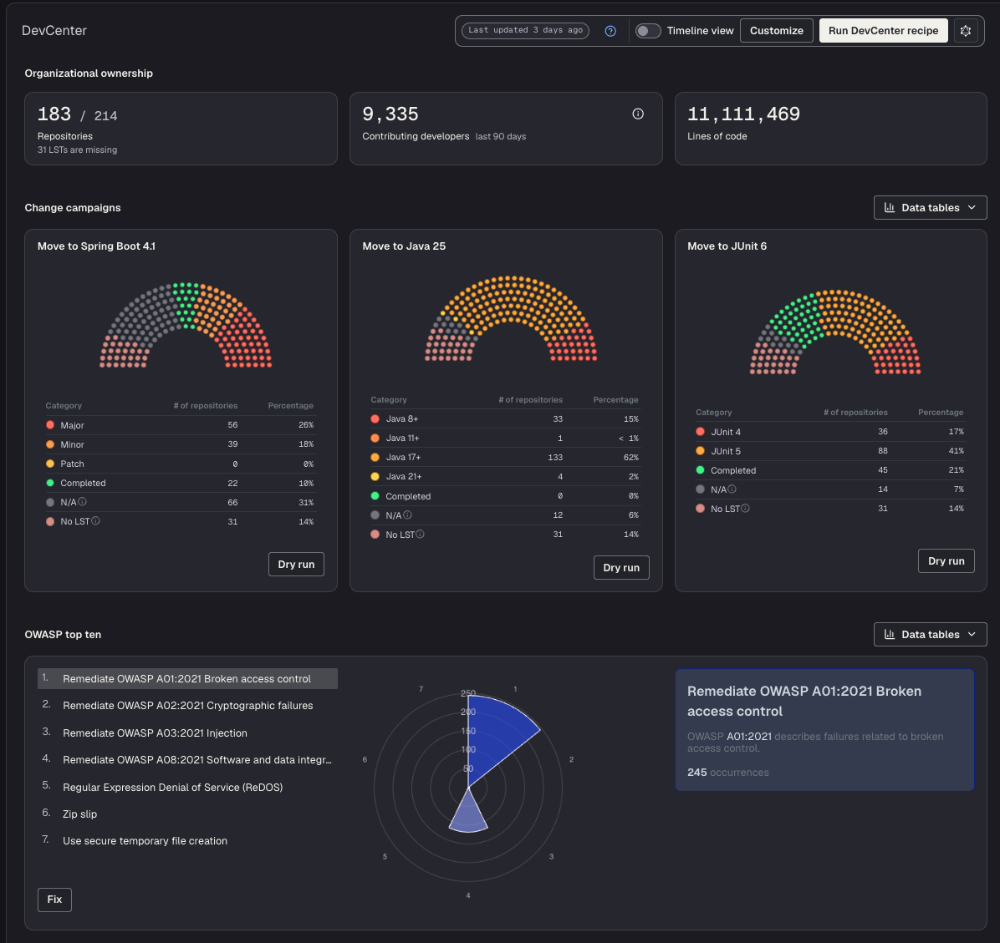
  <figcaption>_Example DevCenter dashboard_</figcaption>
</figure>

:::tip
`DevCenterStarter` targets the JVM ecosystem by default, but DevCenters are available for many other ecosystems too – including Python, Node.js, C#/.NET, Angular, Kotlin, Quarkus, and Apache Maven. Browse the full set in the [DevCenter recipe catalog](https://codegenomeproject.org/recipes?q=io.moderne.devcenter), or learn how to [create a custom DevCenter recipe](../../../administrator-documentation/moderne-platform/how-to-guides/creating-a-devcenter-recipe.md).
:::

## Dependency management

### [Update Gradle wrapper](https://codegenomeproject.org/recipes/org.openrewrite.gradle.UpdateGradleWrapper)

> Updates Gradle wrapper to the latest version, querying `services.gradle.org` for available releases while respecting your artifact repository configuration.

#### CLI commands

```bash
mod run . --recipe org.openrewrite.gradle.UpdateGradleWrapper
mod study . --last-recipe-run --data-table SourcesFileResults
```

#### Recipe results

<figure style={{maxWidth: '500px', margin: '0 auto'}}>
  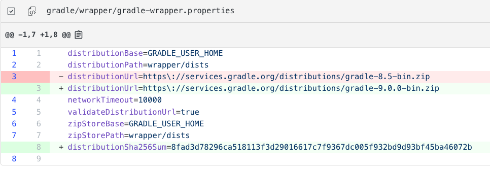
  <figcaption>_Updating the Gradle wrapper_</figcaption>
</figure>

### [Update Gradle plugins](https://codegenomeproject.org/recipes/org.openrewrite.gradle.plugins.UpgradePluginVersion)

> Updates Gradle plugins by ID to newer versions.

#### CLI commands

```bash
# Update specific plugin - adjust parameters for your plugins
mod run . --recipe org.openrewrite.gradle.plugins.UpgradePluginVersion \
  --recipe-option "pluginIdPattern=org.springframework.boot" \
  --recipe-option "newVersion=4.1.x"

mod study . --last-recipe-run --data-table SourcesFileResults
```

#### Recipe results

<figure>
  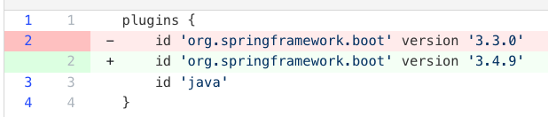
  <figcaption>_An example `build.gradle` change._</figcaption>
</figure>

### [Update Maven wrapper](https://codegenomeproject.org/recipes/org.openrewrite.maven.UpdateMavenWrapper)

> Update the version of Maven used in an existing Maven wrapper.

#### CLI commands

```bash
mod run . --recipe org.openrewrite.maven.UpdateMavenWrapper
mod study . --last-recipe-run --data-table SourcesFileResults
```

#### Recipe results

<figure style={{maxWidth: '500px', margin: '0 auto'}}>
  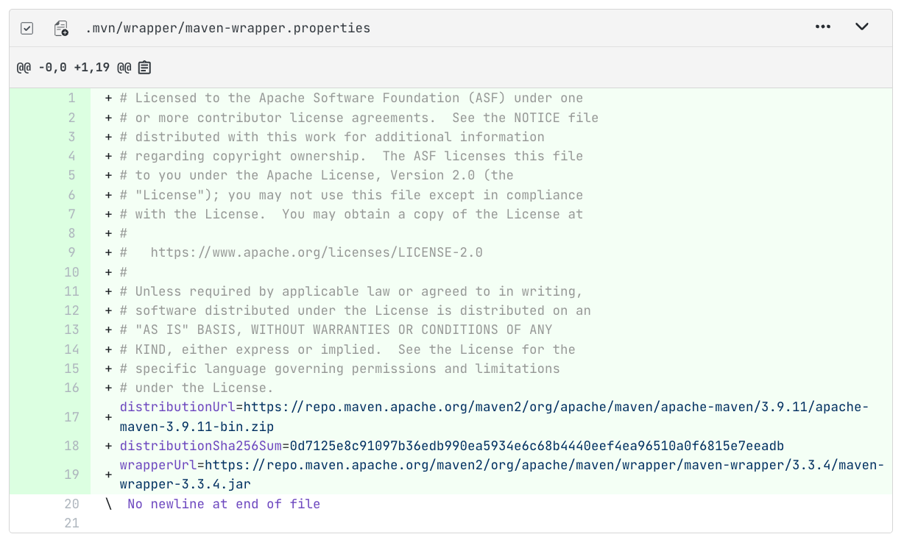
  <figcaption>_Updating the Maven wrapper_</figcaption>
</figure>

### [Update Maven plugins](https://codegenomeproject.org/recipes/org.openrewrite.maven.UpgradePluginVersion)

> Upgrade the version of a plugin using Node Semver advanced range selectors, allowing more precise control over version updates to patch or minor releases.

#### CLI commands

```bash
# Update specific plugin - adjust parameters for your plugins
mod run . --recipe org.openrewrite.maven.UpgradePluginVersion \
  --recipe-option "groupId=org.springframework.boot" \
  --recipe-option "artifactId=spring-boot-maven-plugin" \
  --recipe-option "newVersion=4.1.x"

mod study . --last-recipe-run --data-table SourcesFileResults
```

## Security

### [Find secrets](https://codegenomeproject.org/recipes/org.openrewrite.java.security.secrets.FindSecrets)

> Locates secrets like passwords, API keys, and tokens stored in plain text.

#### CLI commands

```bash
mod run . --recipe org.openrewrite.java.security.secrets.FindSecrets
mod study . --last-recipe-run --data-table SourcesFileResults
```

#### Recipe results

<figure>
  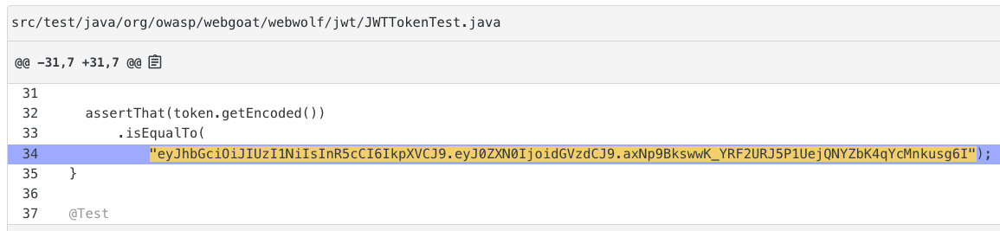
  <figcaption>_Example of a secret being found in the code._</figcaption>
</figure>

### [Use secure random](https://codegenomeproject.org/recipes/org.openrewrite.java.security.SecureRandom)

> Replaces `java.util.Random` with cryptographically secure `java.security.SecureRandom`.

#### CLI commands

```bash
mod run . --recipe org.openrewrite.java.security.SecureRandom
mod study . --last-recipe-run --data-table SourcesFileResults
```

#### Recipe results

<figure style={{maxWidth: '500px', margin: '0 auto'}}>
  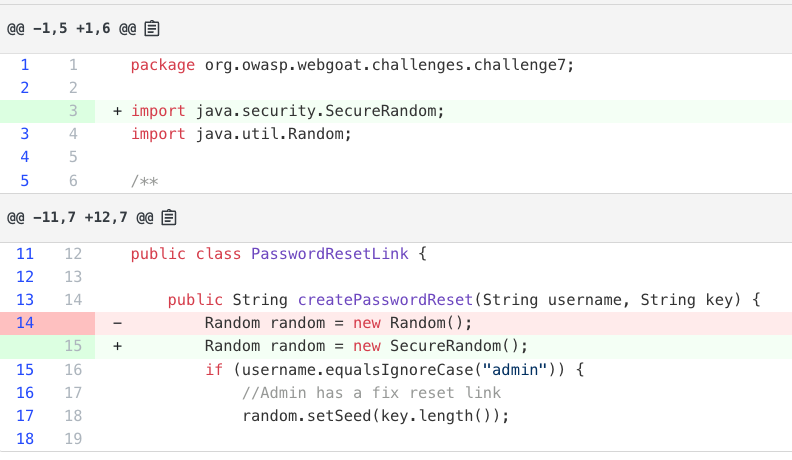
  <figcaption>_Example demonstrating `Random` being replaced with `SecureRandom`._</figcaption>
</figure>

### [Java security best practices](https://codegenomeproject.org/recipes/org.openrewrite.java.security.JavaSecurityBestPractices)

> Applies multiple security improvements including XML parser XXE vulnerability fixes, secure temporary file creation, Zip slip vulnerability remediation, file descriptor leak prevention, and loop condition safety checks.

#### CLI commands

```bash
mod run . --recipe org.openrewrite.java.security.JavaSecurityBestPractices
mod study . --last-recipe-run --data-table SourcesFileResults
```

#### Recipe results

<figure>
  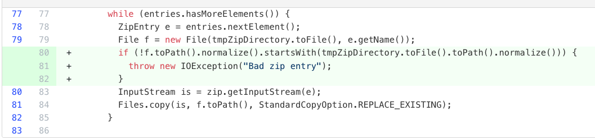
  <figcaption>_Example demonstrating how this recipe handles security issues such as the Zip slip vulnerability._</figcaption>
</figure>

### [OWASP Top Ten](https://codegenomeproject.org/recipes/org.openrewrite.java.security.OwaspTopTen)

> Identifies and remediates vulnerabilities from the OWASP Top Ten including broken access control, cryptographic failures, injection, security misconfiguration, vulnerable components, and data integrity failures.

#### CLI commands

```bash
mod run . --recipe org.openrewrite.java.security.OwaspTopTen
mod study . --last-recipe-run --data-table SourcesFileResults
```

#### Recipe results

<div style={{display: 'flex'}}>
  <figure style={{maxWidth: '400px'}}>
    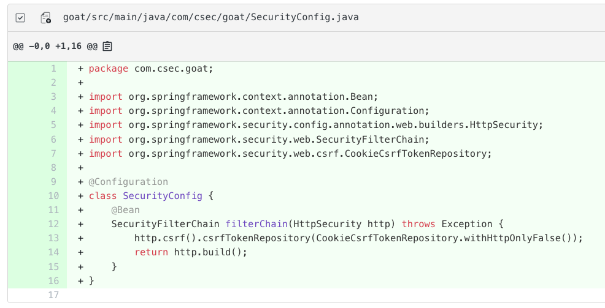
    <figcaption>_Example demonstrating how this recipe fixes security issues such as CSRF attacks._</figcaption>
  </figure>

  <figure style={{maxWidth: '400px'}}>
    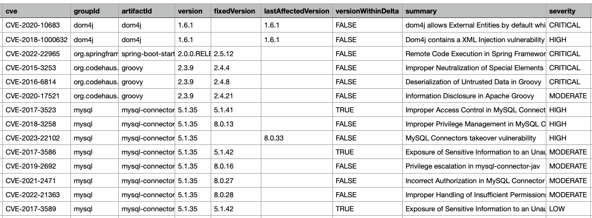
    <figcaption>_A vulnerability report that includes detailed information about the affected artifact and the corresponding CVEs._</figcaption>
  </figure>
</div>

<figure style={{maxWidth: '400px', margin: '0 auto'}}>
  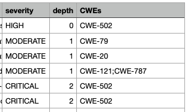
  <figcaption>_The vulnerability report also shows the severity of the CVE and the depth (transitivity) of the dependency. ~80% of vulnerable dependencies are transitive._</figcaption>
</figure>

### [Find and fix vulnerable dependencies](https://codegenomeproject.org/recipes/org.openrewrite.java.dependencies.DependencyVulnerabilityCheck)

> Software composition analysis (SCA) tool that detects and upgrades dependencies with known CVEs. Uses GitHub Security Advisory Database which aggregates multiple vulnerability databases including the National Vulnerability Database.

#### CLI commands

```bash
mod run . --recipe org.openrewrite.java.dependencies.DependencyVulnerabilityCheck \
  -P "scope=runtime" \
  -P "overrideTransitive=True" \
  -P "maximumUpgradeDelta=patch"

mod study . --last-recipe-run --data-table VulnerabilityReport
mod study . --last-recipe-run --data-table SourcesFileResults
```

#### Recipe results

<div style={{display: 'flex'}}>
  <figure style={{maxWidth: '400px'}}>
    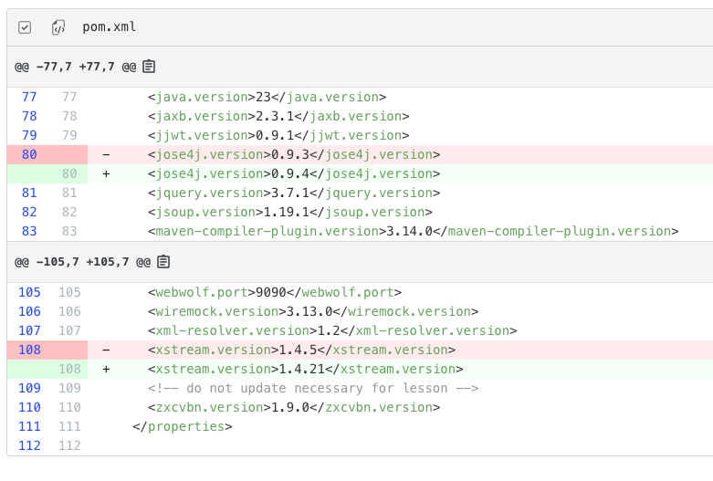
    <figcaption>_Example demonstrating how this recipe updates minor versions to get critical security fixes._</figcaption>
  </figure>

  <figure style={{maxWidth: '400px'}}>
    
    <figcaption>_A vulnerability report that includes detailed information about the affected artifact and the corresponding CVEs._</figcaption>
  </figure>
</div>

<figure style={{maxWidth: '400px', margin: '0 auto'}}>
  
  <figcaption>_The vulnerability report also shows the severity of the CVE and the depth (transitivity) of the dependency. ~80% of vulnerable dependencies are transitive._</figcaption>
</figure>

## Test modernization

### [JUnit 6 best practices](https://codegenomeproject.org/recipes/org.openrewrite.java.testing.junit.JUnit6BestPractices)

> Migrates to JUnit 6 and applies best practices to tests. This recipe will: migrate from JUnit 4.x or 5.x to JUnit 6, statically import JUnit Jupiter assertions, remove the test prefix and public visibility from tests, add `@ParameterizedTest` annotations, and clean up assertions – among other things.

#### CLI commands

```bash
mod run . --recipe org.openrewrite.java.testing.junit.JUnit6BestPractices
mod study . --last-recipe-run --data-table SourcesFileResults
```

#### Recipe results

<figure style={{maxWidth: '600px', margin: '0 auto'}}>
  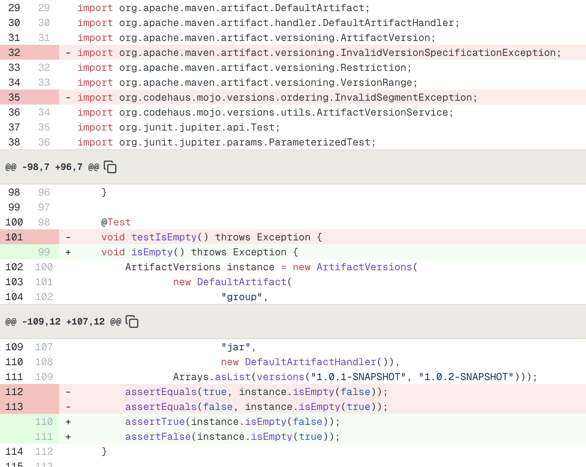
  <figcaption>_Applying best practices to JUnit tests._</figcaption>
</figure>

### [AssertJ best practices](https://codegenomeproject.org/recipes/org.openrewrite.java.testing.assertj.Assertj)

> Migrates assertions to AssertJ for better readability. Migrates from JUnit, Hamcrest, Fest, and TestNG assertions, statically imports `assertThat`, simplifies chained assertions, and adopts type-specific assertions.

#### CLI commands

```bash
mod run . --recipe org.openrewrite.java.testing.assertj.Assertj
mod study . --last-recipe-run --data-table SourcesFileResults
```

#### Recipe results

<figure style={{maxWidth: '600px', margin: '0 auto'}}>
  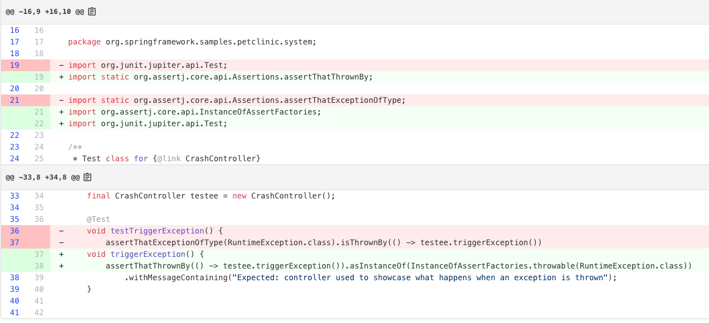
  <figcaption>_Applying AssertJ best practices to a test class._</figcaption>
</figure>

## Major migrations

Major migrations are complex transformations that typically automate 80-90% of the work, with the remainder requiring manual developer intervention. They are typically composed of multiple, complex recipes.

### [Migrate to Java 25](https://codegenomeproject.org/recipes/org.openrewrite.java.migrate.UpgradeToJava25)

> Comprehensive migration from Java 8/11 to Java 25. Updates build files for Java 25 target/source, replaces deprecated APIs, adopts new language features, upgrades plugins to Java 25 compatible versions, and updates GitHub Actions configurations. Swap in the recipe for another target version (such as `org.openrewrite.java.migrate.UpgradeToJava17`) when you need to land on an earlier release.

#### CLI commands

```bash
mod run . --recipe org.openrewrite.java.migrate.UpgradeToJava25
mod study . --last-recipe-run --data-table SourcesFileResults
```

#### Recipe results

<div style={{display: 'flex'}}>
  <figure style={{maxWidth: '400px'}}>
    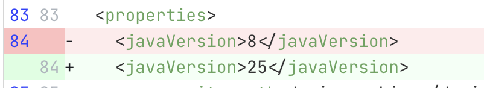
    <figcaption>_Updating the Java version_</figcaption>
  </figure>

  <figure style={{maxWidth: '400px'}}>
    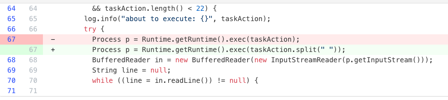
    <figcaption>_Fixing deprecated methods_</figcaption>
  </figure>
</div>

### [Java best practices](https://codegenomeproject.org/recipes/org.openrewrite.java.migrate.JavaBestPractices)

> Applies opinionated best practices for Java projects targeting Java 25. Includes the full Java 25 upgrade chain plus additional improvements to code style, API usage, and third-party dependency reduction that go beyond what the version migration recipes apply.

#### CLI commands

```bash
mod run . --recipe org.openrewrite.java.migrate.JavaBestPractices
mod study . --last-recipe-run --data-table SourcesFileResults
```

### [Spring Boot 4 best practices](https://codegenomeproject.org/recipes/io.moderne.java.spring.boot4.SpringBoot4BestPractices)

> Migrates to Spring Boot 4 and applies best practices. Includes upgrades from prior Spring Boot versions with configuration updates and dependency alignment.

#### CLI commands

```bash
mod run . --recipe io.moderne.java.spring.boot4.SpringBoot4BestPractices
mod study . --last-recipe-run --data-table SourcesFileResults
```

#### Recipe results

<figure style={{maxWidth: '600px', margin: '0 auto'}}>
  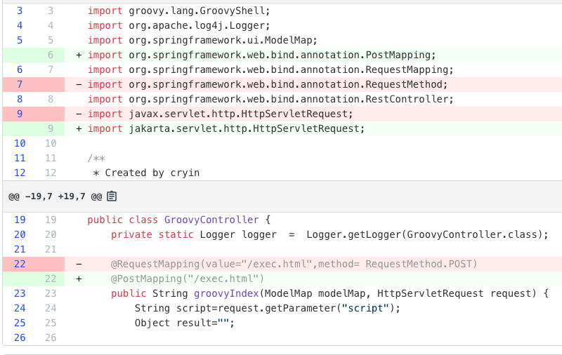
  <figcaption>_Applying Spring Boot best practices to a Java class._</figcaption>
</figure>

## AI agent context

AI coding agents like Claude Code, Cursor, and GitHub Copilot work better when they have structured knowledge about your codebase rather than inferring architecture from raw code. Prethink generates this context automatically, mapping service endpoints, dependencies, test coverage, and architecture so agents reason over facts instead of guessing. To learn more, please [check out our Prethink documentation](../../agent-tools/prethink.md).

### [Update Prethink context](https://codegenomeproject.org/recipes/io.moderne.prethink.UpdatePrethinkContextStarter)

> Generates Prethink context files with architectural discovery, test coverage mapping, dependency inventory, and FINOS CALM architecture diagrams.

#### CLI commands

```bash
mod run . --recipe io.moderne.prethink.UpdatePrethinkContextStarter

mod study . --last-recipe-run --data-table ClassQualityMetrics
mod study . --last-recipe-run --data-table MethodQualityMetrics
mod study . --last-recipe-run --data-table PackageQualityMetrics
mod study . --last-recipe-run --data-table CodeSmells
mod study . --last-recipe-run --data-table TestGaps
mod study . --last-recipe-run --data-table TestQualityIssues

mod git apply . --last-recipe-run
```

#### Recipe results

<figure>
  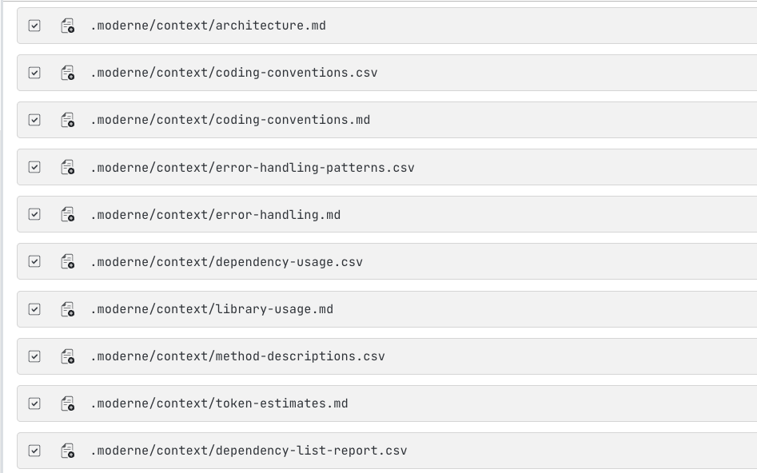
  <figcaption>_Context files generated by the Prethink recipe._</figcaption>
</figure>
