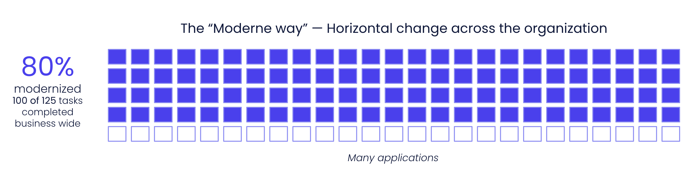
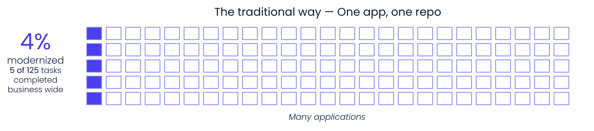

import Tabs from '@theme/Tabs';
import TabItem from '@theme/TabItem';
import { PovScenarios } from '@site/src/components/PovScenarios';

# Proof of value (POV) process

:::info
Before starting the POV process, make sure your team has completed the [prerequisites checklist](./proof-of-value-prerequisites.md).
:::

Moderne automates code maintenance tasks like framework migrations, security vulnerability fixes, and code quality improvements. A coding agent equipped with the Moderne CLI applies that automation across every repository you have at once. It searches your whole organization for where a change is needed, runs recipes over all of it in Moderne, checks the result with each repository's own build, and writes a recipe for whatever no recipe covers yet. The same session works on repositories synced to one machine, so a proof of value can start before your tenant does.

This guide gives you scenarios to run during a proof of value. Each scenario is a prompt you start with `mod <agent> chat` on your repositories. The first runs the POV itself, step by step in terminal windows you can watch, and fills in a value deck you can take to leadership. The others are standing objectives you leave running, so the proof of value shows what Moderne looks like in daily use rather than in a one-off demonstration.

Moderne's value lies in working horizontally across all of your repositories at once. Consider a modernization task that needs to happen across 125 repositories:

<figure>
  
  <figcaption>**The Moderne approach**: Even if you only complete 80% of the work on each repository, that's 80% progress business-wide (100 of 125 tasks done).</figcaption>
</figure>

<figure>
  
  <figcaption>**The traditional approach**: If you fully complete one repository before moving to the next, you achieve 100% on that single repo, but that's only 4% progress across the organization (5 of 125 tasks).</figcaption>
</figure>

This is why every scenario below works on a whole organization and never on a repository you pick out. Rather than getting any single repository perfectly over the line, you will see a change applied across your entire codebase at once, with the remaining gap closed by recipes the agent writes rather than by hand.

## Before you begin

You will need:

* **Your repositories, in Moderne or on the machine.** With a tenant, the [prerequisites](./proof-of-value-prerequisites.md) cover mass ingest and the Connector for the Moderne Platform, and Moderne DX has [a checklist of its own](../../../administrator-documentation/moderne-dx/getting-started/proof-of-value-prerequisites.md). Start with 100 or more diverse repositories. The agent searches and runs recipes in Moderne, and clones a repository only when it has something to build. Without a tenant yet, as in the first weeks of a Moderne DX installation, you sync the repositories to the machine instead and the agent works on those.
* **The Moderne CLI, logged in to your tenant when you have one.** Install it with the script for your operating system. With a tenant, point the CLI at it and log in. The account you log in with opens the pull requests, so it needs push access to the repositories.
* **A supported coding agent on your `PATH`.** Agent chat [lists the agents and the versions it needs](../../agent-tools/agent-chat.md#supported-agents). If you installed the Moderne skills or the local MCP server for that agent, [remove them first](../../agent-tools/agent-chat.md#requirements), since they steer the agent toward one repository at a time.
* **The JDKs and build tools your repositories use.** The agent verifies a change with each repository's own build. The CLI finds JDKs from [SDKMAN, Homebrew and system installs](../../moderne-cli/how-to-guides/java.md), and `mod config java installation list` shows what it sees.
* **A directory outside any repository, in a terminal allowed to record the screen.** The session runs each step in a terminal window of its own and captures the window for the deck. On macOS the first capture asks for the permission, so approve it while you are there. A step that runs git in a directory that is not a repository climbs into the repository above it, so keep the directory out of any checkout.

To install the CLI and log in:

<Tabs groupId="cli-install-os" queryString="os">
<TabItem value="linux-macos" label="Linux / macOS" default>

```bash
curl https://app.moderne.io/cli | bash
mod config moderne edit https://TENANT.moderne.io
mod login
```

</TabItem>
<TabItem value="windows" label="Windows">

```powershell
irm https://app.moderne.io/cli/windows | iex
mod config moderne edit https://TENANT.moderne.io
mod login
```

</TabItem>
</Tabs>

Without a tenant, run only the first line. Then sync the repositories into the directory the scenario names, from a CSV with `cloneUrl` and `branch` columns, and build their LSTs once:

```bash
mod git sync csv ./pov repos.csv --with-sources
mod build ./pov
```

The session then works on what is in the directory, and its command leaves `--org` off.

## Search your code first

Before you start a session, run a search or two yourself, so you see what the agent will work from. Code search runs over the index of your LSTs rather than over text, so it knows which `isEmpty` is which, and it answers questions about dependencies, inheritance and annotations that a text search cannot. The first search over a repository writes its index and takes a while. Every search after that comes back in about a second.

With a tenant, open **Code search** in Moderne's left nav, pick the organization and type a query. **Save and export** runs the search across the whole organization and keeps the matches as a data table in the [activity view](./activity-view.md). From the CLI, search the repositories on the machine or an organization in Moderne:

```bash
mod search . "System.out.println -file:src/test"
mod search moderne://<organization> "dependency:junit:junit:4.x select:file" --output=summary
```

The [code search guide](./code-search.md#writing-queries) covers the query language, and the [recipe reference](./proof-of-value-recipes.md#code-search) has five questions worth asking first. What search cannot do, such as count lines or produce a bill of materials, is a recipe's job.

## Choosing a scenario

<PovScenarios />

Replace `<organization>` with the name or the id of the organization in Moderne, as `mod config moderne organizations show` lists it. With the code on this machine there is no `--org`, and the directory already holds the repositories. The command creates the directory if it is missing, writes an `AGENTS.md` file there that teaches the agent how to use `mod`, and starts the agent with the prompt submitted. If you leave off `--prompt`, the session starts empty and you type the first request yourself.

Whatever the scenario, the session follows the same path:

* It looks before it clones. `mod search moderne://<organization>` answers where the objective is not yet met, type-aware and across every repository, with nothing on disk.
* It runs recipes over the whole organization in Moderne. A run creates a changeset that holds the changes and their data tables, and it leaves alone every repository that was already right.
* It brings to disk only what it has to build. `mod git sync moderne` with the changeset's id syncs the repositories the run changed, and the agent verifies each one with its own build.
* It fixes the recipe, not the repositories. Where the recipe fell short, the agent fixes it or writes a new one, in Java or TypeScript, and runs it again over everything, so that a gap found in one repository is closed in all of them.
* It ships through Moderne. The agent pushes each repository as it passes and opens pull requests for people to merge, and it records what it learned in data tables on the changeset.
* It starts more sessions when the work is larger than one machine. Each one is a `mod <agent> chat` of its own on the same changeset.

Without a tenant, the same path runs against the directory. `mod search .` and `mod run .` work over the synced repositories, a run leaves a patch and a run id under `.moderne/run` rather than a changeset, and the agent applies, builds and pushes from the directory. The message board and `mod agent sessions <changeset>` need Moderne. `mod agent sessions` on its own lists the sessions on this machine either way.

:::tip
A session you want to watch runs in your terminal. A session you want to leave alone takes `--unattended`, which approves the agent's tool use and runs the prompt to completion. [Running a factory continuously](#running-a-factory-continuously) covers how to keep one going.
:::

## Running the POV and filling in the value deck

The value deck is a short presentation for your leadership, built the way Moderne builds its own: one sentence per slide and one visual under it. It is also the script of the proof of value. Where a slide shows a command, that command is a step. The session runs it as a session of its own and fills the slide from what the step did. [Download the value deck](pathname:///decks/moderne-pov.pptx) and put it in the directory the session will start in, which must not be inside a git repository:

```bash
mkdir pov
curl -o pov/moderne-pov.pptx https://docs.moderne.io/decks/moderne-pov.pptx
```

Then start the agent with the deck scenario from the picker above, with your objectives added to the end of the prompt in your own words, one sentence each, after "The objectives are:". The deck has room for three. Leave them off and the session picks up to three the code calls for, such as the scenarios below, and says in the notes that it chose them. The notes on the title slide tell it how to work:

* It runs the steps one at a time, each in a terminal window of its own, so the people watching see the step's transcript: the agent searching for a recipe, running it over every repository, syncing what it changed and building it. It captures the window every 45 seconds while the step runs, so a slide can show the moment it asks for. With a tenant, each step runs in a subdirectory with `--org`. Without one, each step runs in the same directory, on the repositories synced there.
* Every step's prompt ends with the same instruction: reach for the recipes that exist first, write a recipe only where none makes a change the objective needs and say what the gap was, say why when part of a recipe's result is left out, verify with each repository's own build, open pull requests or say why they cannot be opened and go on, and when done write a summary to `board/<step>.md` with the changeset or run ids, what changed, what built, the pull requests, the recipes written and the usage the step's harness reports. The session waits for that file, reads it, and ends the step with `mod agent stop`. The transcript stays in its window.
* It fills the slides in plain words, puts a capture of the step's window where a slide asks for one, and leaves a slide out rather than guess. It does not stop to ask: the title slide's notes answer every choice a step can raise. A recipe is named on a slide by what it does; recipe ids, changeset ids and session ids go under "Source:" in the slide's notes, so every number traces to a changeset or run id, a data table or a session.

The deck fixes the form of every slide and leaves the content of the result slides to the run. The slides that frame the story keep their words. Every result slide, which is one per step, has the same five parts:

1. A headline the agent writes from what the step did: one sentence with one number the slide's own evidence carries, and no claim the evidence does not show.
2. The command, on the objective slides, as the step was started.
3. Before and after: one change in one file from the step's changeset, at most a dozen lines a side, the change a developer would recognise as a real fix. A step that changed nothing shows the line in its window that says so.
4. The reach: how many repositories and files changed, how many built and passed their own tests, how many pull requests opened.
5. Why, only where the agent left part of a recipe's result out or wrote a recipe of its own: one sentence on what the gap was.

| Slide                    | What it holds                                                                                            |
|--------------------------|----------------------------------------------------------------------------------------------------------|
| Title                    | `{{Customer}}` and Moderne, with the month                                                               |
| The code                 | Every number in this deck comes from `{{N}}` repositories worked on at once: the language composition recipe |
| The first prompt         | The first prompt was deliberately ordinary: the step `Fix code quality issues`, and a capture of its window |
| What it did              | The result template, filled from that step                                                               |
| The factory              | The same prompt, asked never to stop, is a factory: the one command, and a capture of its second pass    |
| What the second pass did | The result template, filled from the second pass; the why sentence names the recipe it wrote and the gap |
| Objectives 1 to 3        | The result template, one slide per objective in your words, with its command across the top             |
| The loop                 | The agent gets better at this work by writing recipes, not by changing the model: the recipe count when the proof of value started and when it ended |
| Cost                     | The proof of value took `{{hours}}` of a person's time and `{{dollars}}` of agent usage: the sessions' usage reports, and what a recipe costs to run again |
| What you keep running    | The factory and each objective, with an owner and a machine for each                                     |
| Who already runs Moderne | Used by the companies running the world's largest codebases: the customer logos from moderne.ai         |

When the session ends, the deck in the directory is filled in, the steps' changesets or runs are there to review, and `board/` holds each step's summary. Review the deck as you would the agent's pull requests. The deck shows no scheduler: how to keep a factory going when nobody is watching is under [Running a factory continuously](#running-a-factory-continuously).

:::note
The agent edits the deck with a library such as `python-pptx`, which it installs itself. If it reports that it cannot edit the file, ask it to write the results as a markdown report with the same headlines, and fill the deck in yourself.
:::

## Keeping every repository on the latest Spring Boot

This scenario is a standing objective. The session finds the Spring Boot line each repository runs with one search, runs the Spring Boot upgrade recipe over everything that is behind, and syncs the repositories the run changed to build and test them. A repository that fails is a gap in the recipe before it is a change to make by hand. The agent fixes the recipe or writes a new one, runs it again over the whole organization, and pushes each repository as it passes. When every repository is current, the session says so and ends, and the next run starts over when a new release ships.

Standing exceptions belong in the prompt. A sentence such as "acme/legacy stays on Spring Boot 3.3 until its reporting plugin is replaced" is all the session needs, and it records the exception in its data tables. The recipes this scenario draws on are under [major migrations](./proof-of-value-recipes.md#major-migrations) and [dependency management](./proof-of-value-recipes.md#dependency-management) in the recipe reference.

## Watching for vulnerabilities and fixing them everywhere

The session reads what was disclosed, finds which repositories it reaches, and remediates it everywhere at once. It researches newly disclosed vulnerabilities with web search, or with a research skill such as `last30days` where the agent has one. For each vulnerability, a `dependency:` search over the organization says which repositories the vulnerable range reaches, including through transitive dependencies. Where a version bump is the fix, the [dependency vulnerability check](./proof-of-value-recipes.md#find-and-fix-vulnerable-dependencies) makes it. Where the fix is a change to code, the agent writes a recipe for the vulnerable pattern and runs it over every repository the search found. Each fix is verified with the repository's own build and opened as a pull request.

A fix the agent makes by hand in one repository is generalized into a recipe before the session moves on. The same vulnerability found later is then fixed by running the recipe again.

## Building a data-flow understanding of the code

This scenario is a longer piece of work than a single session, and it ends when the capability exists rather than when a release lands. The session builds recipes and data tables that answer where data goes. Which methods call which, where a value that enters an API endpoint ends up, and which third-party libraries it passes through are each a question one of them answers. It starts from the search and analysis recipes in the [recipe reference](./proof-of-value-recipes.md#code-search-and-impact-analysis), such as the call graph and the sensitive endpoint search, and writes what is missing as recipes of its own.

Each capability is proved on a real question about your code before it counts, and the session records what it answers and where it falls short. What the session leaves behind runs again on demand, so a data flow question later is a query over the organization rather than a reading of the code.

## Running a factory continuously

A session ends when the agent judges the objective met for now. A factory is that same session, started again whenever you want it to look again. Start it with `--unattended` from a scheduler on a machine you keep for it. Keep the prompt in a file beside the directory, so the scheduler's entry stays short:

```bash
# Look again every night at 02:00
0 2 * * * cd /srv/factories && mod copilot chat ./factory-spring-boot --org "<organization>" --unattended --prompt "$(cat spring-boot.prompt)"
```

Without a tenant, the entry refreshes the sources and their LSTs first, since no changeset brings them:

```bash
0 2 * * * cd /srv/factories && mod git sync csv ./factory-spring-boot repos.csv --with-sources && mod build ./factory-spring-boot && mod copilot chat ./factory-spring-boot --unattended --prompt "$(cat spring-boot.prompt)"
```

With a tenant, the session keeps no state on the machine. The code is in Moderne and the work underway is the organization's changesets, so a session that starts after a crash, or on another machine, reads the same picture and continues. It leaves alone work that is underway and finishes work that stalled. Without one, the state is the directory itself: the synced repositories, their branches, and the patches under `.moderne/run`.

:::warning
`--unattended` lets the agent run tools without asking you first. Run it in a directory and on a machine you are comfortable letting the agent change, with credentials that can push to your repositories and nothing more.
:::

To see and steer what is running:

* `mod agent sessions` lists the sessions on this machine, with no tenant needed, and `mod agent sessions <changeset>` lists the sessions on a changeset wherever they run, with the machine, the directory, the state and the command each one is running.
* The changesets a factory creates are in Moderne's activity view, with their data tables, pull requests and the agents that worked on them.
* `mod agent stop <session>` ends a session. It stops the agent, closes the session in Moderne, and gives the terminal its prompt back.
* `mod agent send <session> "<message>"` hands a message to an interactive Codex session as its next turn. For other agents, and for unattended sessions, change the prompt and start the session again.

## Next steps

* [Browse the recipe reference](./proof-of-value-recipes.md) for the recipes the scenarios draw on, with a CLI command and an example result for each.
* [Read about agent chat](../../agent-tools/agent-chat.md) for the agents it supports and what a session does.
* [Study the results](./data-tables.md) with data tables and [visualizations](./visualizations.md) after a run.
* [Give leadership a DevCenter](./dev-center.md), the single-page view of where every repository stands.
