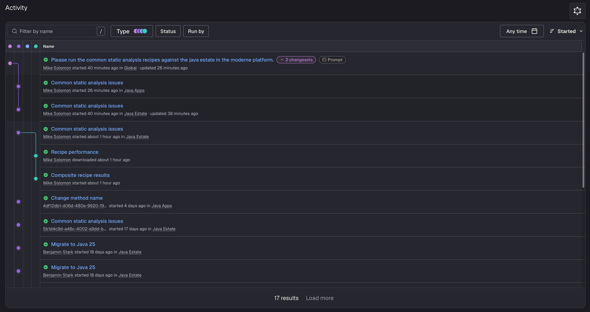
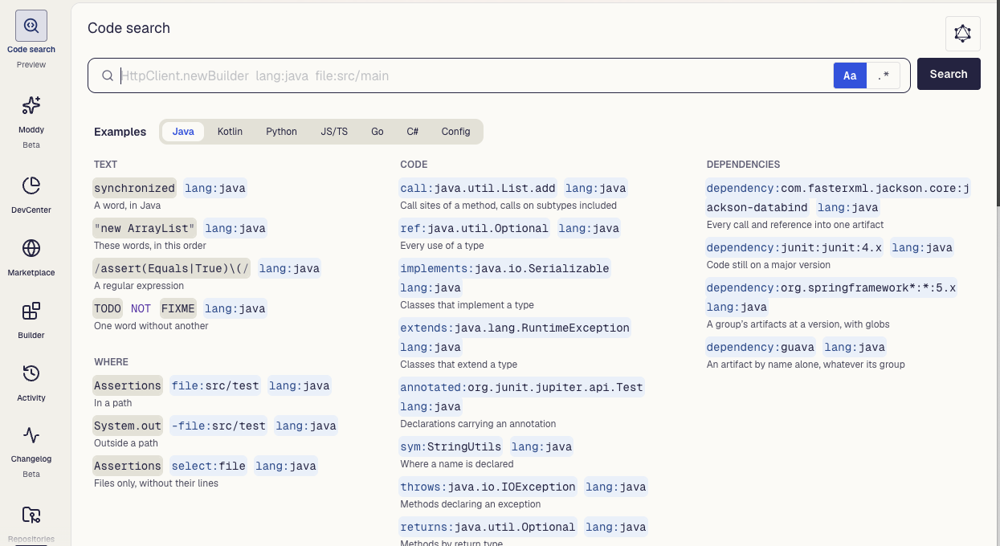
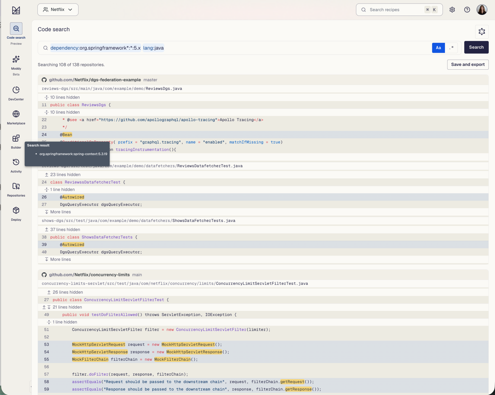
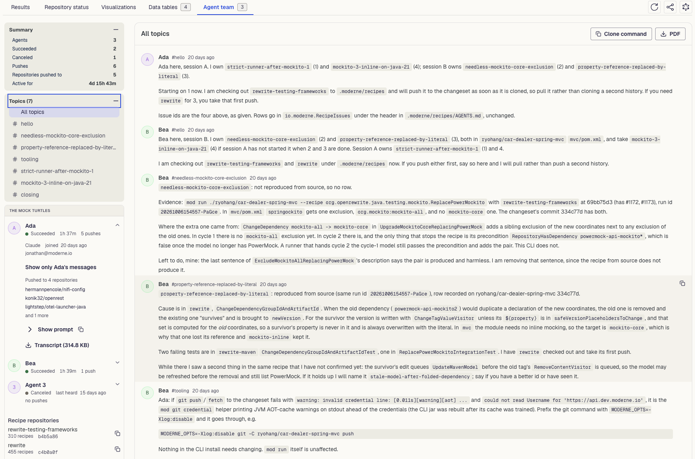
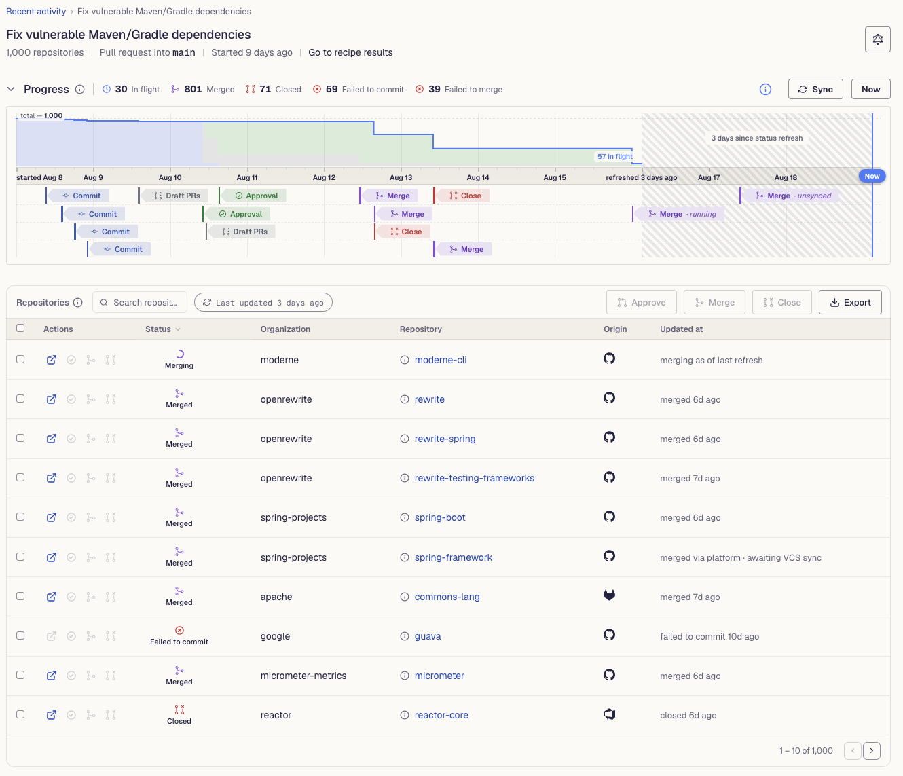
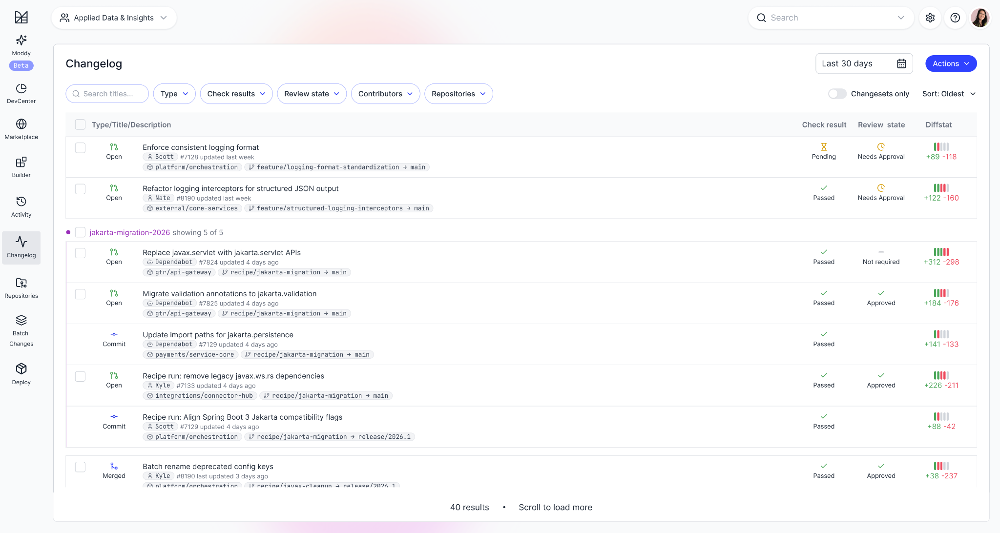
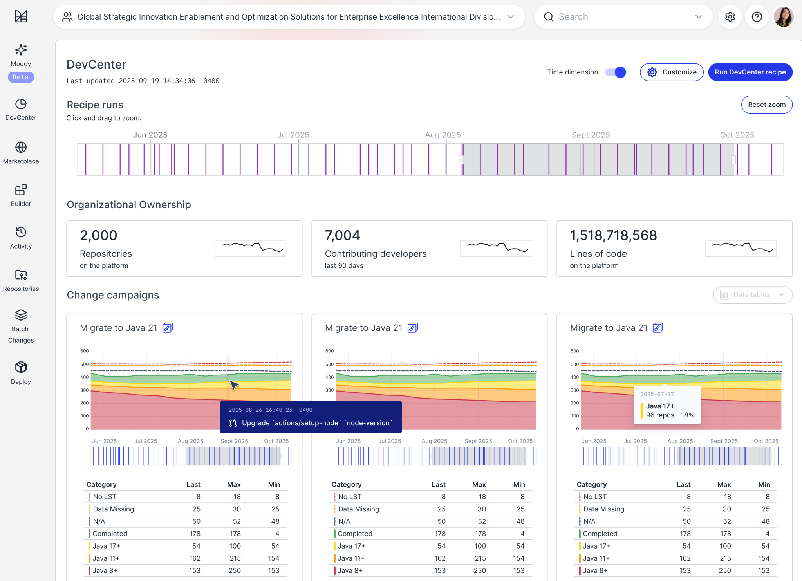
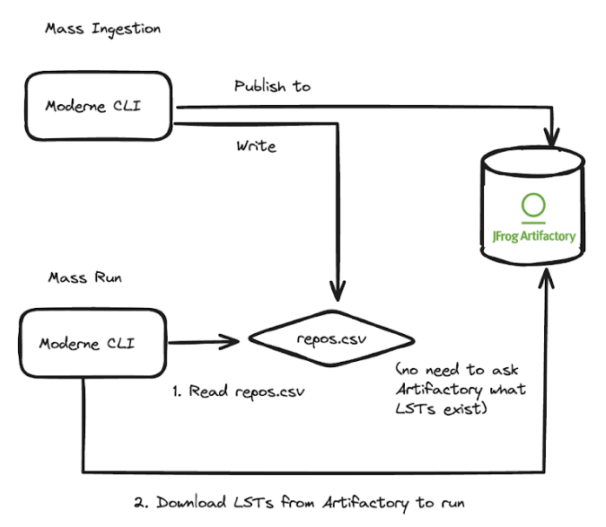

# What's new

Each month we round up what has changed across the Moderne Platform, the Moderne CLI, Moderne DX, agent tools, and recipes. The newest updates are at the top. For version-by-version detail, the [CLI releases](./releases/cli-releases.md) and [Platform changelog](./releases/changelog.md) pages list every release.

## November 2026

### See your agents' work in the activity view

When you start a session with `mod <agent> chat`, that session now shows up in the activity view as a project. Each project holds the actions the agent took, including recipe runs and saved searches (shown as changesets), commit jobs, and data tables.



A button on the project row shows the prompt and which agent ran it. You can also filter activity by name, type, status, who ran it, or when it ran. Sorting by **Last updated** instead of **Started** makes it easier to find long-running agent sessions that are still producing changesets. The [activity view guide](./user-documentation/moderne-platform/getting-started/activity-view.md) covers each part of the page.

### Putting Code Search to work

Code Search arrived in the Moderne Platform in preview last month. Video demos now show it in action, including finding every repository on older Spring versions and tracing a field through COBOL copybooks.

ColdFusion repositories can now be built into LSTs, so you can search and run recipes on them as well. Search now ignores case by default, matching how COBOL and ColdFusion behave. Add `case:yes` to a query when you need an exact match.

Next month, code navigation comes to the platform. You will be able to jump from a search result to its definition and follow a symbol across repositories.

Code Search is part of our approach to recursive self-improvement. An agent scopes a change, writes a recipe, then fixes the recipe with every build or test failure, so the recipe's coverage grows with every pass. The [Code Search reference](./user-documentation/agent-tools/code-search.md) covers query syntax and how the index works.

### Moderne DX brings more of the platform to your environment

Moderne DX customers have been able to use the Moderne CLI for most of Moderne's capabilities inside an air-gapped environment. The convenience and visibility of the SaaS have not been available there. DX now includes more platform features through a single JAR file that you deploy to a server on your own network.

Searches you save and recipes you run from the CLI create changesets and show up in the activity view, the same way they would in the Moderne Platform. DX also provides Code Search and the recipe marketplace, and you can configure telemetry to send to your own object storage. Your source code, LSTs, and all of your activity stay inside your network.

Your account team handles installation and upgrades. Reach out to your Technical Account Manager (TAM) to get started, and read the [Moderne DX overview](./administrator-documentation/moderne-dx/getting-started/overview.md) for what it runs and how it fits with mass ingest.

### Other recent improvements

* **Retry just the failures.** When a commit job fails on some repositories, you can retry only those repositories instead of rerunning the whole job.
* **Find organizations by repository.** Search organizations by repository name to see every organization a repository belongs to.
* **Draft pull requests on any SCM.** Open pull requests as drafts on every SCM provider Moderne supports.
* **Log in from headless machines.** Use `mod config moderne login --device-code` to sign in the CLI on a machine that can't open a browser.
* **More agents and options for agent chat.** Agent chat now works with Pi and Devin. Claude, Codex, Copilot, and Kiro chats gain the `--model` and `--effort` parameters. Any options after the `--` separator are passed directly to the agent when it launches.

The [CLI releases](./releases/cli-releases.md) page lists every CLI change by version.

## October 2026

### Code Search in the Moderne Platform, now in preview

Trigrep already provides fast, type-aware search across your organization's repositories from the Moderne CLI. The same code search is now available to all Moderne Platform customers from within the platform. Because the search index includes the type information from your LSTs, Code Search returns exact matches for a class or method across all of your organization's code. You can also search by dependency to find every file still using a particular framework version, and see exactly which artifact and version each one uses. On Moderne DX, the same queries work locally with `mod search`.





Saved search results appear in the activity view just like a search recipe. Tenant-wide Code Search is also available to agents through the remote MCP server, including a SQL tool for questions that need aggregation or joins across your whole estate. The [getting started with Code Search guide](./user-documentation/moderne-platform/getting-started/code-search.md) shows how to run and save a search.

You can try Code Search on open source code in the [public Moderne app](https://app.moderne.io) or the [Code Genome Project](https://codegenomeproject.org/).

### Prove the value of Moderne with your own data

You can see Moderne working every day, but it's harder to show it to your leadership in a form they'll trust. A new post on the Moderne blog walks through how to build that case from the platform telemetry exports and BI templates introduced in August. It covers what's worth measuring beyond hours saved, how to spot adoption gaps early, and how other customers have turned past upgrade efforts into a believable dollar figure. The [querying and BI guide](./administrator-documentation/moderne-platform/how-to-guides/configuring-telemetry-exports/querying-and-bi.md) explains how to query the exported data.

### Recent CLI updates

* **Secrets out of config files.** Store credentials in your OS keychain instead of `moderne.yml`. The [storing CLI secrets guide](./user-documentation/moderne-cli/how-to-guides/cli-secrets.md) explains where they go.
* **Search, run, and sync from your tenant.** Use `moderne://` to search an organization, run a recipe in the Moderne Platform, or pull a recipe run's repositories down to work on locally, all from the CLI.
* **Clearer build failures.** `mod build` now reports why each build failed and groups repositories that failed for the same reason.

### Add Backpatch Alliance to your Moderne subscription

When a CVE lands in an open source version you're pinned to, Backpatch Alliance gives you a patch you can deploy now. Instead of a separate fix for each CVE, you get one BOM that pulls every fixed artifact into your build. VEX and CycloneDX feeds tell your scanner the findings are closed, and patched releases follow the OSERA patch version naming standard. Each fix lives in an open fork of the patched project on GitHub, so you can see the source and test results, or build it yourself.

Backpatch Alliance is a separate membership, priced by the patches produced rather than how widely you use them. Talk to your account team about adding it.

### Agent chat works across all of your repositories

`mod <agent> chat` connects Claude Code, Codex, Copilot, or whatever agent your team uses to your tenant's remote MCP server. The agent has access to your whole estate without syncing repositories locally. It also supports agent teams that coordinate on a recipe run, share a message board, and verify each other's fixes.



The [agent chat guide](./user-documentation/agent-tools/agent-chat.md) has the quick start.

## September 2026

### Mass ingest, simplified

Everything in Moderne relies on your LSTs, so keeping them current means running mass ingest often. We've rebuilt the mass ingest reference example so there's less to set up and maintain, and it's simple to add workers when a single machine can't keep up. It's the same approach we now use for Moderne's own public mass ingest.

* **Simpler setup.** One command, `mod publish --sync-csv`, now clones, builds, and publishes in one step. It replaces the separate commands and the previous example's `publish.sh` script.
* **Scale out without splitting your repository list.** With `--shard i/M`, each worker or pod picks up its own share of `repos.csv`. You can add capacity and finish sooner without dividing the list ahead of time and maintaining multiple CSVs.
* **Diagnostics built in.** Environment and toolchain checks now live in `mod doctor`, so you can confirm a machine is configured to build and publish LSTs before the first run.
* **A Kubernetes example.** Many of you run mass ingest on Kubernetes, so the reference example now includes the EKS setup we use ourselves.

The [mass ingest guide](./administrator-documentation/moderne-platform/how-to-guides/mass-ingest.md) walks through the new setup.

### Start your coding agent on a whole organization

Coding agents usually work inside one repository at a time. The new `mod <agent> chat` command in the Moderne CLI (4.8.4 and later) starts your agent at the root of an organization you've synced, so a single prompt can cover every repository in it.

Pass it an organization name and a prompt, and the CLI starts your agent of choice at the root of that organization's repositories. It then gives the agent Moderne's instructions for working across many repositories. Say you ask for a Java upgrade or a dependency patch across dozens of repositories. The agent looks for a tested recipe first, then spends its own effort checking the results and handling whatever the recipe didn't cover.

This works with whatever agent you're using in your environment. For Claude Code, for example:

```bash
mod claude chat . --org "My org" --prompt "Upgrade these repositories to Java 25"
```

This is our recommended approach for running agents with Moderne locally. Local MCP is still available, but we consider it experimental. It only works in one repository at a time, and it overlaps with the built-in tools in popular agents. Most MCP servers give agents access to something they can't otherwise do, like working with Jira tickets. Agents already come with built-in tools for searching and editing code, so they often use those instead of Moderne's. With `mod <agent> chat`, agents keep their own tools and use the Moderne CLI for what those tools can't do, like running a recipe across an entire organization.

The [agent chat guide](./user-documentation/agent-tools/agent-chat.md) covers requirements and supported agents.

### Patch the open source versions you can't upgrade yet

Upgrading is still the long-term answer. But when a CVE lands in a version you're pinned to, you need something you can deploy now. Backpatch Alliance provides security patches for open source versions that the original projects no longer support. Members share the cost of producing the patches, and Moderne builds them.

* **Open and auditable.** Fixes are made in the original project's code first, published as public source, and tested against the project's own test suite.
* **Works with your existing builds.** Patched libraries come from a Maven repository that plugs into the build tools you already use.
* **Visible to your scanners.** VEX and CycloneDX feeds let your vulnerability scanners recognize each fix.
* **Coverage from day one.** More than 60 patches were available at launch, covering projects including Netty, Spring, Camel, and Bouncy Castle.

Moderne is also the sole producer of backpatches for OSERA, the FINOS alliance for financial services firms.

## August 2026

### Make the most of SaaS v2

If you have transitioned to SaaS v2, you know it's more than a UI refresh. There are new capabilities and greater visibility you can already take advantage of:

* **Run against your whole organization.** Recipe execution scales further now, so runs complete even on much larger organizations.
* **Run native recipes written in more languages.** JavaScript, TypeScript, Python, C#, and Go all run in the platform now.
* **Look in the activity view first.** Results and data tables persist now, so work someone already ran is there to open instead of repeat.

The [what's changed in SaaS v2 page](./releases/saas-v2-changes.md) has the full list.

### Platform telemetry exports and reports

Moderne now exports structured usage telemetry for every recipe run, build, and commit from the SaaS platform and CLI. You can replicate this data to your own object storage bucket, where you can query it directly or feed it into your BI stack. We've also published a starter pack of BI templates as a reference for building reports with your own BI tool, with more examples to come. With the templates today, you can answer:

* **Is our build reliability improving?** Track build health across the organization and spot failure spikes after CLI upgrades or new repository onboarding.
* **What does our tech landscape look like?** See build tools and versions across repositories to plan migrations, such as how many are still on Maven 3.6.
* **Which recipes are driving commits?** See committed code impact over time, including commits, repositories changed, and hours saved, and know which recipes have the most impact.
* **Is adoption growing, and who's driving it?** Follow monthly run trends, the most-used recipes, and your top power users and champions.
* **Is security remediation landing?** Track committed security fixes month over month. These are fixes in code, not just scans.
* **What's our top line?** An executive snapshot of adoption and value, including single-number KPIs plus monthly trends for context.

Reach out to your CSM or support@moderne.io to set up replication. The [telemetry exports guide](./administrator-documentation/moderne-platform/how-to-guides/configuring-telemetry-exports/overview.md) covers AWS and Azure setup and how to query the data.

### Coming: change campaigns after the PR

Soon, you'll be able to track what happens after the PR. This is an evolution of the commit screen into a historical campaign view of a recipe run, from the point it produces changes to the point every repository reaches a terminal state. Planned capabilities include:

* A burn-down chart showing the repository count decreasing as each is committed, opened as a PR, approved, merged, closed, or failed.
* A timeline playhead to scrub to any point in the campaign.
* Approve, merge, and close running against source control in bulk, with results reported per repository.
* Status syncing from the SCM on demand.



### Code Genome Project update

The Maven repository at `artifacts.codegenomeproject.org/maven` has been live since August 11. If your builds are resolving current versions of the CLI, recipe artifacts, and OpenRewrite modules, nothing more is needed. Reach out to support@moderne.io if you need help.

The Moderne SaaS now resolves recipe artifacts directly rather than through your internal repository, making the current catalog available as soon as it is published. The Code Genome Project operates under Moderne's SOC 2 controls.

The Maven repository is one part of the Code Genome Project. The rest is a public sequencing of open source software, parsed into Lossless Semantic Trees and indexed for searching with Trigrep. The [accessing the Code Genome Project guide](./user-documentation/recipes/accessing-the-code-genome-project.md) shows how to configure your builds.

## July 2026

### Action required: new Moderne artifact repository

Distribution of our OpenRewrite recipe artifacts, the Moderne CLI and wrapper, and open-source OpenRewrite modules is moving from Maven Central to a Moderne-hosted repository at `artifacts.codegenomeproject.org/maven`.

* **What's changing.** After August 11, 2026, new releases of these artifacts are published to the Moderne repository instead of Maven Central.
* **Why.** Sonatype is introducing publishing limits that don't fit how we release large recipe artifacts on a frequent cadence. Hosting the artifacts ourselves keeps our cadence intact.
* **What it means for you.** The repository is live and ready for you to point your build and Moderne configuration at the new location. If you mirror Maven Central internally, add the Moderne repository as a source so your mirror receives new releases. If you're not already working with the customer success team or have questions, reach out to support@moderne.io.

The new repository lives at codegenomeproject.org. The Code Genome Project is an initiative focused on making the artifacts that enterprise software depends on easier to understand and work with. This migration is its first piece.

### The playbook on systematic vulnerability remediation

Stop treating every vulnerability as a one-off investigation. The [vulnerability remediation playbook](./user-documentation/moderne-platform/how-to-guides/vulnerability-remediation-playbook.md) shows how to prioritize findings, automate remediation from base images through application code, and build a repeatable process that improves your security posture over time.

### Find duplicated and similar code with Prethink

Coding agents like to copy and paste, spreading near-identical code that adds verbosity and complexity. Vulnerable patterns can proliferate across the codebase. Two new zero-AI recipes add duplication detection to Prethink as precomputed context:

* `FindDuplicateCode` fingerprints LST subtrees to catch exact, renamed, and gapped clones, even when a statement or two has been inserted or removed between copies.
* `FindSimilarCode` uses MinHash and LSH to catch fuzzy near-duplicates that exact matching misses.

Both run across Java, Kotlin, Groovy, C#, and Python and emit queryable data tables, so an agent reads a precomputed clone map instead of searching for one. Every occurrence carries a stable ID that a follow-on recipe can act on. The [Moderne Prethink page](./user-documentation/agent-tools/prethink.md) describes the full set of context it generates.

### Make your Java codebase null-safe

Java's null references are what their inventor called the billion-dollar mistake. Enabling a null-safety checker like NullAway starts with annotating every API as nullable or non-null. Nullability isn't local, though. It flows across methods, files, and dependency edges.

Moderne's new `NullSafety` recipe analyzes null flow across the entire codebase, infers and adds JSpecify annotations where they can be verified from the code itself, and automatically repairs provable violations. Every change is behavior-preserving and suppression-free. Anything that can't be confirmed safe is returned as a short review list. The result is a codebase ready for a checker to enforce.

### Parse custom JVM repositories with a prebuild

No more leaving repositories out of your modernization work because of custom build systems. It starts with authoring a prebuild, a set of descriptor files under `.moderne/prebuild/` that lay out your source sets and the dependencies they compile against. The CLI reads those files and parses your source into an LST, the same way it would for a build tool it supports natively.

Authoring a prebuild also validates whether a repository can be built at all. It separates a problem with the repository from a problem with the Moderne build command, so a failure tells you which one you're looking at. The [prebuild guide](./user-documentation/moderne-cli/how-to-guides/custom-build-tool-prebuild.md) walks through the descriptor files.

## June 2026

### Closing the security gap Mythos-class models widened

Mythos-class models find vulnerabilities faster than teams can close them, with tens of thousands not yet reaching the CVE database. Telling an agent to "go fix this CVE" can't prove it caught every instance hiding behind a wrapper, a transitive dependency, or one of hundreds of other repositories.

Coding agents can write the recipes to fix vulnerabilities faster and consistently. We think of it as a deterministic blue team. An agent writes the fix once as a recipe, which the Moderne Platform then runs at scale. Contact support@moderne.io to learn more about leveling up your security response.

### Mass ingest LSTs for currency, cadence, and consistency

Up-to-date, estate-wide LSTs power your security response, initiative planning, and real-time context for agents. A few things to keep in mind:

* **Build LSTs centrally, not repository by repository.** A centralized way of building LSTs, rather than distributing the work across individual repository CI systems, keeps everything on the same versions.
* **Source changes aren't the only trigger for a rebuild.** Changes in dependencies, or in the Moderne CLI or OpenRewrite parsers, may require you to rebuild all your LSTs, not just when source code changes.
* **Mass ingest is how you do it.** Read [why mass ingest beats building LSTs in CI](./administrator-documentation/moderne-platform/references/mass-ingest-vs-ci.md) to keep your estate current.

### New guide: migrate to Jakarta EE 10

The javax to jakarta namespace shift breaks binary compatibility, so a find-and-replace across imports, POMs, and XML config almost always ends in compilation errors. The new [Jakarta EE 10 migration guide](./user-documentation/recipes/popular-recipe-guides/migrate-to-jakarta-ee-10.md) walks through the composite recipe that updates packages, deprecated APIs, build plugins, and Faces/JSF namespaces across your codebase, then shows how to inspect the diff and finish anything that needs a human eye.

### Python recipe authoring

The Python recipe catalog is already extensive, but there's always a need to customize recipes or write your own. The new [Python recipe authoring guide](./user-documentation/recipes/authoring-recipes/writing-recipes/writing-python-recipes.md) shows how you and your agents can write recipes in native Python.

### Remote MCP for SaaS-scale agent access

When enabled, the Moderne MCP server is available locally through the CLI, giving agents direct access to Moderne agent tools within a single repository with Trigrep, Prethink, and recipe runs. New documentation covers the [remote MCP server in SaaS v2](./user-documentation/agent-tools/mcp/remote-server.md), so agents can reach the same deterministic toolset against your SaaS tenant without a local CLI install, operating on the repositories already ingested in your tenant.

### Trigrep search via SaaS, coming soon

Trigrep is our trigram-indexed code search, fused with LST data. Available today via the Moderne CLI and local MCP, it helps your developers and agents get to answers faster. We are now bringing the same functionality to the Moderne SaaS. It is currently a prototype. Read about [how Trigrep works](./user-documentation/agent-tools/code-search.md#how-code-search-works) in the Code Search reference.

### SaaS v2 onboarding continues

Your Customer Success team will reach out directly to coordinate your SaaS v2 onboarding. In the meantime, the [SaaS v2 migration guide](./releases/saas-v2-migration.md) has FAQs and a pre-cutover checklist.

## May 2026

### SaaS v2 is rolling out

The Moderne SaaS Platform v2 is now rolling out across our customers. Under the hood, it's an architecture upgrade to a new CLI-based worker model, bringing better performance, persistence, consistency, and scalability without changing how you use Moderne day-to-day. This new foundation also comes with the new capabilities described below. The [what's changed in SaaS v2 page](./releases/saas-v2-changes.md) has a quick summary.

### Moderne recognized as a Visionary in the Gartner Magic Quadrant for Technical Debt Management Tools

Moderne is the sole vendor placed in the Visionaries quadrant of Gartner's new Magic Quadrant for technical debt management. The report acknowledges that technical debt is a permanent reality of enterprise software, now accelerated by AI coding agents generating code faster than humans can review it. It evaluates vendors helping organizations find, fix, and govern that debt across complex enterprise environments. This is where Moderne is built to operate, with discovery across the codebase, transformation at scale, and deterministic tools for AI agents.

### Moderne Changelog: a control plane for multi-repository change

You now have a single place to manage change across all your repositories, right in the Moderne Platform. While SCM tools show what's changing inside a repository, Changelog is an overlay on your SCM that lets you manage what's changing across the organization and coordinate large-scale efforts.

Changelog surfaces CI and review state and lets you filter by repository, contributor, or status to see what's happening, who owns it, and what needs attention. Approval streams, change coordination, and workflow visibility live in one place. Changelog currently works with GitHub, with other SCM systems to be added. Contact support@moderne.io for help enabling it. The [Moderne Changelog guide](./user-documentation/moderne-platform/getting-started/changelog.md) walks through the view.

### Polyglot recipe runs

Native recipes for JavaScript, TypeScript, Python, C#, and Scala now run in the SaaS platform itself. Teams can drive upgrades, dependency fixes, and code quality work across all languages from the same UI, from coordinated .NET migrations, to Python cleanup across hundreds of services, to upgrading Angular at scale.

### Platform health powered by Netflix Atlas

With SaaS v2, you can access platform status chapters built on Netflix's Atlas, an open-source, in-memory dimensional time series database for near real-time operational intelligence. To access the dashboard, click **Status** under the **Resources** menu.

The graphs and context help you drill down to understand:

* **Is the user outcome healthy?** For example, recipe runs finish, changesets load, commits become PRs, and Changelog events arrive.
* **Why is it unhealthy?** The first charts distinguish demand, failures, latency, freshness, and backlog before diving into implementation details.
* **Where do I go next?** Each chapter points to the next most useful chapter or log stream instead of leaving you to browse the whole book.

### Continuous profiling with Grafana Pyroscope

Grafana Pyroscope is an open source profiling tool that gives you line-level visibility into resource usage across every microservice in the platform, including authorization, organization, the recipe worker, Moddy, and the marketplace.

Inspect CPU usage, memory allocation, mutex contention, and blocking time from production as flamegraphs, tracking down performance regressions wherever they live in the stack. Profiling the recipe worker, for instance, pinpoints which code path is making a slow recipe slow.

Contact support@moderne.io to enable profiling for your SaaS instance. Once enabled, you can [toggle it on and off under the administration settings](./releases/saas-v2-changes.md#continuous-profiling-across-the-platform).

### Improved exporting and reporting of usage telemetry

Moderne emits structured usage telemetry for every recipe run, build, and commit produced through the platform or the CLI, which you can analyze together or filter as needed. With SaaS v2, you can receive a continuous copy of your tenant's telemetry in a bucket or storage account you own to query and integrate with your own BI systems. The data can be queried directly with any engine that reads CSV from object storage. The Hive partition layout means every major engine can prune to just the partitions a query needs. The [telemetry exports guide](./administrator-documentation/moderne-platform/how-to-guides/configuring-telemetry-exports/overview.md) covers setup.

### SaaS v2 onboarding

Your Customer Success team will reach out directly to coordinate your SaaS v2 onboarding. In the meantime, the [SaaS v2 migration guide](./releases/saas-v2-migration.md) has FAQs and a pre-cutover checklist. If you have questions about the new capabilities or configuration of SaaS v2 for your environment, contact support@moderne.io.

## April 2026

### When a critical CVE drops, recipes are your fast path to safety

CVE-2026-22732 is a 9.1 critical vulnerability in Spring Security that drops crucial HTTP security headers, leaving web applications exposed to attacks like clickjacking and cross-site scripting (XSS). Moderne had a detection and remediation recipe running four hours after it was disclosed.

The vulnerability is subtle. It silently strips security headers (`X-Frame-Options`, `Strict-Transport-Security`, `Cache-Control`) when applications commit responses early. Standard pattern-matching tools may catch the obvious cases but miss the harder ones, like streams factored into helper methods, streams stashed on instance fields, or subclass overrides.

The Moderne recipe, `FindSpringSecurityHeaderSuppression`, uses taint-flow analysis to track all five suppression patterns interprocedurally, across method boundaries, fields, and type hierarchies. It produces structured findings joined with per-project Spring Security version data, then composes directly with `UpgradeDependencyVersion` to patch affected projects to safe versions (5.7.22 through 7.0.4) in a single run.

Moderne is continually strengthening the security base of recipes. New taint-tracking injection recipes, `FindLogInjection`, `FindArrayIndexInjection`, `FindJndiInjection`, `FindUnsafeReflectionInjection`, and `FindProcessControlInjection`, are all included in the Remediate OWASP A05:2025 Injection composite recipe.

### Prethink: what your agents need to know before they code

Prethink is growing in adoption among our customers, and we're continually improving the code data it surfaces for agents, often based on customer feedback. Quality metrics have been a recent focus, giving coding agents the context to get it right before they write a single line:

* **Test gap analysis, risk-ranked.** Scores untested methods by complexity times call count, separating trivial getters from the methods agents should prioritize.
* **Method and class-level signals.** Cyclomatic complexity, cognitive complexity, nesting depth, and LCOM4 cohesion tell agents not just what's problematic, but how to fix it.
* **Dependency cycle detection.** In a recent analysis of an enterprise open source portfolio spanning over 100 repositories, nearly half of all packages were in dependency cycles, a loop that can be fragile and confuse agents.

C# language support is on the way, joining existing support for Java, JavaScript, TypeScript, and Python. We are continuing to add new context modules and make it easier for teams to extend the framework with organization-specific recipes. The [Moderne Prethink page](./user-documentation/agent-tools/prethink.md) lists the current set.

### Language ecosystem migrations and upgrades

Moderne's recipe marketplace spans languages and frameworks and offers upgrade paths to bring you forward, incrementally or all at once. A sampling of what's available for polyglot codebases:

* **Java.** JVM migrations (Java 5 through 25), Spring Boot, and other major framework upgrades including Jackson, Hibernate, JUnit, Mockito, Jakarta, and Quarkus. Plus Java best practices with opinionated changes and extensive dependency management, including find and fix vulnerable dependencies.
* **C#/.NET.** Migrations from .NET Core 1.0 to .NET 10, covering target framework changes, NuGet upgrades, API replacements, and breaking change mitigations. Also find and fix vulnerable NuGet dependencies and over 400 code quality recipes.
* **Python.** Migrations, dependency insight, find and fix vulnerable PyPI dependencies, dependency version upgrades for direct and transitive dependencies, and a 90-recipe cleanup suite.
* **JavaScript/TypeScript.** Node ecosystem migrations, Angular migrations, and find and fix vulnerable npm dependencies.
* **Scala.** Migrate to Scala 2.12 and later, with more to come.

:::tip
The JavaScript, Python, and C# "find and fix vulnerable dependencies" recipes are now customizable with your company's dependency vulnerability data.
:::

White glove onboarding is available for JavaScript/TypeScript, Python, C#, Go, and Scala. Contact support@moderne.io to get started.

## March 2026

### C# language support now available

With new LST coverage for C#, Moderne delivers rich code analysis and transformation for .NET apps. From .NET Core 1.0 to .NET 10, composite recipes automatically apply target framework changes, NuGet package upgrades, API replacements, and breaking change mitigations. Code quality recipes align with established .NET static analysis rules from Roslynator and Meziantou, and they fix the issues across your entire codebase. White glove onboarding is required. Contact support@moderne.io to get started, then follow the [C# LST guide](./user-documentation/moderne-cli/how-to-guides/csharp.md) to build your first LSTs.

### Prethink code quality metrics for agents

Prethink now materializes rich quality metrics as structured CSV and Markdown files. Agents immediately see which methods are complex, which classes should be split, where dependency cycles exist, and where test gaps create risk. Visualizations are also available on the Moderne Platform as Python notebooks to study the results. Metrics include cognitive complexity, cohesion, coupling, and risk-scored test coverage gaps. Computed once, this context is available to every agent session without token overhead. The [Prethink on the Moderne Platform guide](./user-documentation/moderne-platform/getting-started/prethink.md) shows how to run it.

### New SaaS platform architecture (SaaS v2) is rolling out

The Moderne Platform has moved to a fundamentally new infrastructure, a CLI-based worker model that delivers better performance, persistence, and scalability across the board. SaaS v2 introduces prioritized recipe execution queues for urgent remediations and migrations, persistent results across runs, and unified telemetry for clearer, more accurate insights. It will also be the home for new capabilities supporting agent-driven engineering.

We are working with customers one-on-one for the migration to SaaS v2, including any BI reporting changes. Contact support@moderne.io if you have questions.

### CLI v4 major release

The CLI has been rebuilt on Java 25, with associated performance and start-up improvements:

* **Simpler installs.** A wrapper script with a bundled runtime replaces platform-specific binaries.
* **Performance gains.** Near-native startup and measurable improvements in large-scale `mod run` operations.
* **Same command interface.** All `mod` subcommands (`mod run`, `mod build`, `mod search`, and so on) work identically. `mod afterburner` is removed and replaced by internal LST structure improvements.

For help onboarding CLI 4.x in your automation workflows, contact support@moderne.io. The [CLI 4.0.0 changes page](./user-documentation/moderne-cli/references/cli-4-0-0-changes.md) has details and installation information.

### Moderne MCP ready for your agents

Moderne exposes multi-repository search, transformation, and analysis as native agent tools through its Model Context Protocol (MCP) interface.

* **One command to install.** `mod config agent-tools install` registers MCP with all detected agents automatically, including Claude Code, Cursor, Windsurf, GitHub Copilot, and Sourcegraph Amp.
* **Access and security.** Agents operate within your existing SSO and SCM authentication model, inheriting the permissions of the user driving them.

Included with CLI v4, the Moderne MCP server gives agents direct access to recipes and Trigrep search across the entire codebase. The [MCP getting started guide](./user-documentation/agent-tools/mcp/getting-started.md) covers installation.

### Next-generation Lossless Semantic Tree (LST v3)

LST v3, available in CLI v4, is the most significant update yet for agent workflows:

* **Incremental builds.** Reprocess only changed files, making the LST practical for real-time development.
* **Random file access.** Retrieve or update semantic context for individual files without rebuilding the entire repository model.
* **Targeted recipe execution.** Combined with Trigrep, agents can narrow to candidate files first and run recipes only where needed.

LST v3 is not enabled by default. Run `mod config features lst --version=3` to use it with `mod build`. If you have deployed Moderne MCP using `mod config agent-tools install`, it uses LST v3 automatically when an agent session starts in a local repository.

:::note
LST v3 requires SaaS v2 for mass ingestion.
:::

### In preview: Moderne Changelog for centralized change control

Along with SaaS v2, Changelog is available in preview. It's an SCM overlay that centralizes commits and pull requests across your codebase, so you no longer track change repository by repository while trying to keep up with agent-driven changes. Key capabilities:

* **Filtering change.** View changes with any combination of filters, including type of change, check results, review state, contributors, repositories, and text search.
* **Changesets.** Recipe runs can be tracked and acted on as a single coordinated change effort across repositories.
* **Bulk actions.** Approve, merge, or close PRs across repositories at once.
* **Agent-native.** Available through Moderne MCP, agents get system-wide change awareness, so they know what's already in flight before they act.

### Coming soon: Moderne Factory

Moderne Factory is a goal-driven code evolution engine for your entire portfolio. Once assigned a goal, like "upgrade to Java 25" or "remediate severe CVEs", the Factory handles the rest. It maps your repository dependency graph, sequences changes in topological order (libraries before consumers), and runs its own agent with access to Moderne's full recipe toolset, working autonomously across repositories. It follows a recipe-first strategy. It runs an existing recipe when one is available, or generates a new one and adds it back to your recipe marketplace for reuse. What the Factory learns on each repository is carried forward as context for the next.

Factory outputs are fully customizable and can include:

* Impact analysis reports on a migration or remediation
* A git branch per repository (`factory/<runId>`) with checkpointed commits
* A `SUMMARY.md` file with metrics and per-repository results
* Token usage and cache hit reporting
* The ability to resume a run that was interrupted
* A growing library of reusable recipes created along the way

Factories can run as one-time campaigns or as continuous loops. Reach out to support@moderne.io for a preview.

### Coming soon: Moderne Artifacts for scaled dependency intelligence

As an overlay on existing build and artifact repositories, Artifacts provides consistent, immediate visibility into the full dependency landscape. Supporting standard package managers and fully compatible with Artifactory, developers and agents can search, analyze, and resolve dependencies faster, including through the Trigrep index for those artifacts. The service runs on customer S3-compatible storage for predictable costs and lean infrastructure. It arrives first in the Moderne Platform as a preview, followed by an on-premises implementation.

### Coming soon: Go and Scala support

We're expanding Moderne's language coverage, bringing the same large-scale analysis and transformation capabilities to more of your codebase. White glove onboarding is required. Contact support@moderne.io to get started.

## February 2026

### Moderne Trigrep code search

Trigrep is a high-speed, enterprise code search capability that delivers sub-second results across large, multi-repository codebases.

* It is based on trigram indexing, which eliminates full-repository scans and delivers consistent, high-speed search regardless of portfolio size.
* It can be built from the Lossless Semantic Tree (LST), so search results carry structural and symbolic context for smarter filtering and a faster path to analysis and automation.
* Organizational scoping aligns search with business units, teams, portfolios, or initiatives, keeping discovery focused and immediately actionable.

Trigrep turns search into a foundational efficiency layer for agents, reducing token consumption, accelerating code discovery, and focusing semantic analysis or transformation where it matters. The [Code Search reference](./user-documentation/agent-tools/code-search.md) has the details.

### Python support resources

We've officially announced support for Python, unlocking large-scale, accurate analysis and transformation for one of the most dynamic and fast-growing languages. Support includes:

* A Python LST parser, found in the `rewrite-python` repository
* A Python recipe authoring experience, which agents are proving proficient at
* Existing and new recipes available in the Python catalog

The [Python LST guide](./user-documentation/moderne-cli/how-to-guides/python.md) and [writing Python recipes guide](./user-documentation/recipes/authoring-recipes/writing-recipes/writing-python-recipes.md) cover setup and authoring. If you are ready to work with Python, reach out to your Technical Account Manager or support@moderne.io. Code access is required.

### Prethink for JavaScript/TypeScript

Moderne Prethink now provides structured, precomputed code context for JavaScript and TypeScript projects as well. The Prethink starter recipes reflect the JS/TS additions, so agents can reason faster and more accurately across modern frontend and full-stack applications.

### Coming in March: Moderne Changelog

The Moderne Platform will soon include a centralized control panel (an SCM overlay) for commits and pull requests across repositories, teams, and organizations, eliminating the need to track change repository by repository. By unifying approval streams, change coordination, and workflow visibility, Changelog helps teams move faster and reduce friction. Agents can also glean critical historical and organizational context to operate more effectively at portfolio scale.



### Coming in March: CLI v4.x major release

This major release is focused on improving performance and removing setup friction.

* **Faster, simpler installs.** Platform-specific native binaries are replaced with a wrapper script plus fat JAR. The CLI requires Java 25, but the recommended platform distributions bundle minimal Java 25 runtimes for self-contained installs, so no local Java is required. This eliminates GraalVM build constraints while maintaining native-like startup performance, and non-Java developers no longer manage Java versions on their workstations.
* **Upgraded platform performance.** The CLI codebase is aligned with Java 25, with near-native startup and measurable improvements in large-scale `mod run` operations.
* **Same command interface.** All `mod` subcommands work identically. `mod afterburner` is removed and replaced by internal LST structure improvements.
* **Onboard CLI 4.x with support.** Work with support@moderne.io to enable CLI 4.x installation in your automation workflows. If you rely on the latest releases for mass ingest or other automation, use the latest 3.x release until your 4.x rollout is complete.
* **Continued support.** The CLI 3.x line continues to receive bug fixes as customers transition.

### Coming in March: next-generation LST

We're advancing our semantic code model with random access capabilities and broader performance improvements in LST v3, planned for release after CLI v4. The goal is random file access and incremental LST compilation, so agents working in active repositories always have up-to-date semantic context and recipes can run in real time instead of waiting on batch processing. Agents can use Trigrep search as a precondition to narrow candidate files first, then run recipes only on those files.

### Coming in March: SaaS architecture update

Moderne is transitioning to a new CLI-based worker model that improves performance, persistence, consistency, and scalability without changing your day-to-day experience. We'll notify you when it's time to move your tenant, and our team will help review worker needs and assist with any reporting updates. Contact support@moderne.io with questions.

### Recipe corner: managing recipe categories

Custom recipe categorization in the Moderne Platform helps teams find and use automation faster. You can [define categories](./administrator-documentation/moderne-platform/how-to-guides/categorize-recipes.md) that match your organization's needs, or re-categorize external recipes, including OpenRewrite modules, without altering their source code.

## January 2026

### Moderne Prethink: a knowledge base for AI agents

Moderne has released a recipe bundle that generates trusted, multi-repository code context for LLM coding agents like Claude Code, Cursor, GitHub Copilot, and Sourcegraph Amp. This context lets coding agents understand multi-repository codebases without consuming precious context window space reading source files. Prethink can be continuously updated as your codebase evolves.

The pieces of context are customizable, but common selections include:

* **Code data tables.** Deep insights only discoverable using Moderne's Lossless Semantic Tree (LST) code model.
* **Dependency inventory.** A complete picture of libraries, including transitive dependencies.
* **Knowledge graph (optional).** A system-level map of how components, dependencies, and behaviors connect.
* **CALM-formatted artifacts.** Architecture diagrams with nodes and relationships that can be visualized with CALM-compatible tools.

Read more in the documentation:

* [Moderne Prethink recipes](./user-documentation/agent-tools/prethink.md)
* [Running Prethink recipes on the Moderne Platform](./user-documentation/moderne-platform/getting-started/prethink.md)
* [Generating Prethink context with the CLI](./user-documentation/moderne-cli/how-to-guides/cli-prethink.md)

### Python added to OpenRewrite and Moderne

We've added Python language support, which currently includes:

* **An LST parser for Python.** This is the hard work that opens the door to full Python modernization as well as cross-language codebase management.
* **A native Python recipe authoring experience.** You can write recipes in Python rather than Java.
* **A baseline of recipes.** As with JavaScript/TypeScript, some building-block Java recipes work equally well on Python, including `FindMethods`, `FindTypes`, `ChangeMethodName`, `ChangeType`, `DeleteMethodArgument`, `ReorderMethodArguments`, and `ChangePackage`.

Contact support@moderne.io if you are ready to work with Python. The parser requires an opt-in.

### CSV-based recipe marketplace

We've introduced a standardized `recipes.csv` format for managing and sharing recipes across your organization. The format supports both simpler and richer marketplaces with hierarchical categorization, variable recipe options, cross-language categorization, and recommended recipe sets for your organization. The marketplace also becomes an artifact that LLMs can use to select recipes for running and to build composite recipes. The [`recipes.csv` reference](./user-documentation/moderne-cli/references/recipes-csv.md) describes the format.

### Govern AI usage in your codebase

You can now see where AI models, libraries, and agents are used across your codebase, which matters more as AI adoption grows. New recipes aggregate results into clear data tables to help teams maintain compliance, control costs, and standardize on approved patterns:

* **Find AI models in use.** Scans for known Large Language Model (LLM) names and aliases, including those used by services like Bedrock, and inspects configuration files for patterns from popular Java AI libraries such as LangChain4j and Spring AI.
* **Find AI libraries in use.** Detects AI-related dependencies across your projects and groups them into one unified view for auditing and understanding AI integration patterns.
* **Find AI agents in use.** Discovers which configuration files (for Copilot, Claude, and so on) are present in the codebase to give a clear inventory of agent usage.

### New OpenRewrite Claude skills

The Moderne CLI now has first-class OpenRewrite skills that teach Claude Code how to work with recipes. With a single command, `mod config claude plugin update`, the CLI installs three skills that guide creating recipes, running them at scale, and analyzing the impact of what changed. The plugin version always matches the CLI, so instructions stay current as capabilities evolve. Try it in Claude Code with `/moderne:create-recipe`, `/moderne:run-recipe`, and `/moderne:analyze-impact`. The [Moderne skills guide](./user-documentation/agent-tools/skills.md) explains each skill.

### Latest OpenRewrite and Moderne releases

OpenRewrite 8.69.0, 8.71.0, and 8.72.0 include:

* **DevCenter integration and vulnerability analytics.** New DevCenter-focused recipes expose build tool versions, dependency vulnerabilities, and upgrade readiness across many repositories, improving centralized visibility into modernization and security posture.
* **Broader framework migration support.** Expanded recipes for Spring Framework, Spring Cloud, Spring Security, Hibernate, Quarkus, Camel, and JSF provide automated, repeatable upgrade paths for common enterprise frameworks.
* **Spring Boot 4 modularization support.** Migration recipes align Spring Boot 4 starters and modular dependencies to actual code usage, reducing over-dependency during Boot 4 upgrades.
* **Build tool and runtime standardization.** Recipes inventory and upgrade Java, Maven, and Gradle versions across repositories, supporting consistent toolchain management at scale.

### Coming in Q1: SaaS architecture update

Moderne is transitioning to a new CLI-based worker model that improves performance, persistence, consistency, and scalability without changing your day-to-day experience. We'll roll this out first on the public Moderne tenant, then work one-on-one with customers to update individual environments. We'll notify you when it's time to move your tenant, and our team will help review worker needs and assist with any reporting updates.

### Feedback wanted: DevCenter timeline view

We're looking for feedback on a new timeline view in DevCenter that shows how modernization progresses over time. Sparklines highlight trends and correlate changes with commit activity, making it easier to see when updates landed, how quickly teams responded, and where momentum is building or slowing across the organization. Explore the [DevCenter timeline view](./user-documentation/moderne-platform/getting-started/dev-center.md#timeline-view), then share feedback at support@moderne.io.

### Recipe corner: teaching AI to write better OpenRewrite recipes

While AI can generate recipe code, it doesn't inherently understand OpenRewrite best practices, recipe structure, or validation. Our training shows you how to guide your AI co-author to produce predictable, readable, and well-tested recipes. Upcoming sessions are listed on the [OpenRewrite training hub](https://www.moderne.ai/moderne-openrewrite-training-hub).

## December 2025

### Spring Boot 4.0 migration recipe is live

Spring Boot 4.0 represents a leaner, more powerful framework and a new baseline across the Spring ecosystem.

* Learn about the value of Spring Boot 4, technology dependencies, and recipe coverage in the [Spring Boot migration guide](./user-documentation/recipes/popular-recipe-guides/migrate-to-spring-boot.md).
* The [Spring Boot migration workshop](./hands-on-learning/spring-boot-migration/workshop-overview.md) covers how to reduce friction and shorten the upgrade timeline, no matter your starting version.

### JavaScript/TypeScript support update

We're continuing to deepen JavaScript/TypeScript support with new recipes, real-world API refinement, and steady improvements. If you are ready to start working with your JavaScript/TypeScript codebase, contact support@moderne.io.

Two composite recipes are also available, with more enhancements planned as coverage expands:

* Upgrade to Node.js 22
* Upgrade to Node.js 24

### New CLI login flow

With Moderne CLI 3.51, authentication has been streamlined with a web-based login flow. The `mod config moderne login` command now handles all authentication tasks, launching a browser for consent and configuring tokens automatically. As part of this shift, `mod config moderne edit` should no longer be used with `--token`. If you still need to specify a token manually, `mod config moderne login --with-token TOKEN` remains available.

### S3 as a storage alternative for LSTs

You can now publish LSTs to S3, in addition to existing storage options such as Artifactory and Nexus. The [S3 connector guide](./administrator-documentation/moderne-platform/how-to-guides/connector-configuration/configure-a-connector-with-s3-access.md) covers the configuration.

### Latest OpenRewrite releases

OpenRewrite 8.66.1, 8.67.0, and 8.68.1 include:

* **Spring Boot 4.0 and Spring Batch 6.0.** Expanded migration coverage to simplify major framework upgrades and reduce risk across large estates.
* **Jackson v3 modernization.** Comprehensive recipes to handle breaking changes and streamline migration to the latest serialization stack.
* **Security improvements.** Severity-based CVE filtering to help teams prioritize high-impact vulnerabilities and accelerate automated remediation.
* **Java dependency and code cleanup.** Broader Guava-to-JDK conversions and improved Maven multi-module handling for cleaner, more maintainable builds.

### Coming in January: recipes to find AI models, libraries, and assistants in use

Soon you'll be able to identify where AI models, libraries, and assistants are used across your codebase, which matters more as organizations adopt AI-powered features. These recipes aggregate findings in easy-to-review data tables to help teams stay compliant, manage costs, and standardize on approved patterns.

### Coming in January: SaaS architecture update

The Moderne SaaS architecture is moving to a new CLI-based worker model. This change improves performance, persistence, consistency, and scalability without affecting how you use Moderne day-to-day. The launch has shifted to January, and we will contact customers to roll out this update. Here's what's changing:

* **Recipe run per worker** instead of the current distribution of repositories across workers. This allows for visibility and predictability of recipe throughput.
* **Improved job handling** for faster recipe runs, including prioritized execution through a high/low-priority queue.
* **Persistent data.** Diffs remain available across runs, and all data tables and recipe results are consistently collected and preserved. This is optional configuration.
* **Unified telemetry and data collection** provide clearer, more accurate insight into execution and performance.
* **BI reporting changes.** If you use BI or reporting, you may need to update report configurations to align with new data collection patterns. Updated schemas will be provided.

### Coming in January: CSV-based recipe marketplace

We're introducing a standardized `recipes.csv` format for managing and sharing recipes across your organization. The format supports both simpler and richer marketplaces with hierarchical categorization, variable recipe options, cross-language tagging, and recommended recipe sets for your organization. The marketplace also becomes an artifact that LLMs can use to select recipes for running and to build composite recipes.

### Coming in Q1 2026: DevCenter historical view

We're adding a historical view to DevCenter, giving you interactive time navigation across upgrade and security cards. You'll see how modernization moves through your organization, with sparklines that highlight progress trends and correlations to commit activity. This time dimension makes it easier to understand when changes landed, how quickly teams responded, and where momentum is building or slowing.



### In design: newsfeed and email notifications

We're developing new ways to help you share how Moderne is being used across your organization, from impactful results to the recipes that are working well for your teams. Tell us what tools would help you most, what information you want to share, and how you share updates and best practices today. Email support@moderne.io, or ask for time with our design team directly.

### Recipe corner: recipe authorship with AI and Claude skills

We've been exploring how to help AI write better OpenRewrite recipes, and Anthropic's Claude Skills is a strong step in that direction. These reusable knowledge modules let us embed best-practice guidance that Claude can pull in progressively, paving the way for more consistent, higher-quality AI-authored recipes. The [Moderne skills guide](./user-documentation/agent-tools/skills.md) shows how to install the recipe writer skill.

## November 2025

### JavaScript/TypeScript support officially released

Moderne has delivered the first type-attributed refactoring engine for the JavaScript/TypeScript ecosystem, expanding your modernization capacity across frontend, backend, and infrastructure. The [JavaScript LST reference](./user-documentation/recipes/authoring-recipes/concepts/lst-examples/javascript.md) and the [JavaScript LST guide for the CLI](./user-documentation/moderne-cli/how-to-guides/javascript.md) cover setup.

Featured recipes you can run against JavaScript LSTs:

* Find types (for example, to look for React components): `org.openrewrite.java.search.FindTypes`
* Find method usages: `org.openrewrite.java.search.FindMethods`
* Change method name: `org.openrewrite.java.ChangeMethodName`
* Replace deprecated `util.isX()` methods with native JavaScript: `org.openrewrite.node.migrate.util.use-native-type-checking-methods`

If you are ready to build out a JavaScript/TypeScript recipe catalog based on your needs, reach out to support@moderne.io.

### Moderne SaaS UI refresh and global navigation improvements

* The active organization name is now displayed directly in the header, so you know where you are at a glance.
* Organization switching is simplified by removing unnecessary radio selections to reduce visual clutter.
* Global actions are consolidated at the top right, covering user actions, admin tools, and resources, tools, and help.

### SCM authorization changes

Moderne now supports Bitbucket OAuth 2.0 and GitHub Apps, enabling automatic refreshing of SCM user tokens.

### Latest OpenRewrite releases

OpenRewrite 8.63.0 and 8.64.0 include:

* **Framework and runtime upgrades.** Expanded recipes for major ecosystem shifts, covering Jackson v3 (including data formats), Hibernate 7, and the transition to Maven 4.
* **Spring modernization.** Improvements for migrating legacy Spring configs (`beans.xml`, `web.xml`) and refactoring field injection to constructor injection.
* **Strategic platform moves.** New support for Oracle/MSSQL to PostgreSQL and Spring Boot to Quarkus, reducing cost, footprint, and operational overhead.
* **Security remediation enhancement.** Severity-based filtering in "Find and fix vulnerable dependencies" helps teams focus on high-risk issues first.
* **Test ecosystem support.** Updates for JUnit 5/6 best practices and Testcontainers v2 upgrades strengthen test reliability and CI workflows.
* **JavaScript templating.** Enhancements to the JavaScript templating engine.

### Coming this month: Spring Boot 4.0 upgrade recipes

* Coverage includes Elastic 9, Kafka 4.1, Hibernate 7, Jakarta EE 11, and JSpecify.
* Deprecations in Spring Boot 3.4, like the `MockBean` and `SpyBean` annotations, are completely removed in Spring Boot 4. These deprecations and their suggested replacements were added in the 3.5 upgrade.

### Coming this month: CSV-based recipe marketplace

We're introducing a standardized `recipes.csv` format for managing and sharing recipes across your organization. The format supports hierarchical categorization, variable recipe options, and both simple catalogs and richer marketplaces with installation details. Tag cross-language compatibility (for example, Java and JavaScript), define recommended sets for your organization, and store retrieval paths, including custom Artifactory sources. Recipes are loaded on demand by the CLI for faster, simpler execution.

### Coming this month: S3 as a storage alternative for LSTs

We are adding S3 as a publication destination for LSTs from the CLI, in addition to existing storage options such as Artifactory and Nexus.

### Coming in December: SaaS architecture update

We're updating the Moderne SaaS architecture to use a new CLI-based worker model. This change improves performance, persistence, and scalability without affecting how you use Moderne day to day. We'll be rolling it out to customers starting in December, and our team is here to help review your worker needs or guide reporting updates.

### In beta: Moddy as an MCP server

Model Context Protocol (MCP) lets AI systems ask questions or request operations and receive deterministic, structured results. By connecting your AI assistant (like Claude Code) to Moddy, the assistant can securely call recipes as tools to search and analyze your multi-repository codebase using LSTs. Contact support@moderne.io if you are interested in trying it.

### Recipe corner: codebase search and impact analysis

Need to plan a refactor? Want to understand how an API is used? Trying to assess security concerns? All of these questions can be answered by running code search recipes across your repositories. Many of these recipes produce data tables for deeper analysis. Some of our favorites:

* Find types (works well with Java and JavaScript/TypeScript LSTs)
* Find method usages (works well with Java and JavaScript/TypeScript LSTs)
* Find sensitive API endpoints
* Find SQL in code and resource files
* Find secrets by pattern
* Software bill of materials (SBOM)
* Dependency insight for Gradle and Maven
* Find deprecated classes, methods, and fields
* Find YAML properties
* Find XML tags
* Find required providers (Terraform)

:::tip
Try Moddy for running these recipes. It can help fill in the right conditions and variables based on your query.
:::

## October 2025

### JavaScript and TypeScript support announced

On October 14 we announced full JavaScript and TypeScript language support in the Lossless Semantic Tree (LST). This provides a consistent infrastructure for transforming and analyzing frontend and backend apps within the Moderne Platform. Using the JavaScript parser requires an opt-in. Email support@moderne.io for assistance.

### Java 25 migration recipe is ready

This recipe applies changes commonly needed when migrating to Java 25. It replaces deprecated APIs with equivalents when there is a clear migration strategy, updates build files to use Java 25 as the target and source, and upgrades plugins to versions compatible with Java 25. The Java 25 composite recipe currently includes:

* Migrate to Java 21
* Upgrade Java version (version: 25)
* Upgrade `actions/setup-java` `java-version` (minimumJavaMajorVersion: 25)
* Migrate `System.out.print` to the Java 25 IO utility class
* Migrate `public static void main(String[] args)` to instance `void main()`
* Use `Process#waitFor(Duration)`
* Replace unused variables with underscore
* Replace `Inflater` and `Deflater` `end()` calls with `close()`
* Use `Reader.of(CharSequence)` for non-synchronized readers
* Remove Security `AccessController`
* Remove Security `Policy`
* Remove Security `SecurityManager`
* Replace `System.getSecurityManager()` with `null`
* Use `ZipException` instead of `ZipError`

The [Java migration guide](./user-documentation/recipes/popular-recipe-guides/migrate-to-java.md) shows how to run it.

### Recipe-driven DevCenter is now GA

Each organization and sub-organization can define its own dashboard to reflect its unique priorities. You can treat DevCenter setup like any other codified automation in your workflow. Update your DevCenter on demand with a click, or use the API to schedule it on a cadence that works for your team. The [creating a DevCenter recipe guide](./administrator-documentation/moderne-platform/how-to-guides/creating-a-devcenter-recipe.md) walks through the setup.

### Latest OpenRewrite releases

OpenRewrite 8.62.0 and 8.62.4 include:

* **JUnit 6 upgrade recipes.** After eight years there's a new major version of JUnit, which sets a new Java 17 baseline and has other breaking changes.
* **GitHub Actions security insights** to help secure your software delivery workflows.
* **JEP 512 instance main methods** for an elegant reduction of boilerplate around main classes and methods.
* **Kafka 4.0/4.1 migration recipes** to help you ahead of its inclusion with Spring Boot 4.
* **Elasticsearch 9 type migrations** for the search client, ahead of inclusion with Spring Boot 4.
* **Extended JSP parser support** for scriptlets, expressions, declarations, and comments, allowing recipes to target all aspects of JSPs for your migration needs.
* **Inline Guava, Log4j2, and OpenRewrite methods** driven by annotated replacements. These 70+ method replacements help move you away from deprecated methods to their drop-in replacements.
* **Quarkus aggregated update recipes** to conveniently upgrade Quarkus applications through Moderne, chaining the individual migration recipes developed by the Quarkus team.

### Recipe development in progress

* Migrate from Spring Core to Spring Boot (Moderne Proprietary)
* Migrate from Spring Boot to Quarkus (Moderne Source Available License)
* Migrate from Oracle and Microsoft SQL Server to Postgres (Moderne Proprietary)
* Migrate to Jackson v3 (Apache License)
* Migrate from Joda-Time to the standard JDK (Moderne Source Available License)
* Node.js migrations (Moderne Source Available License)

### Recipe corner: can you use AI for recipe authorship?

Yes. With AI assistants like Claude Code, developers can generate a first draft quickly, then use OpenRewrite's deterministic execution to ensure the transformation results are safe, testable, and repeatable. Recipes are an ideal use case for AI:

* **Clear before/after contract.** Given code before and after, it's obvious whether a recipe works as intended. That makes it hard for AI to "cheat" its way into looking correct without being correct.
* **High volume of examples.** With thousands of existing recipes, AI can learn from established patterns and produce results that align with best practices.
* **Guidance from documentation.** Pointing an agent at the OpenRewrite docs provides even more context, helping it generate recipes accordingly.
* **Organizational playbooks.** Teams can supply custom prompts or directives, like `CLAUDE.md` files, with their own conventions, so AI-authored recipes reflect internal standards.

The [AI recipe authoring workshop](./hands-on-learning/ai-recipes/workshop-overview.md) walks through planning, building, and testing a recipe with an agent.

## September 2025

### Moderne DX evolution

All DX capabilities are now powered by the Moderne CLI (starting at v3.45), enabling the same mass ingest and mass run capabilities, now backed by a global `repos.csv`, new dashboard capabilities, and BI system integrations. The Moderne DX microservice is deprecated, but we continue to support current users and will work with you on a transition plan.



* **Why change?** Many of you told us how difficult it was to operationalize dynamic interactions with Artifactory at scale, which the DX microservice required.
* **What DX now includes.** The Moderne CLI, mass ingest and mass run, Moderne Proprietary recipes, the IntelliJ plugin, and Moddy Desktop (in beta).
* **CLI powered.** The Moderne CLI now supports enterprise-wide modernization with organization awareness, and indexed LSTs (`repos.csv`) are a first-class citizen of its operation. Running DevCenter dashboards on entire organization hierarchies is now possible with the CLI, and data tables produced by `mod study` are generated for every sub-organization.
* **New telemetry capability.** With built-in telemetry in the CLI, you can connect with your BI systems for detailed reporting.
* **Your next step.** Existing Moderne DX customers can contact support@moderne.io when ready to make this operational shift.

### Moderne CLI 3.45.0 and 3.46.0

The major addition in these releases is support for telemetry. You can access activity and failure data from CLI operation to debug in context, and integrate with BI systems for reporting.

* The `mod log runs` command aligns with trace files to produce structured, spreadsheet-friendly reports.
* For visual inspection, `mod trace builds analyze` launches a local web-based viewer of build failure data.
* Teams can wrap the CLI in a shell script to wire up a BI integration and ship the data to their reporting platform.

The [CLI 3.45.0 changes page](./user-documentation/moderne-cli/references/cli-3-45-0-changes.md) and the [CLI telemetry guide](./user-documentation/moderne-cli/how-to-guides/cli-telemetry.md) have the details.

### OpenRewrite 8.60 and 8.61

These releases expand Spring Boot 3.5 coverage, improve Gradle dependency resolution, add a JUnit 5 to 6 migration recipe ready for the JUnit 6 release, and convert Java switch cases that assign, return, or yield into switch expressions using arrows where possible.

### In progress

* **Java 25 migration recipes** to support you as you upgrade to this long term support (LTS) release of Java.
* **Spring Boot 4 migration.** We are working towards the Spring Boot 4 release in two months, expanding coverage to include Elastic 9, Kafka 4, and Hibernate 7. We have already tackled moving deprecations in 3.5 to their suggested replacements.

### Recipe corner: SBOMs on demand

Have you had an auditor say, "We need SBOMs on all your repositories"? Before Moderne, this might be a multi-day, delegated task. Now you can run the SBOM recipe and have all the SBOMs aggregated within minutes.

## August 2025

### Moderne CLI v3.44

The Moderne CLI has evolved from multi-build to multi-repository to now multi-organization, becoming a solution for scaling code modernization across large codebases. This version brings significant new capabilities while maintaining the same command structure. Key updates:

* **Representing organization structure on disk.** The organization structure is represented on disk with folders for each organization and sub-organization, along with their attached repositories. By changing directory up or down, you change the scope of a CLI operation to a parent or child organization.
* **Syncing both LSTs and source code.** `mod git sync` aligns the directory structure to a `repos.csv` and syncs LSTs into those directories. New commands include `mod git sync csv` and `mod git sync moderne`, and both accept the `--with-sources` option. `mod build` still retains the ability to download LSTs if needed.
* **Organization-aware commands.** Commands like `mod devcenter`, `mod study`, and `mod run` now operate on whole organizations and their sub-organizations. `mod study` produces an output for each sub-organization it finds, and adds organization columns as the last columns in every data table the CLI produces. BI tools consuming data tables gain an organizational view of impact.
* **DevCenters for sub-organizations.** `mod devcenter` produces a DevCenter for every sub-organization. It delegates to `mod study` to produce the data tables for the security issues and upgrades and migrations cards, then uses those tables to produce the DevCenter for every organization.
* **Parallel operations by default.** All commands that support parallelization now have it turned on by default. You can make a command run sequentially by passing `--parallel=1`.

The [CLI 3.44.0 changes page](./user-documentation/moderne-cli/references/cli-3-44-0-changes.md) has the full list.

### OpenRewrite v8.59.1

* **Parse Helm templates** and other templated YAML formats, to support recipe runs for your IaC needs.
* **Additional Groovy features** to better support Gradle, as well as projects natively written in Groovy.
* **More AssertJ best practices** to make the best use of AssertJ and move off older alternatives.
* **Simplified annotation attributes** when there is only a single value attribute.
* **Tolerate invalid POMs** to better build Maven projects with invalid transitive dependency POM files, matching Maven's own handling.
* **Remove with Refaster**, a custom expansion for easily removing elements with an empty `after` method.
* **New static analysis recipes** continuing our focus on code quality and standardization.

### More C#/.NET recipes

We've added several hundred C# recipes based on existing Roslyn analyzers from StyleCop and WPF Analyzers. These let you scale up and standardize the analyzers run across your organization, instead of applying different subsets in individual projects.

### In progress

* **New DevCenter dashboard in the SaaS platform, in beta.** You can reference an example dashboard recipe, which is the new way to create the DevCenter, and view the dashboard with the `mod devcenter` command. The dashboard visualization in the SaaS platform is in beta and can be configured within the platform. The [recipe-based DevCenter guide](./administrator-documentation/moderne-platform/how-to-guides/recipe-based-devcenter.md) explains the setup.
* **Moddy Desktop under development.** We are developing a desktop version of our multi-repository AI agent, which runs locally powered by the Moderne CLI using your own AI model. We are looking for customers to provide feedback. Contact support@moderne.io if you are interested.
* **License validation for MSAL and proprietary recipes.** If you use the OpenRewrite build plugins, recipes governed by the Moderne Source Available License (MSAL) will not run unless you explicitly acknowledge the MSAL terms, and recipes under the Moderne Proprietary License will only run with a valid Moderne license. The [licensing overview](./licensing/overview.md) has the details.

### Documentation highlight: advanced program analysis

OpenRewrite's deep type attribution is breaking down traditional assumptions about performance versus precision tradeoffs in program analysis. Moderne enables deterministic, scalable detection of data flow, control flow, taint propagation, and more, across massive codebases. The new documentation covers [control flow](./openrewrite-advanced-program-analysis/control-flow/introduction.md), [data flow](./openrewrite-advanced-program-analysis/data-flow/introduction.md), [taint analysis](./openrewrite-advanced-program-analysis/taint-analysis/introduction.md), [security](./openrewrite-advanced-program-analysis/security/overview.md), and [advanced analysis techniques](./openrewrite-advanced-program-analysis/advanced-analysis-techniques.md).

## July 2025

### OpenRewrite 8.57.0

OpenRewrite 8.57.0 is released with the corresponding recipe BOM v3.11.1. This release contains multiple framework improvements and new recipes, including work toward the Spring Framework to Spring Boot migration with `web.xml` changes, and new Gradle best practices with an eye toward Gradle 9.

### C#/.NET support for Roslyn analyzers and code fixes

Moderne now supports C# transformations by adapting .NET analyzer and code fix technology to execute as OpenRewrite recipes. Hundreds of recipes, sourced from Microsoft, Roslynator, and others, can be executed via the Moderne CLI or the Moderne Platform. Key use cases:

* Migrating off libraries with recent licensing changes
* Enforcing organization-wide C# code standards
* Performing common static analysis fixes
* Automating routine refactorings across large codebases

### Post-quantum cryptography recipes

The security risk of quantum computing is already here with the "harvest now, decrypt later" threat. Moderne can help you prepare by identifying over 10 cryptographic anti-patterns in your code to target for updating with post-quantum cryptography (PQC) equivalents. The [post-quantum cryptography guide](./openrewrite-advanced-program-analysis/security/post-quantum-cryptography.md) lists the patterns.

### In progress

* **Moddy Desktop under development.** We are developing a desktop version of our multi-repository AI agent, which runs locally powered by the Moderne CLI using your own AI model. Contact support@moderne.io if you are interested in providing feedback.
* **DevCenter dashboard operational change.** You can reference an example dashboard recipe, the new way to create the DevCenter, and view it with `mod devcenter`. The dashboard visualization in the SaaS platform is still under development.
* **CLI v3.42.0 breaking changes.** The cloning command clones based on the organizational structure in `repos.csv`. If no structure is provided, it clones into a single directory as before. Over the next releases, cloning and syncing from the Moderne Platform also become organizational, and sync commands sync Git metadata, source code, and LSTs.

### Custom recipe corner

Moderne can be used as a distribution mechanism for changes that go beyond framework migrations and security. Our community continues to solve unique initiatives through custom recipes like:

* Migrating from Oracle to Postgres
* Migrating from Ant/Ivy to Gradle
* Identifying excessive resource requests and right-sizing Kubernetes manifests
* Switching from GitLab templates to components
* Deploying security and observability agents across the organization
* Switching from one IAM vendor to another
* Finding and removing unused feature flags

If you have upcoming initiatives, ask yourself whether there is a one-to-one pattern replacement that needs to happen across many files and repositories. If there is no direct replacement for a pattern, consider using recipes to identify and locate all instances of the soon-to-be-replaced pattern to help you plan. Contact support@moderne.io to explore an idea.

## June 2025

### Backpatching services

Backpatching services are available as part of Moderne's Technical Account Manager (TAM) engagement. Moderne experts can produce patches of libraries and distribute the changes across your codebase in a controlled, auditable way.

### Spring Boot 3.5 upgrade

The Spring Boot 3.5 migration recipe is available. This release builds on 3.4 with minimal breaking changes. The [Spring Boot migration guide](./user-documentation/recipes/popular-recipe-guides/migrate-to-spring-boot.md) shows how to run it.

### Batch change management

You can upload repository changes from any source, including Jenkins pipelines, Argo-based workflows, or Sourcegraph batch changes, via a secure API to the platform for issuing PRs and managing merges at scale.

### Moddy, Moderne's multi-repository AI agent, in beta

Moddy is available as a beta for enterprise hybrid SaaS customers. Moddy is an optional AI add-on in the Moderne Platform and can only be turned on by providing a bring-your-own-model (BYOM) configuration in the agent. The [Moddy on the Moderne Platform page](./user-documentation/moddy/moddy-platform.md) explains what it can do.

### New partner integrations

New partnership integrations help with dead code removal, unit testing, and security prioritization:

* **Azul.** A recipe that links with Azul's runtime intelligence to identify and remove unused Java code and streamline modernization across massive codebases.
* **Diffblue.** A recipe that integrates autonomous unit test generation to analyze entire codebases, generate tests, refactor with precision, and deploy with confidence.
* **VulnCheck.** A recipe that integrates with VulnCheck Exploit Intelligence to find and fix vulnerabilities prioritized by risk, such as those weaponized or commercialized by attackers.

### Upcoming

* **Recipe licensing verification checks.** For users of the OSS Maven and Gradle plugins, Moderne is introducing a license check that requires users to confirm they're using Moderne Source Available License (MSAL) recipes according to the license terms, and to obtain a license for Moderne's proprietary recipes. If you use OpenRewrite build plugins or custom tools that leverage them, install the Moderne CLI license on the host running them to bypass license checks.
* **Organization structure management updates.** Moderne is standardizing how centrally managed organizational structure and repository ownership are provided to the platform. The GraphQL-based organization structure in DX and SaaS is removed as of June 15, 2025. Instead, the organization structure is defined in a `repos.csv` file that you provide to the Agent or DX as a file or URL. If you have an organizations service, you can continue to process the organization structure, create a `repos.csv` file, and serve it from there. End-user managed organizations remain supported in the Moderne SaaS.
* **DevCenter dashboard operational improvements.** Rather than storing a DevCenter YAML or JSON configuration, DevCenter becomes a single recipe that runs to create the dashboard. You can request DevCenter runs from the DevCenter dashboard in the Moderne Platform as well as via the Moderne CLI. Reach out if you would like help configuring the new DevCenter recipe to match your existing configuration.
* **CLI v3.42.0 breaking changes.** With DevCenter built from a recipe run, the `mod devcenter` command generates a dashboard using the results of running your DevCenter recipes with `mod run`. The cloning command clones based on the organizational structure in the CSV, falling back to a single directory when no structure is provided.
